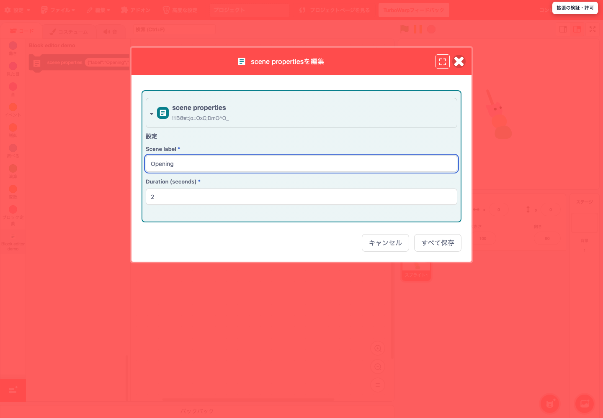

# TurboWarp-Plus-Editor

[English](README.md) | 日本語

[](https://kubohiroya.github.io/turbowarp-plus-editor/)

**[TurboWarp-Plus-Editorを開く](https://kubohiroya.github.io/turbowarp-plus-editor/)**

TurboWarp Plusの作品をつくるための、そして手元にあるScratch・TurboWarpの作品を編集するためのエディターです。パネルを好きな位置に並べ、分割し、ステージ・スプライト一覧・パレット・コードを別のウィンドウに出して、次に開いたときにその配置を復元します。作品全体を検索し、選択箇所を置換します。作品をひとつのSB3ではなく、Gitで追えるフォルダとして持てます。拡張の取得元と実行条件を確認してから動かします。できた作品は、Plus拡張を同梱したひとつのHTMLとして書き出せます。

kubohiroyaがフォークした[scratch-gui](https://github.com/kubohiroya/scratch-gui)・[scratch-vm](https://github.com/kubohiroya/scratch-vm)の固定リビジョンと、独立に版を持つ約20の `@kubohiroya/turbowarp-*` パッケージからビルドし、日本語と英語でGitHub Pagesから配信します。

- サイト: <https://kubohiroya.github.io/turbowarp-plus-editor/>
- エディター: <https://kubohiroya.github.io/turbowarp-plus-editor/editor.html?lang=ja>
- npm: `@kubohiroya/turbowarp-plus-editor`
- ファミリーの一覧とダッシュボード: <https://kubohiroya.github.io/turbowarp-plus-packages/>

## このエディターが引き受けること

**手元にある作品が、そのまま開く。** Scratch 3や標準のTurboWarpで保存したSB3はそのまま開き、ここで作ったものはそれらのエディターが読めるSB3として保存されます。作り直しも移植もいらないので、ここは乗り換えを決めてから入る別世界ではありません。同じ作品のまま、できることが増えた場所です。どちらの向きに何が保たれるかは[互換性の一覧](docs/features/sb3-compatibility.md)に記録しています。

**どこに何があるかを、学べる。** スプライト一覧からブロックパレット、ステージを動かすところまでの動線を整理しました。スプライト一覧は起動時から編集領域の横に固定表示され、名前で探せて、横幅を広げると列が増えます。パレットは画面上部の横長の帯です。カテゴリを選び、その中を検索し、下からブロックをドラッグできます。カテゴリのアイコンを長押しすれば、自分の使う順に並べ替えられます。ステージには表示専用のメニューがあり、全画面・表示・非表示を切り替えても、非表示の間も作品は動き続けます。変数・リスト・メッセージも見えないままにはなりません。作品全体の検索が名前で見つけ、それぞれがどこで使われているかを、ブロック名・引数の値・機能拡張名・コメント文・素材名と並べて一覧にします。

**長い作品を、先へ進められる。** 作業領域はDockviewを全面採用しています。パネルを左右・上下に分割し、区切り線をドラッグし、編集パネルとブロックパレットを別画面で開き、次に開いたときに同じ配置が戻ります。長いコードはミニマップとズームで移動します。編集メニューには取り消し・やり直し・切り取り・コピー・貼り付け・削除が、ショートカットとアイコンとともに並びます。ブロック定義のダイアログは独自のもので、真偽値の引数、ラベル、画面を再描画せずに実行する指定を扱います。スクリプトとステージの転送は、`.blocks3` / `.stage3` のファイルやウィンドウ間のコピー・貼り付けで、作ったものを別の作品へ移します。

**作品を、Gitのフォルダとして持つ。** `sb3-toolchain` はSB3を作品データ・素材・個別の拡張に展開し、そこから配布用のSB3を組み立て直します。そのあいだ、作品はGitが差分を取り、ブランチを切り、レビューし、マージできるテキストとファイルです。Editorはその作品フォルダを直接開き、**「ファイル」→「ローカル Git…」**で差分・ブランチ・直近50件のコミット・プルリクエストを表示します。これはリミックスの意味を変えます。他人の作品を分解して自分のものにしていくのはScratch文化そのものですが、これまでそれはバイナリをダウンロードして、元へ戻る糸を切ることでした。Gitのフォルダなら、リミックスは読める履歴であり、レビューできる差分であり、元へ送り返せる変更になります。

**AIと組んで、Scratchの作品をつくる。** **「ファイル」→「プロジェクトフォルダを開く…」**で作品フォルダを読み、**「保存」**でその中の `project.source.json` を、ローカルの画像・音声・拡張コードの隣に書き戻します。保存前には、フォルダが外部で変更されていないかを確かめます。つまり作品の全体が、テキストと普通のファイルです。エージェントは手持ちのファイル操作でそれを読んで書けます。バイナリのSB3を先に解く必要も、画面を操作する必要もありません。交代で進められます。エージェントがフォルダを書き、こちらは作品を再読込して見る。そのうえで、コードをレビューするようにレビューします。ローカルGitが差分を見せ、プルリクエストの表示は `project.source.json` の変更を対象とスクリプトごとに展開するので、読むのはJSONではなく変わったブロックです。登録していない拡張のブロックも、名前と接続が分かる代替ブロックとして描かれるので、拡張がなくても変更は読めます。組み込みのYAML文書はスキーマ付きの原文のままで、ローカル補助プロセス経由でVS Codeから編集できます。Scratchのバイブコーディングのために特別な仕掛けは要りません。作品がファイルであることから出てきます。

**拡張を使う側から、書く側へ進む。** 拡張はTurboWarp Plusの一覧から追加し、動かす前に取得元・内容・実行条件を確認します。そのうえで、作品と一緒にコードをどう保存するかを `remote-non-cacheable`・`remote-cacheable`・`embedded-file`・`embedded-data` から、一括または個別に選びます。その先では、自分で書いた拡張をファイルとしてSB3に埋め込み、作品と一緒に持ち運べます。拡張は `Scratch.gui.blockEditors.register` で自分のブロックにフォームを、`registerPreview` でプレビューを、ブロックの中に自分で描く入力欄を、そして独自の検証とスキーマを持つ文書を与えられます。あとは `sb3-toolchain` が引き受けます。コードヘッダーから名前・説明・サンドボックスの要件を読み、GitHubのコミットやnpmのバージョンを固定し、埋め込むコードのSHA-256を検証し、更新時にAPIマニフェストで互換性を比較し、複数の拡張を元のコードを残したまま1つの複合拡張にまとめます。他人の拡張を追加するところから自分の拡張を公開するところまでが、Editorの中で一段ずつ見える道筋になっています。

**TypeScriptで書く。そしてnpmのエコシステムにつながる。** 機能拡張はTypeScriptで書くことをすすめています。このプロジェクト自身がそう作られています。ここにあるソースはすべてTypeScript（`.ts`、CommonJSは `.cts`）で、開発中はNode.jsの型除去がそのまま実行し、ブラウザー向けはesbuildがJavaScriptとして出力し、npm向けはtscが型定義とともにコンパイルします。ファミリーの各パッケージはサブパスexportsの裏に自分の `.d.ts` を公開しているので、拡張はホストの挙動を推測するのではなく、型の付いたAPIに対して書けます。間違いは、誰かのステージの実行中ではなく、エディターの中で分かります。そして拡張は普通のNodeのツールでビルドするnpmパッケージなので、Scratch拡張の中からnpmのエコシステムに手が届きます。パーサー、幾何計算のライブラリ、モデルの実行環境をnpmから取ってきてバンドルし、`sb3-toolchain` がそのバージョンを固定して、配るコードのSHA-256を検証します。Scratchからnode.jsの世界への出口と、そこからの戻り道が、ここにあります。

**YAML文書とJSON Schemaを、作品の一部として扱う。** 作品はスクリプトだけでなく、文書を持ちます。文書はYAMLまたはJSONの原文で、それを所有する提供元がJSON Schemaを付けます。Editorは3つを同じ文書として扱います。原文のテキスト、キー・配列・値・コメントを1つずつ表す共通YAMLブロック、そして所有するAppが提供するスキーマ専用ブロックです。表現を切り替えると、現在の編集を原文へ適用してから変換し、その全体が1回の保存になります。未適用のブロック編集を上書きする再生成は拒否します。スキーマだけあれば、標準のエディターがreact-jsonschema-formでフォームを生成してスキーマに対して検証するので、誤りは実行時ではなく入力したその場に出ます。VS Codeでは、ローカル補助プロセスが所有者のスキーマと関連付けを専用の作業領域へ書き出すため、補完と診断は専門家が宣言したスキーマから出てきます。公式のRed Hat YAML拡張を使い、既存の設定には触れません。解析・参照・決定的なパス操作・永続化・提供元契約は `yaml-json`・`named-data`・`structured-data`・`document-data`・`document-source` が担います。

文書が何のためにあるかというと、ドメインの専門家が——コードではなく対象を知っている人が——スキーマを宣言して文書を書き、作品がそれを運用するためです。ブロックは、プログラムの全体を打ち込む場所ではなく、ドメインモデルを動かす場所になります。これは「ブロックでプログラミングを学ぶ」とは別の話です。[`turbowarp-kamishibai-app`](https://www.npmjs.com/package/@kubohiroya/turbowarp-kamishibai-app) はこれを製品まで持っていった例で、物語がスクリプトではなく文書であるAI活用のインタラクティブな物語システムです。

**インタラクティブ作品とデバイスアプリの土台になる。** Editorはメニューバーに操作欄を用意し、capability拡張がそこへ自分の操作を登録します。`@kubohiroya/turbowarp-app-shell` を通して同じ置き場所を共有するので、独立にバンドルされた拡張からも届きます。ツールバーのない単一HTMLのプレイヤーでも同じです。ファミリーはすでにこれを使っています。[`camera-source`](https://www.npmjs.com/package/@kubohiroya/turbowarp-camera-source) は1つの `MediaDevices` カメラ映像を複数の拡張で共有し、`camera-calibration` がその内部パラメーターを公開し、`ar` がカメラ基準の対象状態を持ち、`jsqr` がStructured Appendを含むQRコードを読み、`teachable-machine` が姿勢・画像・音声のモデルで認識します。`async-input` は対象ごとの非同期なキーボード・ポインター・累積姿勢入力を扱い、`bubble`・`svg-text`・`diagnostic-overlay`・`runtime-expression`・`kvs`・`asset-cache` が立ち絵つきの吹き出し、ルビ付きテキスト、ステージ上のSVG診断、安全な条件評価、キーバリュー保存、ブラウザーローカルの素材キャッシュを受け持ちます。Editor自身は個々の拡張を一切知りません。カメラやセンサーのホストアプリは、Editorのフォークではなく、拡張と作品の組み合わせとして作れます。

**入口は、TurboWarp紙芝居。** ここまでのことは、10歳の子にとっては、画面の上に作りたいものが現れるまで何の意味もありません。[`turbowarp-kamishibai-app`](https://www.npmjs.com/package/@kubohiroya/turbowarp-kamishibai-app) がその入口です。物語は文書で、絵と声は作品の中の素材で、次の場面を分岐させたいと思った子どもには、ブロックを開く理由があります。その先は、同じ作品にスキーマがあり、Gitの履歴があり、型の付いた拡張があり、カメラが付きます。そして子どもは、すでに開いている同じエディターの中にいます。目指しているところははっきりしています。チュートリアルからではなく物語から入る、STEAM教育の標準的な道具です。

## 標準TurboWarpから増える機能

| 作業 | 標準のTurboWarp | Plusで加わる操作 |
| --- | --- | --- |
| 作品を開く | SB3の読み込みと拡張の実行確認 | 読み込みの経過表示、Plusカタログ、読み込みの診断 |
| 作品を管理する | SB3ファイル単位の保存 | 作品フォルダの読み書き、ローカルGitの差分と履歴 |
| 作業画面を整える | コード・ステージ・スプライトの基本配置 | パネルの分割、パネルとパレットの別画面、ステージの別表示、配置復元 |
| 編集する | ブロックの入力欄やメニュー | 作品全体の検索と置換、編集メニュー、検索付きの横型パレット、ミニマップ、対応する拡張が提供するフォームとYAMLタブ |
| 再利用する | バックパックなどで再利用 | スクリプトやステージのファイル転送、バンドル素材の追加 |
| 保存して渡す | SB3の保存と標準Packager | 上書き保存と名前を変えて保存、組み込みデータの格納方式、拡張コードの保存方式、Plus拡張を同梱したHTML |

Plus固有の機能には、対応する拡張や専用データが必要なものがあります。どれが必要かは[機能ガイド](https://kubohiroya.github.io/turbowarp-plus-editor/features/)に記録しています。

作品全体の検索は、すべてのスプライトとステージを横断し、結果を種類ごとにまとめます。対象はブロック名、変数・リスト名、メッセージ名、引数の値、機能拡張名、コメント文、YAML本文、素材名です。[Project Properties（作品のプロパティ）](https://kubohiroya.github.io/turbowarp-plus-editor/features/#project-properties)はタイトル・概要・作者・連絡先を日時とともにSB3へ保存し、作者名と連絡先の履歴を各5件保持して、メールやHTTPSのリンクを開きます。[Project Diagnostics（作品の診断）](https://kubohiroya.github.io/turbowarp-plus-editor/features/#project-diagnostics)は、作品が開けないときのために検証・実行許可・読み込み・再試行・失敗の記録を集めます。診断記録はEditorを開いている間だけ保持します。どちらも通常URLから利用でき、追加拡張や有効化の設定は不要です。

**書き出し**は作品を配布用にまとめます。通常のScratch 3やTurboWarpのSB3なら標準のTurboWarp Packagerが開き、Plus形式の拡張を記録した作品では同じ操作でPlus専用の出力画面が開きます。HTTPSで配信される拡張コードも、記録したハッシュと照合したうえでHTMLに入り、サンドボックスの指定は保持されます。カタログの信頼条件を満たす拡張は、同梱されたハッシュと照合して実行します。外部依存のない作品は、そのHTMLだけでオフラインで動きます。

[実画面と操作図で読む追加機能ガイド](https://kubohiroya.github.io/turbowarp-plus-editor/features/)は、ここまでの内容を分野別の11ページで、実際の画面・操作図・比較表・利用条件・保存と互換性とともに説明しています。

[](https://kubohiroya.github.io/turbowarp-plus-editor/features/documents/#forms)

## エディターの配置

TurboWarp Plus 標準配置では、起動時にスプライト一覧が編集領域の左側に固定表示されます。ピンを外すと、左端にポインターを置いて一覧を開けます。検索アイコンから名前で探せます。固定表示中に区切り線をドラッグすると、横幅に応じて列数が増えます。操作列のアンドックボタンで、一覧と背景タイルを別のウィンドウに移せます。中央上部の横長パレットでカテゴリを選ぶと、その下からブロックをドラッグできます。

ステージ右上の「ステージの表示」メニューで、全画面・表示と非表示を切り替えられます。非表示の間も作品は実行されます。自由配置を有効にしている場合は、配置メニューからアンドックボタンを表示できます。

従来の配置で起動するには、エディター URL に `twPlusStandardLayout=0` を指定して再読み込みします。

標準配置のコード編集領域では、右下の縮小・拡大・リセットボタンの上にミニマップが表示されます。クリックや表示範囲の枠のドラッグで移動できます。非表示にするには、エディター URL に `twPlusWorkspaceMinimap=0` を指定して再読み込みします。

カテゴリのアイコンを長押しすると、縦・横どちらのパレットでも順番を変更できます。別の位置で離すと確定し、パレットの外で離すと取り消します。並べ替えを無効にするには `twPlusPaletteCategoryReorder=0` を指定して再読み込みします。

スプライトや素材の一覧、ブロックやコード領域の右クリックメニューでは、操作名の横にアイコンが表示されます。アイコン表示を無効にするには、エディター URL に `twPlusContextMenuIcons=0` を指定して再読み込みします。

コード領域のブロックを削除できる位置までパレットにドラッグすると、パレットがぼけて中央にゴミ箱が表示されます。横並びパレットでは、ブロック一覧を閉じた状態でもカテゴリの帯に表示されます。表示を無効にするには `twPlusPaletteDeletePreview=0` を指定して再読み込みします。切り戻しを確認するには、パレットへのドロップでブロックを削除し、Undo で戻せることを確かめます。

**パネルとウィンドウ。** 作業領域はDockviewの配置です。区切り線のドラッグで大きさを変え、パネルを左右・上下に分割でき、次にEditorを開いたときに同じ配置が戻ります。公開版では編集パネルとブロックパレットを別画面で開けます。開発版ではさらに、複数のコード画面、ステージ、スプライト一覧、スプライト設定のフォームをそれぞれ別のウィンドウに置き、コスチューム・音・変数の表示を編集中の選択を保ったまま扱う経路を検証しています。子ウィンドウはその document で独自の ScratchBlocks を起動し、`MessagePort` で親の単一VMに接続します。子はVM・Node・preload・openerを持ちません。編集権は一度に1つの対象だけが持ち、Undo／Redoの履歴は対象ごとに保持するため、確定したコードはVMが通常どおりSB3へ保存します。同じパネルの接続はDesktopアプリの中でも動きます。

**編集。** ブロック定義のダイアログは本プロジェクト独自のものです。数値または文字列の引数、真偽値の引数、ラベルを追加し、「画面を再描画せずに実行する」を指定できます。日本語と英語に対応します。編集メニューには取り消し・やり直し・切り取り・コピー・貼り付け・削除を、ショートカットとアイコンとともに並べます。拡張が提供する場合は、ブロックの中に拡張自身が描く入力欄を置くことも、対応ブロックの入れ子をその場で編集することもできます。

## 作品フォルダ・Git・sb3-toolchain

作品はひとつのSB3ファイルである必要はありません。`sb3-toolchain` は手元で使うNode.jsのツールです。`import` がSB3を作品データ・素材・個別の埋め込み拡張に展開してGitから変更が見えるようにし、`check` が展開したデータを検証し、`build` が配布用のSB3を生成します。展開した作品フォルダは、Editorで直接開いて編集することもできます（現時点では試作）。バンドルは各拡張のコードヘッダーから名前・説明・サンドボックスの要件を読み取り、GitHubのコミットやnpmのバージョンを固定し、埋め込むコードのSHA-256を検証し、更新時にはAPIマニフェストで互換性を比較できます。複数の拡張は元のコードを残したまま1つの複合拡張として埋め込めて、実行許可は複合拡張全体に対して判断します。公開版のEditorでは、`turbowarp-plus-packages` が公開する[TurboWarp Plusファミリー公式カタログ](https://kubohiroya.github.io/turbowarp-plus-packages/extensions-v1.json)の条件を満たす拡張を信頼済みとして扱い、記録された取得元とコードのSHA-256を照合してから個別の承認画面を省略します。

**「ファイル」→「ローカル Git…」**でリポジトリのルートを開くと、ステージ済み・未ステージ・未追跡の変更を分けて表示し、ファイルのテキスト差分とバイナリ素材のサイズ、現在のブランチ、HEAD、ローカルブランチ、直近50件のコミットと、選んだコミットの第一親との差分を確認できます。ルート配下の `sb3-toolchain` v1 の作品フォルダを選ぶと一覧がそのフォルダに絞られ、「この作品を開く」でEditorに読み込めます。パネルはGitの状態を書き換えません。コマンドラインで操作したあとは「再取得」を、同じ作品を開き直すときは「作品を再読込」を使います（未保存の編集を先に確認します）。接続先が設定された環境では「GitHub 接続」の欄が、HTTPSリモート `origin` に対するfetch、fast-forwardのみのpull、明示的に許可したpushを行います。File System Accessに対応したChromium系ブラウザーが必要です。linked worktree、サブモジュール、シンボリックリンクは対象外で、作業ツリーの実行権限の変更はブラウザーから確認できません。起動URLに `twPlusLocalGit=0` を指定するとパネルを外せます。

**公開PRの変更レビュー**は、同じパネル上部の**「プルリクエスト」**から開きます。GitHubを `origin` に設定した作業フォルダで、一覧またはPR番号から選べます。PR本文と変更ファイルが表示され、`project.source.json` の変更は対象とスクリプトごとに展開できます。比較にはPRのマージベースとheadを使います。GitHubへの通信は公開APIの読み取りのみで、確認済みの印は表示中だけ保持し、公開APIの利用上限が適用されます。未登録の拡張ブロックは名前と接続が分かる代替ブロックで示し、拡張コードの取得・実行は行いません。

## パッケージ・差し込み口・ビルド

Editorは、フォークが抱えるパッチではなく、独立に版を持つパッケージから組み立てます。実装は約20の `@kubohiroya/turbowarp-*` パッケージが持ち、それぞれが自分の版・テスト・リリースを持ちます。

```text
yaml-json · named-data · structured-data · document-data · document-source · document-editor ┐
extension-data-editor · extension-loader · extension-security-dialog · sb3-save-format       ├→ turbowarp-plus-editor → GitHub Pages
editor-layout · editor-ui · editor-views · editor-surfaces · editor-transfer · editor-backpack│
plus-editor-git · plus-editor-auth · plus-editor-project-folder · script-transfer             ┘
   scratch-gui フォーク · scratch-vm フォーク · @turbowarp/packager（いずれもリビジョン固定）───┘
```

上流のパッケージが下流のものを取得・ビルド・配信することはありません。`scratch-gui` フォークは、**本家TurboWarpに存在しないファイルを1つも持ちません**。追加していた32のモジュール・ツール・文書・テストは本リポジトリへ移設し、残る接続は任意の1オブジェクト `plusIntegration()` を通ります。その名前付きの口が、拡張ホスト、モーダル、テーマトークン、翻訳、ブロック形状、workspaceへの接続、キー処理、project-stateの還元、ステージとカメラの操作、拡張ライブラリ、GUIの拡張API、アドオンを運びます。素のGUIビルドではこのgetterが `null` を返し、本家とまったく同じに動きます。測った差分・残る改変・それぞれの行き先は[差し込み口の設計](docs/plus-integration-sockets.md)に、移設とビルド契約は[移設一覧](docs/gui-integration/README.md)に記録しています。

[`site/source.json`](site/source.json) はGUI・VM・data-editorのcore・拡張Loader・Packager・document-editorを40桁のリビジョンで、security-dialogとcoreをnpmの完全版で固定します。checkout・導入済みパッケージ・固定値が一致しなければビルドは進みません。公開成果物の `build-info.json` は実際に組み合わせたGUI・VM・ライブラリ・サイトの版を記録し、`notices/family.json` は同梱した全ファミリーパッケージのライセンス文とソースの入手先を一覧にします。旧data-editorのPagesは廃止対象であり、移行先には本サイトを使用してください。

検証は配信のあとの工程ではなく、配信の一部です。通常CIが単体テスト、統合基盤、固定GUIの接続テスト、ビルド、移設したGUI E2Eを実行します。ブラウザーE2Eは19件、固定入力profileを含めてCIでは24件です。Pagesは、同じSHAの通常CIが全件成功した `main` の成果物だけを配信し、再ビルドせず固定した識別子を照合し、公開後に7件を実行します。npmはTrusted PublisherとOIDCで公開し、workflowはtokenを持たず、既存版とバイト列が異なれば停止します。

本リポジトリがファミリーのどこに位置するかは、上下関係ではなく持ち物の分担です。[`turbowarp-plus-packages`](https://github.com/kubohiroya/turbowarp-plus-packages) はファミリー全体の一覧とダッシュボードで、13カテゴリ・70余のリポジトリを、依存の相関図・デモ・未クローズのissue・リリースの鮮度とともに[1枚のページ](https://kubohiroya.github.io/turbowarp-plus-packages/)に出します。そして、本リポジトリが意図的に持たない3つを持ちます。公式の機能拡張カタログ [`extensions-v1.json`](https://kubohiroya.github.io/turbowarp-plus-packages/extensions-v1.json)（各項目がnpmパッケージ名・バージョン・jsDelivrのURL・SHA-256・カテゴリ・unsandboxedの要否を持ちます）、`assets/extension-icons/` に置く拡張の表示名とアイコン、そして設計の正本である `docs/editor-architecture.ja.md` です。本リポジトリの文書は、この正本を書き写さず参照します。

本リポジトリはEditorであり、その3つを使う側です。[`site/plus-catalog.ts`](site/plus-catalog.ts) が固定したURLからカタログを取得し、Editorは拡張の取得元とコードのSHA-256を照合してから個別の承認画面を省きます。GUIに名称変換のロジックは持たせません。導線は逆向きにも通っています。ファミリーのページのデモは、下に書いた編集ボタンでこのEditorを開くので、向こうに載っているパッケージはここで編集するまで1クリックです。

案内画面には `turbowarp-plus-site-header` の共通ヘッダーを読み込みます。エディター本体は全画面GUIとして表示します。

## 作品を開く

ランディング画面の **TurboWarp-Plus-Editorで編集** ボタンを押すとエディターが開きます。手元のSB3ファイルはエディターの「ファイル」から開けます。URLから開く場合は、ブラウザーによる取得を許可したHTTPSのSB3を指定します。

```text
https://kubohiroya.github.io/turbowarp-plus-editor/editor.html?lang=ja&project_url=https%3A%2F%2Fexample.com%2Fstory.sb3
```

`project_url` はURLエンコードしてください。`lang=ja` と `lang=en` を指定できます。ランディング画面へ指定した作品URLや他のEditorパラメーターも、編集ボタンでエディターに引き継ぎます。

<a id="edit-button"></a>
## 「TurboWarp-Plus-Editorで編集」ボタン

既存のTurboWarp Plusブランドの青いベースを青色鉛筆で塗るSVGを、編集操作用のブランドバリエーションとして提供します。画像だけでなく操作名も表示し、キーボードでフォーカスできるリンクを使います。共通CSSは高さ56px以上、画像36px、明確なフォーカス表示を設定します。

HTMLページの `<head>` にスタイルシートを1回読み込み、ボタンを置きたい場所へ次を貼り付けます。

```html
<link rel="stylesheet"
      href="https://kubohiroya.github.io/turbowarp-plus-editor/assets/edit-button.css">

<a class="twpe-edit-button"
   href="https://kubohiroya.github.io/turbowarp-plus-editor/editor.html?lang=ja&amp;project_url=https%3A%2F%2Fexample.com%2Fstory.sb3">
  
  <span>TurboWarp-Plus-Editorで編集</span>
</a>
```

新しい作品用のボタンは `project_url` を省略します。英語では `lang=en` と `Edit in TurboWarp-Plus-Editor` を使います。

通常版はアイコンと操作名を表示します。小サイズ版は `twpe-edit-button--small` を追加し、表示文言を「編集」、`title` と `aria-label` を「TurboWarp-Plus-Editorで編集」にします（英語は `Edit` / `Edit in TurboWarp-Plus-Editor`）。`title` がホバー時のツールチップです。

```html
<a class="twpe-edit-button twpe-edit-button--small"
   href="https://kubohiroya.github.io/turbowarp-plus-editor/editor.html?lang=ja"
   title="TurboWarp-Plus-Editorで編集" aria-label="TurboWarp-Plus-Editorで編集">
  
  <span>編集</span>
</a>
```

両サイズとも既定はOSの配色に追従（auto）します。`<html data-theme="light">` / `dark` で固定し、`auto` または属性の削除で自動へ戻せます。JavaScriptで生成する場合は `renderEditButton({size: 'small', language: 'ja', projectURL: 'https://example.com/story.sb3'})` を使います。省略時は通常版です。

GitHub READMEは外部CSSを適用できないため、次の画像付きリンクを使用できます。

```html
<a href="https://kubohiroya.github.io/turbowarp-plus-editor/editor.html?lang=ja">
   TurboWarp-Plus-Editorで編集
</a>
```

TurboWarp Plusの機能拡張一覧は通常のEditor URLから利用できます。従来のカタログ経路を使う場合は `twPlusExtensionLoader=0&twPlusExtensions=1` を指定して再起動します。その他のGUI機能フラグは変更せず、ボタンに渡したパラメーターも保持します。

Issue #4 の拡張Loaderは、独立したLoaderコアと薄いGUI/VMアダプターで実装します。通常配信では、URLフラグなしでEmbedded/Remoteの検証・許可UIを利用できます（起動時固定・既定ON）。Plus作品のPackager操作はローカル出力画面へ進みます。カタログに載っている拡張はEditorと同じく確認なしで動き、カタログにない拡張だけ、HTMLを生成するときと、生成したHTMLを開くたびに承認を確認します。`twPlusExtensionLoader=0` を指定して再起動するとLoaderを無効にできます。従来の `=1` も利用でき、不正値はOFFです。構成、検証、Desktopの制約、切戻しは [接続仕様](docs/extension-loader-integration.md) を参照してください。

機能拡張一覧でEmbedded／Remoteを一括・個別設定するUIは [Issue #11の操作・開発ガイド](docs/extension-authoring-ui.md) を参照してください。このUIは通常起動から利用できます（既定ON）。`twPlusExtensionLoader=0` で無効にできます。「カスタム拡張機能」は本家TurboWarpと同じ画面で、ローダーを通しません。

## npmで利用する

```sh
npm install @kubohiroya/turbowarp-plus-editor
```

```js
import {createEditorURL, renderEditButton} from '@kubohiroya/turbowarp-plus-editor';

const url = createEditorURL({
    language: 'ja',
    projectURL: 'https://example.com/story.sb3',
    parameters: {fps: 60}
});
const html = renderEditButton({language: 'ja', projectURL: 'https://example.com/story.sb3'});
```

ブランドSVG、ボタンCSS、URL/HTML生成関数、配信元の固定情報をnpmに含めます。巨大なGUI生成物はnpmへ同梱せず、固定情報を使ってPages用にビルドします。HTTP(S)以外の作品URLと未対応言語はURL生成関数が拒否します。

## 開発と配信

scratch-guiの本家に存在しなかった実装・ツール・文書・テストは、本リポジトリに集約します。[移設一覧とビルド契約](docs/gui-integration/README.md)を参照してください。

Node.js 26を使用します。自作コード・スクリプト・設定・テストはTypeScript（`.ts` / CommonJSの`.cts`）で管理します。開発用スクリプトはNode.jsの型除去で実行します。`npm run build` は公開用JavaScriptと型定義を `dist/` へ生成し、`npm pack` でも自動実行されます。実VSCode検証の前に `npm run build:test-driver` を実行します。

```sh
TWEXTSEC_SOURCE_REVISION=$(node -p "require('./site/source.json').securityRevision || ''") npm ci
npm run typecheck
npm run build
npm test
npm run test:package
E2E_GUI_ROOT=/absolute/path/to/pinned/scratch-gui \
TW_PLUS_PACKAGER_ROOT=/absolute/path/to/pinned/packager npm run build:pages
E2E_GUI_ROOT=/absolute/path/to/pinned/scratch-gui npm run test:e2e
```

レビューダイアログはGitの依存で、ビルドが自身のリビジョンを読みます。npmは履歴のないアーカイブから取得するため、素の `npm ci` はここで止まります。固定値がそのリビジョンなので、インストール時に渡します。ワークフローも同じ形で実行します。

ミニマップだけを検証するには、ビルド後に `E2E_GUI_ROOT` を指定して `npm run test:e2e -- workspace-minimap.spec.cts` を実行します。既定表示、URL での非表示、クリックとドラッグでの移動を確認します。

GUIとPackagerは `site/source.json` に記録したSHAをチェックアウトします。GUIの依存をインストールし、`node scripts/prepublish.mjs` で準備します。ビルドはGUIのSHA、実際にインストールされたdata-editorのSHA、security-dialogのバージョンが固定値と一致することを確認します。Pagesは統合検証に成功したmainから配信します。リリースのタグはnpmのバージョンと一致させます。

ローカル Git パネルの Cloudflare 方式を有効にするには、ビルド時に `TW_PLUS_GIT_BFF_ORIGIN` と `TW_PLUS_GIT_PROXY_ORIGIN` の両方に正確な HTTPS オリジンを指定します。Desktop ローカル方式は、ホストが `EditorPreload.localGit` を公開すると選べます。起動 URL の `twPlusLocalGit=0` で Git パネルを非表示にできます。

統合Editorの動作確認はこのリポジトリが担当します。既存の上流ライブラリの単体テストとGUIの機能フラグは維持します。新配信先の確認後、各参照先を移行し、旧data-editorのPagesを停止します。旧サイトへのリダイレクト配信は残しません。切戻しは直前のGUI固定SHA・サイト差分へのrevertと直前成果物の再配信で行います。

### CI の検証範囲

リポジトリ変数 `TW_PLUS_CI_SCOPED` が未設定のときは従来の検証を実行します。`1` にすると、通常 PR は変更差分に対応する項目を実行し、`main` は同じ Git ツリー・検証契約の PR CI で成功した項目を再利用します。差分や証跡を確認できないときは全体検証に切り替えます。Pages 用の成果物は毎回 `main` のリビジョンでビルドします。

従来の検証に戻すには変数を未設定に戻すか `0` にします。安定版の公開前には、タグが指すコミットに対して全体検証を行います。

## 組み込み文書を編集する（0.2.0-rc.1）

[Issue #3](https://github.com/kubohiroya/turbowarp-plus-editor/issues/3)と[共通化Issue #6](https://github.com/kubohiroya/turbowarp-plus-editor/issues/6)に対応する機能です。起動設定はありません。登録された提供元が文書を所有するハットにだけファイルアイコンが付くため、そうした提供元のない作品は上流のTurboWarpと同じ見た目です。VSCodeで編集するには、Visual Studio CodeとNode.jsをインストールした環境で、ローカル補助プロセスからEditorを開きます。編集UIと外部エディタ連携は `@kubohiroya/turbowarp-document-editor` に分離し、scratch-guiフォークが直接組み込みます。TurboWarp-Plus-EditorはGUIの固定・ビルド・配信を担当します。原文文書の保存・文書参照・提供元登録は `@kubohiroya/turbowarp-document-data`、ハット・YAMLアイコン・共通YAMLブロックは独立した `@kubohiroya/turbowarp-document-source` に置きます。各拡張が文書を登録し、共通編集UIは所有者の検証と差分適用を呼び出します。標準のSB3ファイル保存はGUIが担当します。

提供元は文書を所有する各拡張に置き、その拡張の検証APIとSchemaを使用します。Editorのブラウザ用コードにはAppやそのparserを組み込まず、依存パッケージにもAppを含めません。対象となる作品と旧作品の移行手順は、各Appの文書を参照してください。

準備済みのEditorビルドに機能を加え、ローカルで起動します。`build:pages`で新たにビルドした場合は、同じ追加処理を自動で実行します。

```sh
npm ci --ignore-scripts
npm run build:yaml-tools -- /absolute/path/to/editor/build
npm run editor:yaml -- --site-dir /absolute/path/to/editor/build --data-dir /absolute/path/to/work-files
```

共有パッケージは公開rcへ固定しています。VSCodeとの連携には、ビルド済みEditorを配信するローカル補助プロセスが必要です。npmパッケージからも次のように起動できます。

```sh
npx --package=@kubohiroya/turbowarp-plus-editor@0.2.0-rc.1 turbowarp-plus-editor-yaml --site-dir /absolute/path/to/editor/build --data-dir /absolute/path/to/work-files
```

GitHub Pages上では文書の表示・変換・検証を利用できます。VSCodeを起動する操作は、上記のローカルURLで開いた場合に利用できます。

Web 版では、作品内 YAML は既定でコード・ステージと同じ Dockview に開きます。タブを移動・分割しても草稿を保持し、未保存の変更があるタブを閉じると保存・破棄・キャンセルを選べます。従来の文書モーダルへ切り戻すには、作業中の文書と SB3 を保存してから、Editor の URL に `twPlusDockview=0` を加えて開き直します。この設定は Web の分割ワークスペースも無効にします。

1. 組み込み文書のSB3をEditorで開き、「データソース」ハットブロックのファイルアイコンを押します。文書ダイアログのYAMLテキストタブで「外部エディタで編集」を選びます。
2. 開いたYAMLを編集してVSCodeで保存します。
3. Editorへ戻って、ダイアログ右下の「表示されている形式に変換して検証・保存」を押します。VSCodeで保存済みの作業コピーを読み、書式・アセット参照・プロジェクトの同一性を検証して、Editor内の文書と整合性情報へ反映します。
4. 作品ファイルを残すには、Editor標準の「ファイル」メニューまたは「コンピューターに保存する」でSB3を保存します。ダイアログの「保存」ではファイルをダウンロードしません。画像・音声の格納方式は変わりません。

ハットブロックは組み込みYAMLへの入口です。ドロップダウンにファイル名を表示し、SB3には提供元IDと文書IDの参照を持ちます。文書の文字列をブロックの引数に複製しません。複数文書は同じファイル名でもIDで区別します。文書モーダルでは、別の文書へ移る前に現在の編集を保存またはキャンセルします。実際の文書取得・検証・更新は、その文書を所有する提供元に委ねます。この仕組みは特定のAppに依存しません。文書を所有する拡張がハットブロックを付けたSB3が対象です。ハットのない旧SB3へ、Editorから未知のブロックや拡張コードを自動挿入することはありません。文書の提供元が変換能力を登録すると、同じエディターから原文ファイル・共通YAMLブロック・スキーマ専用ブロックを変換できます。

提供元は任意の `schema: {id, schema}` を文書ごとに指定できます。ローカル連携は所有者のSchemaと関連付けを作業フォルダへ保存し、YAML本文には設定用のコメントを挿入しません。Schema付き文書を初めて開くと、専用拡張領域へ公式のRed Hat YAML拡張 `redhat.vscode-yaml@2.0.0` を取得します。既存VSCodeの設定・拡張一覧は変更しません。初回取得には通信が必要です。Schemaがない文書は従来どおり所有者の検証で取り込みます。

VSCode側の補完と診断には[Red Hat YAMLのSchema関連付け](https://github.com/redhat-developer/vscode-yaml#associating-schemas)を使用します。所有者は原文の編集用Schemaを供給でき、取り込み時には所有者自身の検証も実行します。

補助プロセスはこのローカルEditorからの認証付き操作だけを受け付けます。VSCodeには専用の作業ファイルと独立した設定領域を渡し、既存のウィンドウ・設定・拡張機能を変更しません。保存済みの作業ファイルは、接続終了やプロセス停止後も保持します。実行するコマンドや任意のローカルパスをWeb側から指定する機能はありません。

YAMLが不正な場合や別作品へ切り替えた場合は、古い内容を上書きしません。反映できなかった草稿はVSCodeの作業ファイルに保持します。右上のXと「キャンセル」は、ダイアログ内の候補を破棄してEditorを書き換えずに閉じます。作業ファイルは削除しません。文書に新しいアセット参照を追加する操作は、既存のアセット一式で検証できる範囲に限ります。

macOSの内部通信パス上限を超える保存先では、作業ファイルを移動せず、VSCode設定領域だけを短い専用ディレクトリへ自動分離します。実際の保存先は作業領域の `host.json` に記録します。

切戻しは統合のコミットをrevertして配信し直すか、直前の検証済み版へ戻します。補助プロセスを停止しても作業ファイルは保持します。

関連検証:

```sh
npm run test:yaml
# アセットを含む任意のSB3から、テスト専用fixtureを生成します
# （CIでは `node test/fixtures/yaml-editor/base-project.ts /absolute/path/to/base.sb3` で生成したものを使います）。
node scripts/yaml-editor/build-settings-fixture.ts /absolute/path/to/base.sb3 /absolute/path/to/settings.sb3
node scripts/yaml-editor/build-document-source-fixture.ts /absolute/path/to/base.sb3 /absolute/path/to/document-source.sb3
TWPE_YAML_SITE=/absolute/path/to/editor/build \
TWPE_YAML_FIXTURE=/absolute/path/to/settings.sb3 \
TWPE_YAML_EVIDENCE=/absolute/path/to/evidence \
TWPE_CHROME_EXECUTABLE='/Applications/Google Chrome.app/Contents/MacOS/Google Chrome' \
npm run test:yaml:roundtrip
# 同じ環境変数で、2文書のsettings fixtureも検証できます。
npm run test:yaml:multi-document
# 表現プレビューは同じ環境変数で、document-source fixtureを指定して検証します。
node --test test/representation-preview.browser.ts
```

参照元のプレビュー・取消・保存・再取得・埋め込みファイルへの変換は、`@kubohiroya/turbowarp-document-editor` が自身の試験用提供元で検証します。本リポジトリは、それがビルドしたEditorまで届くことを確かめます。`test/e2e/turbowarp/document-source.spec.cts` は `twpeyamlsettings` のfixtureをURLの切替なしで開き、参照元の切替が現れること、明示的にプレビューするまで何も取得しないこと、保存できることを見ます。廃止したURLの切替を `0` にしても何も変わらないことも確かめます。`document-refusal.spec.cts` は提供元が登録されていないハットと、所有者が開くのを拒む文書を開いて、「この文書は現在利用できません。」が出て作品が変わらないことを見ます。どちらも `npm run test:e2e` でビルドしたEditorに対して実行します。

SB3往復の自動ブラウザ回帰ではネイティブ起動だけを注入し、実GUI・実VM・実SB3で検証します。CIはビルドしたEditorで `test:yaml:roundtrip` と `test:yaml:multi-document` を実行し、画面と `result.json` を `integration-evidence-*` の `test-results/yaml-roundtrip/`・`test-results/yaml-multi-document/` に残します。実VSCode確認には `test/vscode-edit-driver/` のテスト専用Extension Development Hostを用い、VSCode自身の文書編集・保存APIで作業YAMLを保存します。このdriverを通常の補助プロセスへインストールする必要はありません。

### 原文・共通YAMLブロック・スキーマ専用ブロック

原文ファイル、キー・配列・値・コメントを表す共通YAMLブロック、所有するAppが供給するスキーマ専用ブロックを、同じ文書の3つの表現として扱います。原文を意味と変換の基準とし、ブロックを編集中はその内容もEditorの編集状態へ保持します。別のブロック表現へ移るときは、現在の編集を原文へ反映した上で変換する処理を、一つの保存操作の中で行います。変換先を選ぶだけでは作品を書き換えません。初期タブは現在の保存済み表現です。プレビューの上に「💽=保存済み形式」を表示します。別のタブで「保存」を押すと変換確認を表示し、OKで検証・変換してEditorへ反映します。Cancelは選択を保持してダイアログへ戻ります。Xと「キャンセル」は同じ取消操作です。未反映のブロックを原文から再生成して上書きする操作は拒否します。

各タブには、その形式のプレビューを表示します。原文タブはテキスト、ブロックのタブは読み取り専用のScratchBlocksを表示し、表示だけでは作品を書き換えません。ブロックは移動・編集できず、スクロールと拡大縮小で確認できます。💽はEditor内で現在保存されている形式を表し、SB3ファイルをダウンロードしたことを表すものではありません。

共通YAMLブロックはコメントを1行ずつ、複数行の文字列を行と改行種別のブロックで扱います。標準の文字入力欄で改行が失われるのを防ぎます。未編集の原文は改行・引用符・コメントをそのまま保持します。編集した部分の出力書式は所有者とYAMLライブラリが決定します。JSONではコメントを許可しません。

- `turbowarp-yaml-json`: YAML/JSONの解析・出力、原文構文、Schema検証。
- `turbowarp-document-data`: 原文・Schema・文書参照・提供元登録とSB3への永続化。
- `turbowarp-structured-data`: 原文から実行時の値を生成する一時的な投影。原文を書き換えません。
- `turbowarp-document-source`: 共通ハット・共通ブロック・変換候補と適用の契約。
- 各App: DSL専用の検証、スキーマ専用ブロックへの変換、実行データの再生成。
- turbowarp-document-editor: 操作ダイアログ、外部エディタ連携、プレビューと保存の操作。
- scratch-guiフォーク: 共通編集UIの組み込み、VM・Blockly接続、標準SB3ファイル保存。
- TurboWarp-Plus-Editor: GUIの固定・ビルド・配信。

`turbowarp-document-data` の原文文書はYAMLとJSONを利用でき、HTML/Markdownの既存APIは維持します。下位の文書形式判定を担当する `turbowarp-named-data` にもYAML/JSONを追加します。構造化データの既存の限定Schema解釈と、文書の完全なJSON Schema検証は別の契約として維持します。

文書保存・投影・表現変換に起動設定はなく、登録された提供元が所有する文書で利用できます。各文書の変換能力は所有者が提供し、未対応の拡張へ変換機能を追加することはありません。旧ブロック表現に元のモジュールYAMLが保存されていない場合、コメント等を含む元ファイルを復元したとは扱いません。

「ガイドを参照」は提供元のWebサイトを別タブで開きます。独立した検証ボタンは置かず、右下の「表示されている形式に変換して検証・保存」で表示中の形式を検証して反映します。ブロック表現を編集中のVSCode操作は、原文へ反映するまで無効になります。原文がJSONの場合、VSCode標準のJSON支援とSchema関連付けを使います。

## 拡張の保存形式を書き換える

保存済みSB3の拡張を、`remote-non-cacheable`・`remote-cacheable`・`embedded-file`・`embedded-data` のいずれかの形式で保存し直す補助CLIです。形式の語彙と書き込み処理は `@kubohiroya/turbowarp-sb3-save-format` の `./writer` を使い、ZIPの読み書きと既定値（確認なしでunsandboxedにする拡張はなし）はこのリポジトリが持ちます。`--extensions` には security-dialog の `ReviewDecision.loading` の値をそのまま渡せます。旧綴り（`embedded`・`remote`・`cached`）は受け付けません。

```bash
npx --package=@kubohiroya/turbowarp-plus-editor turbowarp-plus-editor-sb3-format --input in.sb3 --output out.sb3 --extensions embedded-file
```

`remote-cacheable` は「開く人のブラウザーが検証済みのキャッシュを保持してよい」と記録するだけです。CLIはそのキャッシュ（IndexedDB）を書くことも読むことも確かめることもできないため、オフラインで動く根拠にはなりません。オフラインで動かすには `embedded-file` か `embedded-data` を選びます。

## ライセンス・製作者

ライセンス: GPL-3.0-or-later。ただし、編集ボタンのスニペットだけはMPL-2.0です。統合GUIと同梱物については各ライセンス・NOTICEも参照してください。

- MPL-2.0の範囲は、EditorのURLと編集ボタンのHTMLを作る`src/index.ts`（`createEditorURL`・`renderEditButton`と定数。npmでは`dist/src/index.js`と`dist/src/index.d.ts`）と、編集ボタンのCSS（`assets/edit-button.css`）です。各ファイルに`SPDX-License-Identifier: MPL-2.0`を書いています。全文は[`LICENSE.MPL-2.0`](LICENSE.MPL-2.0)です。他のサイトのJavaScriptから読み込んでも、GPL-3.0の義務はかかりません。
- アイコン（`assets/icon.svg`）、拡張ローダーの起動API（`./extension-loader`）、YAML編集のコマンドなど、ほかの部分はGPL-3.0-or-laterです。全文は[`LICENSE`](LICENSE)です。
- Pagesで配信するEditorはGPL-3.0の作品です。同梱するturbowarp-plus familyのパッケージのライセンス文とソースの入手先（npmとGitHub）を、配信物の`notices/`に記録しています（一覧は`notices/family.json`）。

製作者: [Hiroya Kubo](https://github.com/kubohiroya)

## ブロックアイコンのプレビュー

統合したデータエディターは、任意API `Scratch.gui.blockEditors.registerPreview` を提供します。仕様は `@kubohiroya/turbowarp-extension-data-editor` の `docs/block-preview.md` を参照してください。各拡張は自身のブロックにプレビューを登録します。プレビューは既存フォームと下書きを共有し、永続化はフォームの「保存」だけが行います。そのため1回の保存は1回のUndoで戻せます。`Scratch.gui.createPreviewVm()` は、拡張を読み込めない独立したVMを作成します。

プレビューと、それを有効にする切り替えは各拡張が所有します。Editor自身はプレビューやプレビュー用サンプルを同梱しません。`test/e2e/turbowarp/block-icon-preview.spec.cts` は、テスト専用の拡張でこのホスト契約を検証します。

## データソース4形式のローカル移行候補

提供元が参照元を変更可能としている文書では「SB3内のファイル」「外部URL」を選択できます。参照元のための起動設定はありません。参照元とYAMLテキスト/YAMLブロック/スキーマ専用ブロックの表現を分けて扱います。文書の名前とreferenceは保持されます。汎用の表示名は「データソース」で、提供元が独自の表示名を指定することもできます。

参照元変更後は取得してプレビューし、画面下の保存で同じ検証済み候補を反映します。キャンセルは作品を変更しません。外部URLはCORSで取得できるHTTPSを指定します。外部の内容を編集・ブロック化するには、参照元を「SB3内のファイル」へ変更・保存して取り込みます。遠隔サイトへの書き戻しは行いません。実行時のURL再取得は提供元が担当し、失敗時に古いcacheへ黙って戻ってはいけません。

起動設定はなく、提供元が文書ごとに決めます。切戻しは統合のコミットをrevertし、元SB3を利用します。現在の依存はローカル候補への参照であり、公開版への参照更新・新npm/リポジトリの公開は別途行います。

この候補は、直前の未公開UI修正（プレビューの重なり表示防止、タブ内の保存形式表示、外部エディタのフローティングボタン、ガイド/Schemaリンク）を引き継いでいます。


## スクリプト・ステージの転送

スクリプトの `.blocks3` 書き出し・読み込み、ウィンドウ間のコピー・貼り付け、ステージの `.stage3` 書き出し・追加読み込みを常に使えます。起動設定は不要で、無効にするフラグもありません。操作と切り戻しは [転送の仕様](docs/script-stage-transfer.md) を参照してください。
