# TurboWarp-Plus-Editor

[English](README.md) | 日本語

**Scratch・TurboWarp作品のための、拡張可能なIDE（統合開発環境）。**

異なるスプライトや同じスプライトを、複数のパネルで開いて同時に編集できます。

[エディターを開く](https://kubohiroya.github.io/turbowarp-plus-editor/editor.html?lang=ja) · [機能ガイド](https://kubohiroya.github.io/turbowarp-plus-editor/features/) · [開発者ガイド](https://kubohiroya.github.io/turbowarp-plus-editor/developer-guide/)

[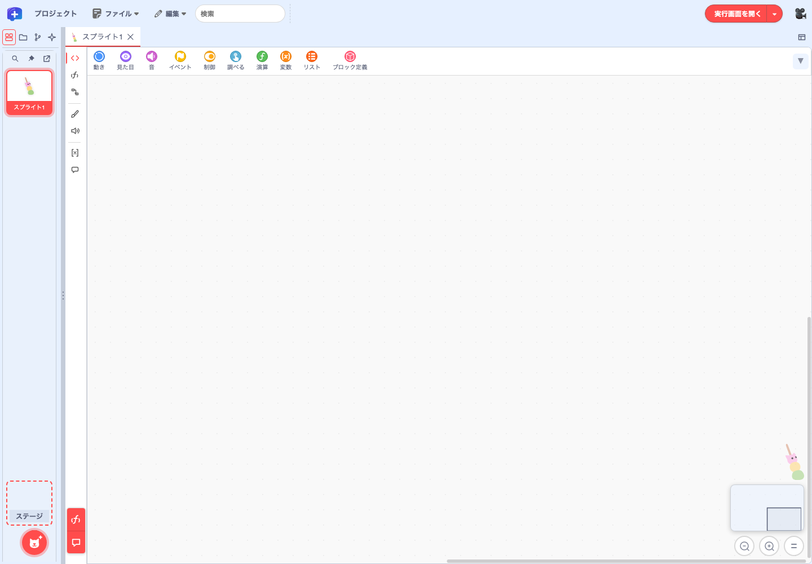](https://kubohiroya.github.io/turbowarp-plus-editor/features/screen/)

*起動直後の作業画面。*

## 目次

- [編集と動作確認](#このエディターでできること)
- [拡張・データ・アセット](#拡張データアセット)
- [作品を開く](#作品を開く)
- [「TurboWarp-Plus-Editorで編集」ボタン](#edit-button)
- [npmパッケージとコマンド](#npmパッケージとコマンド)
- [URLの切り替え](#urlの切り替え)
- [エディターの組み立て](#エディターの組み立て)
- [開発](#開発)
- [ドキュメント](#ドキュメント)
- [ライセンス・製作者](#ライセンス製作者)

<a id="このエディターでできること"></a>

## 編集と動作確認

### 編集ツールにすぐ届く画面構成

必要な操作はポインターを重ねると現れます。ドラッグ＆ドロップでタブを並べ替えたり、別のスプライトにブロックをコピーしたりできます。ミニマップでコード全体を見渡せます。タブやパネルの配置、コード画面の表示位置は作品と一緒に保存されるので、開き直してすぐに作業を再開できます。

| 編集ツールにすぐ届く画面構成 | ステージやパネルを別ウィンドウへ |
| --- | --- |
| <a href="https://kubohiroya.github.io/turbowarp-plus-editor/features/screen/#layout">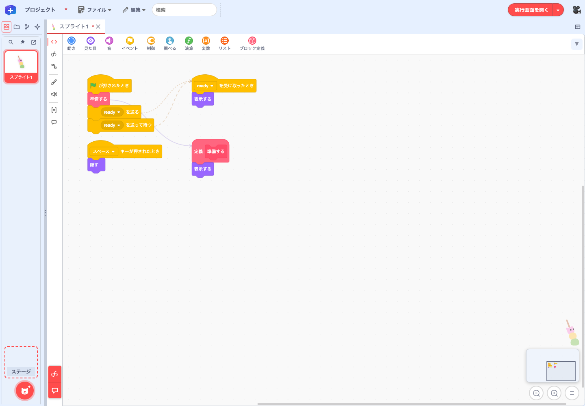</a> | <a href="https://kubohiroya.github.io/turbowarp-plus-editor/features/stage/#dock">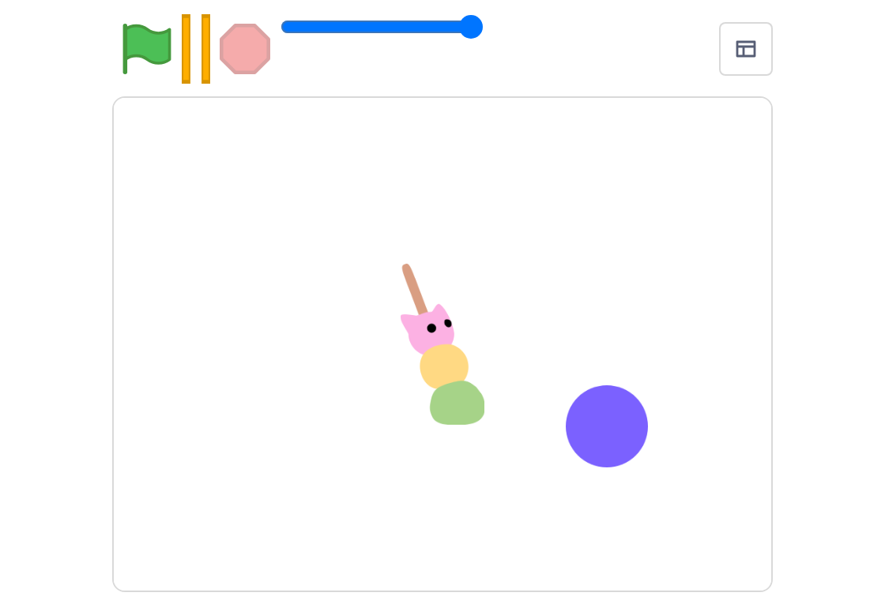</a> |

スプライト一覧は左側に、ブロックのカテゴリはコード画面の上辺に、コード・コスチューム・音・変数・メッセージの切り替えはパネル側面のボタンにまとまっています。パレットのサイズとスクロール位置はカテゴリごとに保持されます。パネルの固定やサイズ調整、作業領域と別ウィンドウ間の移動もできます。[画面構成](https://kubohiroya.github.io/turbowarp-plus-editor/features/screen/) · [作業領域](https://kubohiroya.github.io/turbowarp-plus-editor/features/workspace/)

パレットの検索は表示中の全カテゴリを横断します。使うブロックグループはスプライト・背景ごとに選べ、グループをピンで広げたり並べ替えたりできます。表示設定と順序は作品と一緒に保存されます。[ブロックを探して整理する](https://kubohiroya.github.io/turbowarp-plus-editor/features/blocks/)

### Z配置・N配置でスクリプトを順に読む

コードの背景を右クリックし、**コードの並びの見え方を変更する**からZ配置・N配置を選ぶと、スクリプトを間隔のある縦一列で読めます。ミニマップも表示中の配置に追従します。スクリプトをクリックすると、自由配置での位置を保ったまま内容を編集できます。左縁の▼／▶で個別に折りたたみを切り替え、背景の右クリックでは**すべて折りたたむ**／**折りたたみをすべて解除**を選べます。矢印は右へ張り出して大きく曲がり、左から入る矢印のための余白も確保します。[コードの並びの見え方](https://kubohiroya.github.io/turbowarp-plus-editor/features/blocks/#arrange)

パネルの切り替え中と、作品を開いて初めてコードを描画する間は、待機カーソルを表示します。

| Z配置 | N配置 |
| --- | --- |
| <a href="https://kubohiroya.github.io/turbowarp-plus-editor/features/blocks/#arrange">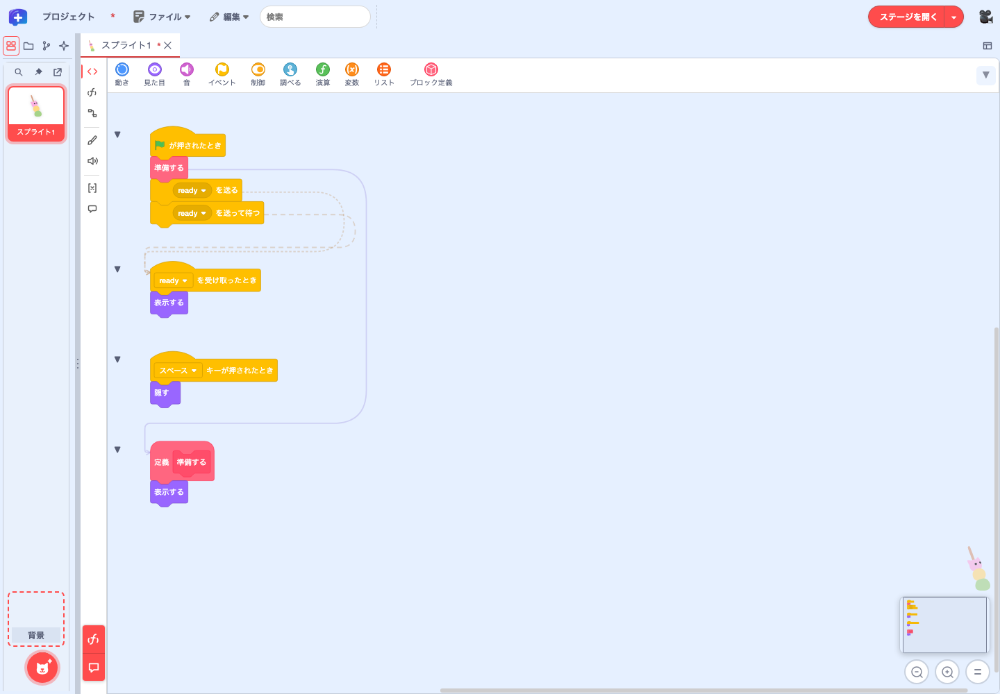</a> | <a href="https://kubohiroya.github.io/turbowarp-plus-editor/features/blocks/#arrange">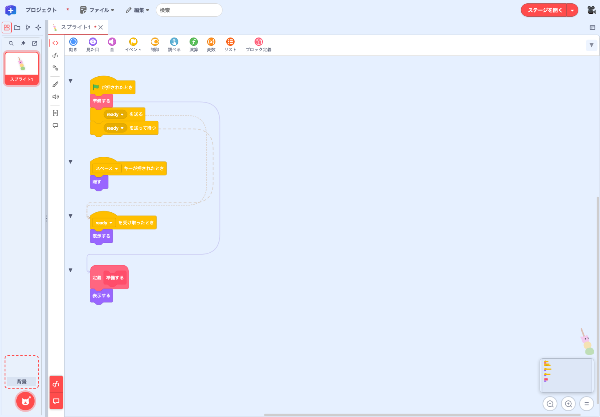</a> |

*Z配置とN配置。左縁の折りたたみボタン、配置に追従するミニマップ、送信方式ごとに異なる破線。*

### クローン・変数・リスト・メッセージを確認する

実行中のクローンを選び、その個体のプロパティやスプライト変数を確認・編集できます。変数のパネルには変数とリストが並び、それぞれを読み取る・変更するブロックの数が表示されます。件数から使用箇所を探したり、リストの項目を編集・並べ替えたりできます。[プロパティと変数](https://kubohiroya.github.io/turbowarp-plus-editor/features/sprites/#variable-pane)

[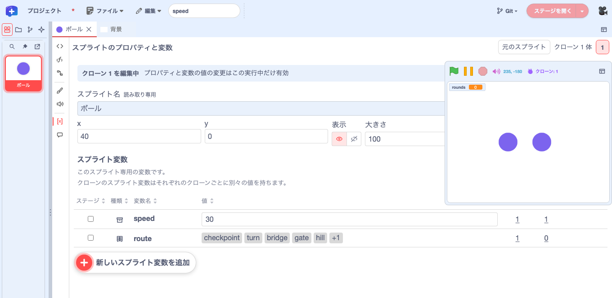](https://kubohiroya.github.io/turbowarp-plus-editor/features/sprites/#variable-pane)

*クローンごとに異なるプロパティと変数の値を確認・編集。*

[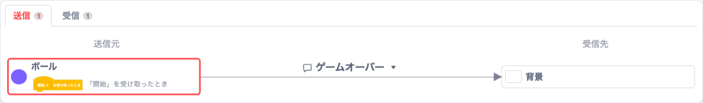](https://kubohiroya.github.io/turbowarp-plus-editor/features/sprites/#messages)

*メッセージの送受信を関係図で確認。*

メッセージを送る・受け取るスプライトや背景を一覧と関係図で確かめられます。関係図では、対象のサムネイルを載せた枠をメッセージ名付きの矢印でつなぎます。枠を選ぶと、その対象のコードが開きます。[メッセージ](https://kubohiroya.github.io/turbowarp-plus-editor/features/sprites/#messages)

変数のパネルでは、一時変数拡張のスレッド変数・ランタイム変数と、それを読み書きする関数も確認できます。[変数の使われ方](https://kubohiroya.github.io/turbowarp-plus-editor/features/sprites/#variable-pane)

### 関数の呼び出し関係をグラフでたどる

**呼び出し関係**では、どの関数がどの関数を呼ぶかを、関数の箱と矢印で確認できます。ほかのスプライトや背景で定義したグローバルな名前付き関数とのつながりや、メッセージを送るスクリプトから受け取るスクリプトへのつながりも表示されます。

[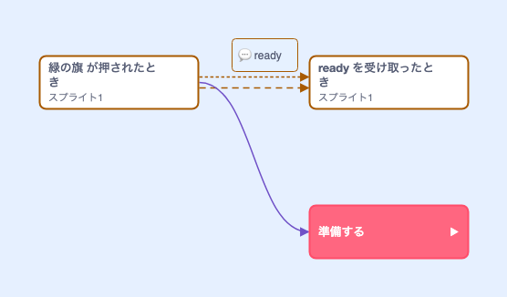](https://kubohiroya.github.io/turbowarp-plus-editor/features/sprites/#call-graph)

*関数の呼び出しとメッセージの流れを図で確認。同じ送信元・受信先でも、「送る」と「送って待つ」を別々の破線で表示します。*

メッセージの矢印は、**送る**を細かい破線、**送って待つ**を長い破線で区別します。自由配置、ハット・関数一覧、Z/N配置、ミニマップでも同じルールを使い、砂時計アイコンは表示しません。

箱にポインターを重ねると、つながる矢印が強調されます。開いているスプライトや背景の関数の箱を選ぶと、その関数が右側のコードパネルに開きます。**ハット・関数一覧**からも、スクリプトやブロック定義を選んで編集できます。[関数と呼び出し関係](https://kubohiroya.github.io/turbowarp-plus-editor/features/sprites/#call-graph)

自由配置のブロックを右クリックすると、**このスクリプトを個別の画面で編集する**、**このスクリプトの呼び出し関係を開く**から、選んだブロックを含むスクリプトの編集と関係図へ進めます。[スクリプトの操作](https://kubohiroya.github.io/turbowarp-plus-editor/features/blocks/#context-menu)

### ブロック編集を、外の道具とつなぐ

作品をプロジェクトフォルダに展開すると、データ・素材・拡張をファイルとして扱えます。VS Codeや生成AIアプリで編集し、Editorへ戻って動作と変更内容を確かめる制作ができます。

[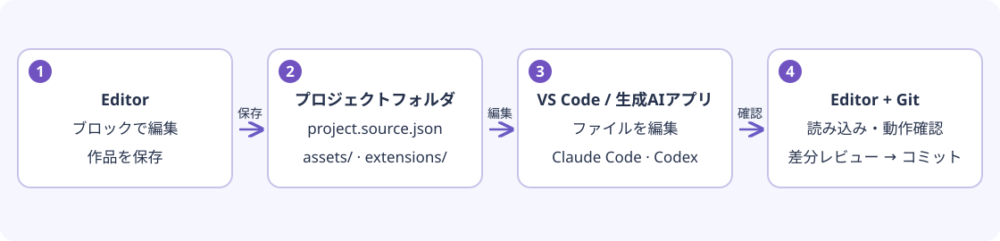](https://kubohiroya.github.io/turbowarp-plus-editor/features/github/#agent)

*外部ツールとの連携例（模式図）。共通の作品フォルダを介して変更を受け渡します。*

#### プロジェクトフォルダで保存

「ファイル」→「プロジェクト一覧…」で、最近開いたSB3・手元のフォルダ・ブラウザー保存・Gitの作業コピーをまとめて扱えます。名前・最終利用日時・保存場所で並び替え、開く、一覧から除外、対応する保存先での削除・名前変更を実行できます。作品名と保存先名は別々に変更でき、同じ名前に揃えることも選べます。Gitは既存の作業コピーを再利用し、一覧からの除外では保存データを消しません。一覧上部の「新しいプロジェクトを作成…」から、ファイルメニューと共通の新規作成ダイアログへ進めます。GitHub上のリポジトリ改名は #681 の対応待ちです。

左ドロワーの「プロジェクトフォルダ」で「フォルダを選んで保存…」か「名前を付けてブラウザー内に保存…」を選び、開いているSB3をフォルダに展開。その後の保存も、同じフォルダに書き込みます。保存したフォルダは「ファイル」→「フォルダを開く…」で開き直せます。 [プロジェクトフォルダで保存](https://kubohiroya.github.io/turbowarp-plus-editor/features/git/#project-folder)

[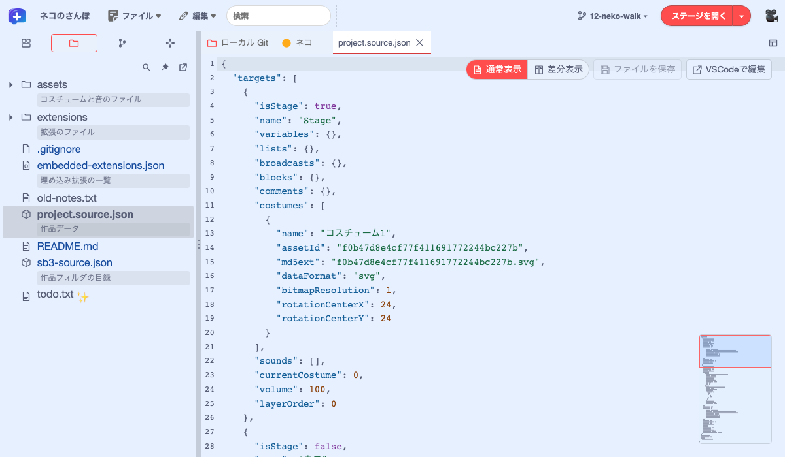](https://kubohiroya.github.io/turbowarp-plus-editor/features/git/#folder-files)

*ファイルを直接編集し、「通常表示／差分表示」のカプセル型切り替えと右下のミニマップで内容を確認できます。保存は未保存の変更があるときに有効になります。*

#### VS Codeでテキストを編集

ローカル補助プロセスからEditorを開くと、ファイルタブの「VSCodeで編集」で作業コピーを開けます。VSCodeで保存し、「終了して取り込む」→「ファイルを保存」で元のファイルへ反映します。外部編集中はタブの表示・操作全体が無効になります。OPFSもローカル連携のURLの保存領域で利用できます。 [ファイルタブと外部編集](https://kubohiroya.github.io/turbowarp-plus-editor/features/git/#folder-files)

#### 生成AIアプリと共同編集

Claude Code・Codexなど、ローカルファイルを読み書きする生成AIアプリに作品フォルダを渡して、スクリプトの修正を依頼できます。たとえば「ネコの移動速度を変える」という変更を依頼し、Editorで動作とブロック差分を確かめます。 [生成AIアプリと共同編集](https://kubohiroya.github.io/turbowarp-plus-editor/features/github/#agent)

外部編集前にEditorで保存し、作品を止めます。未保存の編集がなければスクリプトの変更は自動反映されます。素材や変数などの変更は作品全体を再読み込みし、未保存の編集がある場合は比較して採用する内容を選びます。 [外部変更の取り込み方](https://kubohiroya.github.io/turbowarp-plus-editor/features/git/#external-changes)

#### Gitで変更を比較・記録

Gitのリポジトリのフォルダを開くと、Gitが結び付きます。「ローカル Git」で変更ファイルとブロック差分を確認してコミット。「Git 履歴」で過去のコミットを選んで変更をたどれます。ブランチやプルリクエストで、ほかの人とのレビューにも進めます。 [Gitで変更を比較・記録](https://kubohiroya.github.io/turbowarp-plus-editor/features/git/#block-diff)

[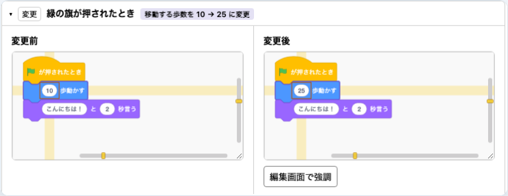](https://kubohiroya.github.io/turbowarp-plus-editor/features/git/#block-diff)

*差分レビュー画面では、スクリプトの中の変更された箇所を、水平・垂直の帯状のガイドが交差する部分で示します。*

ハットからのスクリプトの折りたたみ、長いテキスト引数のダイアログ編集、作品全体の検索、`.blocks3`・`.stage3`による作品間の転送も使えます。[ブロック編集](https://kubohiroya.github.io/turbowarp-plus-editor/features/blocks/) · [検索](https://kubohiroya.github.io/turbowarp-plus-editor/features/search/) · [再利用](https://kubohiroya.github.io/turbowarp-plus-editor/features/reuse/)

<a id="標準turbowarpから増える機能"></a>

## 拡張・データ・アセット

エディタの機能を、もっと便利にしたくありませんか？独自の機能拡張ブロックで、もっと自由に開発したいですよね？　TurboWarp-Plusファミリーのプロジェクト群が、そんなあなたの希望を叶えます。

### 拡張コードの検証と実行許可

Plus Editorは、Plus形式の拡張コードを実行前にSHA-256で照合します。確認が必要な拡張は、取得元と実行条件を確認し、サンドボックス内での実行などを選べます。 ファミリーのカタログでは、取得元とハッシュによって信頼済みの拡張を識別します。[拡張の読み込みと実行許可](https://kubohiroya.github.io/turbowarp-plus-editor/features/open/#review)

### カスタム拡張ブロックのフォーム編集

機能拡張ブロックにはカスタムUIを持たせることができます。カスタムUIはJSON Schemaから自動生成可能です。React JSON Schema Formによる入力欄で、ブロックの引数を項目ごとに編集し、必須項目や値の範囲を保存前に検証します。

[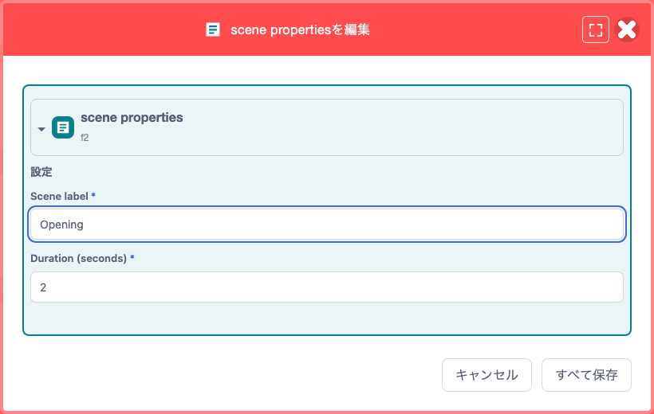](https://kubohiroya.github.io/turbowarp-plus-editor/features/documents/#forms)

*対応する拡張が登録したブロックのフォーム編集。[ブロックのフォーム](https://kubohiroya.github.io/turbowarp-plus-editor/features/documents/#forms)*

### データ構造とDSLを作品に組み込む

対応する拡張を使うと、設定データや、台本などのDSL（用途に特化した言語）をYAMLやブロックで記述し、SB3に組み込めます。たとえば、紙芝居の拡張は実行時に台本を読み、場面を切り替えたり、せりふを表示したりします。 YAML文書はコードの隣のタブに開けます。文書を提供する拡張が対応する形式で編集します。[文書とブロック](https://kubohiroya.github.io/turbowarp-plus-editor/features/documents/#documents)

### 実行時に名前で呼び出す関数を選ぶ

Named Functions拡張では、コードを書くときにブロックで関数を定義し、名前を付けます。実行時に、変数などから関数名を文字列で渡すと、拡張がその名前の関数を探して実行します。引数と戻り値にはJSONを使い、それぞれをJSON Schemaで検証できます。 [Named Functions利用ガイド](https://kubohiroya.github.io/turbowarp-named-functions/ja/)

### アセットの外部配信とキャッシュ

Plus Editorでは、コスチューム画像・背景画像・音などの素材ごとに、作品への同梱かHTTPS配信かを選べます。照合済みの素材はキャッシュで再利用できます。紙芝居などの対応拡張を作品に追加すると、外部動画も使えます。 [素材の格納方式](https://kubohiroya.github.io/turbowarp-plus-editor/features/save/#payload-formats)

カメラ・AR・QR・Teachable Machineなどを使うインタラクティブ作品向けに、拡張から操作ボタンやプレビュー、ブロックを追加できます。TypeScriptとファミリーの型付きAPI、npmのライブラリで拡張を作り、コードの保存方式を選び、`sb3-toolchain`で固定・検証できます。[開発者ガイド](https://kubohiroya.github.io/turbowarp-plus-editor/developer-guide/) · [TurboWarp Plusファミリー](https://kubohiroya.github.io/turbowarp-plus-packages/)

制作した作品はSB3で保存でき、Plus拡張を含む単一HTMLとしても書き出せます。書き出し時も拡張コードを記録済みのハッシュと照合し、実行条件を引き継ぎます。[保存と書き出し](https://kubohiroya.github.io/turbowarp-plus-editor/features/save/)

[互換性の一覧](docs/features/sb3-compatibility.md)では、Scratch・TurboWarp・Plus Editorで作品や追加機能をどう扱うかを説明しています。タイトル・作者・連絡先などは作品のプロパティとしてSB3に保存でき、エディターを開いている間の検証・実行許可・読み込み・失敗の記録は作品の診断で確認できます。[作品のプロパティ](https://kubohiroya.github.io/turbowarp-plus-editor/features/save/#project-properties) · [作品の診断](https://kubohiroya.github.io/turbowarp-plus-editor/features/open/#project-diagnostics)

## 作品を開く

手元のSB3や作品フォルダは、Editorの**ファイル**メニューから開きます。URLで開くときは、ブラウザーから取得できるHTTPSのSB3を、URLエンコードして `project_url` に指定します。

```text
https://kubohiroya.github.io/turbowarp-plus-editor/editor.html?lang=ja&project_url=https%3A%2F%2Fexample.com%2Fstory.sb3
```

`lang` は `ja` か `en` です。トップページの編集ボタンは、受け取った `project_url` などのEditorのパラメーターをそのまま引き継ぎます。

<a id="edit-button"></a>
## 「TurboWarp-Plus-Editorで編集」ボタン

自分のページに、作品をここで開くボタンを置けます。`<head>` でスタイルシートを一度読み込み、リンクを置きます。

```html
<link rel="stylesheet"
      href="https://kubohiroya.github.io/turbowarp-plus-editor/assets/edit-button.css">

<a class="twpe-edit-button"
   href="https://kubohiroya.github.io/turbowarp-plus-editor/editor.html?lang=ja&amp;project_url=https%3A%2F%2Fexample.com%2Fstory.sb3">
  
  <span>TurboWarp-Plus-Editorで編集</span>
</a>
```

- `project_url` を省くと新しい作品になります。英語では `lang=en` と `Edit in TurboWarp-Plus-Editor` にします。
- 小さいボタンは `twpe-edit-button--small` を加え、24pxの画像と**編集**（`Edit`）を表示し、`title` と `aria-label` に完全なラベルを入れます。
- ボタンはOSの配色に従います。固定するときは `<html data-theme="light">` か `dark` を指定します。
- GitHubのREADMEでは外部CSSを読めないので、アイコン画像とラベルを普通のリンクで囲みます。

## npmパッケージとコマンド

```sh
npm install @kubohiroya/turbowarp-plus-editor
```

```ts
import {createEditorURL, renderEditButton} from '@kubohiroya/turbowarp-plus-editor';

const url = createEditorURL({
    language: 'ja',
    projectURL: 'https://example.com/story.sb3',
    parameters: {fps: 60}
});
const html = renderEditButton({size: 'small', language: 'ja', projectURL: 'https://example.com/story.sb3'});
```

パッケージには、ブランドのSVG（`./assets/icon.svg`）、ボタンのCSS（`./assets/edit-button.css`）、型定義付きのURL・HTMLヘルパー、拡張ローダーの起動部（`./extension-loader`）、固定した配信情報（`./source.json`）が入っています。URLヘルパーはHTTP(S)以外の作品URLと未対応の言語を拒否します。Editor本体はPages向けにビルドするもので、パッケージには含みません。

コマンドも2つ入ります。

- **`turbowarp-plus-editor-sb3-format`** は、既存のSB3の拡張を `remote-non-cacheable`・`remote-cacheable`・`embedded-file`・`embedded-data` で保存し直します。`remote-cacheable` はブラウザーが検証済みのコピーを持ってよいという記録にすぎません。オフラインで動くSB3にするには `embedded-*` を選びます。

  ```sh
  npx --package=@kubohiroya/turbowarp-plus-editor turbowarp-plus-editor-sb3-format --input in.sb3 --output out.sb3 --extensions embedded-file
  ```

- **`turbowarp-plus-editor-yaml`** は、ビルド済みのEditorを、組み込みYAML文書をVS Codeで編集するためのローカル補助プロセスと一緒に配信します。VS Codeには専用の作業ファイルと独立した設定領域を渡し、スキーマ付きの文書を初めて開いたときに、そこへ `redhat.vscode-yaml` を入れます。手元の設定や拡張には触れません。

  ```sh
  npx --package=@kubohiroya/turbowarp-plus-editor turbowarp-plus-editor-yaml --site-dir /absolute/path/to/editor/build --data-dir /absolute/path/to/work-files
  ```

## URLの切り替え

以下はすべて既定で有効です。EditorのURLにパラメーターを加えて再読込すると変わります。

| パラメーター | 効果 |
| --- | --- |
| `twPlusStandardLayout=0` | 標準のPlus配置ではなく、以前の配置で開く |
| `twPlusWorkspaceMinimap=0` | コード領域のミニマップを隠す |
| `twPlusSaveWorkspace=0` | 画面（ドロワー・タブ・ペイン）を SB3 や作品フォルダに保存しない |
| `twPlusPaletteCategoryReorder=0` | パレットのカテゴリを長押しで並べ替えない |
| `twPlusPaletteDeletePreview=0` | ブロックをパレットへドラッグしたときのごみ箱表示を出さない |
| `twPlusContextMenuIcons=0` | コンテキストメニューのアイコンを出さない |
| `twPlusDockview=0` | 組み込み文書をDockviewのタブではなく以前のモーダルで開く |
| `twPlusLocalGit=0` | ローカル Git パネルを隠す |
| `twPlusExtensionLoader=0` | Plusの拡張ローダーと確認画面を止める |

## エディターの組み立て

このリポジトリは、独自のエディターのフォークを持ちません。固定した上流のソースと、npm に公開されたファミリーのパッケージから Editor をビルドします。`scratch-gui` のフォークは、それらを差し込む口だけを持ちます。

**固定したソース**（[`site/source.json`](site/source.json)）。ビルドは次のものを完全なコミット SHA でチェックアウトして照合し、チェックアウト・インストール済みのパッケージ・固定値が一致しなければ止まります。

| ソース | 役割 |
| --- | --- |
| [`kubohiroya/scratch-gui`](https://github.com/kubohiroya/scratch-gui) | 任意の差し込み口 `plusIntegration()` ひとつを持つ TurboWarp の GUI。上流にないファイルはなく、素のビルドでは `null` になって上流と同じに動く |
| [`kubohiroya/scratch-vm`](https://github.com/kubohiroya/scratch-vm) | VM。元にした上流のリビジョンとあわせて固定 |
| [`TurboWarp/packager`](https://github.com/TurboWarp/packager) | **書き出し**で使う標準の Packager |

**npm のファミリーパッケージ。** Plus が加える機能は、npm から厳密な版で入れる `@kubohiroya/*` パッケージから来ます。アーカイブとして同梱するパッケージはありません。`site/source.json` にも記録するもの（データエディター・拡張ローダー・文書エディター・スクリプト転送）は、公開版・integrity・公開元のコミットと照合します。

| 分野 | パッケージ |
| --- | --- |
| エディターの作業台 | `turbowarp-plus-editor-workbench`（配置・スプライトのタブ・ステージとその操作・メニュー・作品のダイアログ・バックパック）、`-windows`（ページ内ウィンドウ・メニュー・ダイアログの操作ボタン・外部の表示先と転送）、`-code-views`（タブや別窓のコード・切り離したパレット・スクリプトの配置・ブロックの入力欄の編集）、`-sprite-panes`（素材・変数・メッセージ・関数と呼び出し図・プロパティ）、`-fonts`（Web フォント）、`-host`（ファミリーが前提にするホストの契約）、`-project-model`（UI に依存しない作品の読み取りと編集、作品全体の検索と置換） |
| 作品フォルダと Git | `turbowarp-plus-editor-project-folder`、`-project-starter`（作品を GitHub リポジトリへ移す）、`-git`（ローカル Git パネル・公開・リポジトリの作成）、`-auth`（Git プロキシのセッション）、`sb3-toolchain` |
| 機能拡張 | `turbowarp-extension-loader`（検証付きの読み込み）、`turbowarp-extension-security-dialog`（実行前の確認）、`turbowarp-extension-data-editor`（拡張データのフォーム編集）、`turbowarp-sb3-save-format`（保存形式の語彙） |
| 文書 | `turbowarp-document-editor`、`turbowarp-document-data`、`turbowarp-document-source`、`turbowarp-structured-data`、`turbowarp-named-data`、`turbowarp-yaml-json` |
| 再利用 | `turbowarp-script-transfer`（`.blocks3` / `.stage3`） |

**このリポジトリに置くもの。** このリポジトリは実装のパッケージを持ちません。新しい機能はファミリーのパッケージに置き、ここでは版を固定して、その入口を GUI へ結線するだけです（[`AGENTS.md`](AGENTS.md)）。GUI の差し込み口を埋める接続コードは [`site/`](site/) にあります。

**ファミリー内の分担。** [`turbowarp-plus-packages`](https://github.com/kubohiroya/turbowarp-plus-packages) が拡張カタログ、拡張の表示名とアイコン、設計の基準文書を持ちます。各パッケージの版と依存関係は、その[ダッシュボード](https://kubohiroya.github.io/turbowarp-plus-packages/)で見られます。このリポジトリは [`site/plus-catalog.ts`](site/plus-catalog.ts) でカタログを取得します。Editor より上流のパッケージが Editor を取得・ビルド・配信することはありません。

公開される `build-info.json` は実際に組み合わせた版を、`notices/family.json` は同梱したファミリーパッケージのライセンスと取得元を記録します。GUI のフォークに残る変更は[差し込み口の設計](docs/plus-integration-sockets.md)に、なぜアドオンではなく差し込み口を使うのか、新しい機能を Editor に組み込む手順は[開発者ガイド](https://kubohiroya.github.io/turbowarp-plus-editor/developer-guide/)にまとめています。

## 開発

Node.jsは [`.nvmrc`](.nvmrc) の版（26）を使います。ソースはすべてTypeScript（`.ts`、CommonJSは `.cts`）です。Nodeが型除去でそのまま実行し、ブラウザー向けはesbuildが出力し、npm向けの入口と型定義は `tsc` が `dist/` にコンパイルします。

```sh
npm ci
npm run typecheck
npm test
npm run test:package
```

**サイトのビルド。** `site/source.json` のリビジョンでGUIとPackagerをチェックアウトし、GUIのチェックアウト内で依存を入れて `node scripts/prepublish.mjs` を実行してから、こちらでビルドします。

```sh
E2E_GUI_ROOT=/absolute/path/to/pinned/scratch-gui \
TW_PLUS_PACKAGER_ROOT=/absolute/path/to/pinned/packager npm run build:pages
```

ブラウザー版のローカル Git を使うときは、ビルド時に `TW_PLUS_GIT_BFF_ORIGIN` と `TW_PLUS_GIT_PROXY_ORIGIN` を正確なHTTPSオリジンで指定します。

**テスト。** `npm test` とほかの `test:*` は単体・結合テストです。Playwright の E2E（`E2E_GUI_ROOT` を指定して `npm run test:e2e`）と `*.browser.ts` はビルド済みのEditorに対して開発中にローカルで実行するもので、CIでは走らせません。

**CIとリリース。** CIは型検査、単体・結合テスト、パッケージの検査、サイトのビルドを実行します。リポジトリ変数 `TW_PLUS_CI_SCOPED=1` のとき、PRは差分に必要な検査だけを実行し、`main` は同じツリーで通った検査を再利用します。差分が読めなければ全体の検証に戻ります。Pagesは、`main` で成功した実行の成果物を、そのSHAのまま配信します。npmへは、パッケージの版と一致するタグから、OIDCのTrusted Publisherで公開します。

### ローカル Git と GitHub の接続

ローカル Git パネルは、GitHub のトークンを受け取りません。受け取るのは短い期限の Bearer だけです。プロキシは `/v1/git/<owner>/<repo>.git/` の Git Smart HTTP の4つの経路だけを中継し、要求のたびに要求元のオリジン・Bearer・接続時に記録したリポジトリ・操作を確かめます。push では、上流へ送る前に `Git-Push-Id` を予約します。

- **ブラウザー（Cloudflare）。** Editor は BFF の `/v1/git-auth/start` からログインを始め、GitHub App の認可を開き、メモリにだけ持つチケットで `/v1/git-auth/session` を問い合わせます。トークンは Durable Object に暗号化して置きます。ログインは最長8時間、プロキシの Bearer は5分ごとに更新します。
- **Desktop。** メインプロセスが認証し、`tw-editor://.` のオリジンだけを受け付ける `127.0.0.1` のループバックのプロキシで Git を中継します。トークンはメインプロセスの外に出ず、保存するときは OS のキーチェーンで暗号化します。ホストの設定に応じて、GitHub App のデバイスフロー、fine-grained PAT、Git credential helper を選べます。（[接続方式ごとの条件](docs/features/git/#connection-methods)）

GitHub App が求める権限は、インストールしたリポジトリの Metadata の read と Contents の read/write だけです。client ID は秘密の値ではなく、デバイスフローは client secret を使いません。残るリスクはフィッシングです。コードは Editor の画面に出たものだけを入れてください。許可は GitHub の **Settings → Applications → Authorized GitHub Apps** から取り消せます。

リポジトリの作成とPRの登録をヘッドレスで確かめるときは、`TW_PLUS_GIT_BFF_ORIGIN=https://github-create.example.invalid` と `TW_PLUS_GIT_PROXY_ORIGIN=https://github-git.example.invalid` でビルドし、`E2E_PROJECT_SAVE_BUILD` にビルドの出力先、`E2E_GIT_HTTP_FIXTURE` に Git パッケージの `test/smart-http-fixture.js` を指定して実行します。GitHub は模擬し、Git の通信はローカルの Git CGI で検証します。

```sh
node --test --test-concurrency=1 test/project-folder-save.browser.ts test/project-repository-creation.browser.ts test/project-publication.browser.ts
```

未公開の依存で確かめるときは、ローカル webpack の `TW_PLUS_PROJECT_SAVE_PREVIEW_ROOT` に、ビルド済みの `sb3-toolchain`・`turbowarp-plus-editor-project-folder`・`turbowarp-plus-editor-project-starter`・`turbowarp-plus-editor-git`・`turbowarp-plus-editor-auth` を `node_modules/@kubohiroya/` に置いたディレクトリの絶対パスを指定します。

### 組み込み文書

文書の編集はパッケージが持ち、このリポジトリは持ちません。`turbowarp-document-editor` がダイアログ・プレビュー・外部エディターとの橋渡しを、`turbowarp-document-data` が保存・参照・提供元の登録を、`turbowarp-document-source` がハットと共通YAMLブロックを、`turbowarp-yaml-json`・`turbowarp-named-data`・`turbowarp-structured-data` が解析・スキーマ・射影を担います。文書を所有する拡張が、その検証・スキーマ・変換を提供します。EditorはAppを埋め込まず、登録された提供元が所有する文書にだけファイルのアイコンを出します。

既存のビルドにYAMLの道具を加え（`build:pages` は自動で加えます）、補助プロセスと一緒に配信するには次のようにします。

```sh
npm run build:yaml-tools -- /absolute/path/to/editor/build
npm run editor:yaml -- --site-dir /absolute/path/to/editor/build --data-dir /absolute/path/to/work-files
```

`npm run test:yaml` がビルドとCLIを確かめます。往復の検証（`test:yaml:roundtrip`・`test:yaml:multi-document`）は `TWPE_YAML_SITE`・`TWPE_YAML_FIXTURE`・`TWPE_YAML_EVIDENCE`・`TWPE_CHROME_EXECUTABLE` を使って実際のChromeでビルド済みのEditorを動かします。fixtureは [`scripts/yaml-editor/`](scripts/yaml-editor/) のスクリプトで作ります。VS Code 本体での確認には [`test/vscode-edit-driver/`](test/vscode-edit-driver/) のテスト専用ドライバー（`npm run build:test-driver`）を使います。

## ドキュメント

### 機能ガイド（公開版）

画面付きの機能ガイドは[機能ガイドのトップ](https://kubohiroya.github.io/turbowarp-plus-editor/features/)にあり、次の12ページで構成しています。最初に[ボールのデモ](https://kubohiroya.github.io/turbowarp-plus-editor/features/ball-demo/)で試せます。

1. [作品を開き、拡張を準備する](https://kubohiroya.github.io/turbowarp-plus-editor/features/open/)
2. [画面の構成とメニュー](https://kubohiroya.github.io/turbowarp-plus-editor/features/screen/)
3. [スプライトと背景を編集する](https://kubohiroya.github.io/turbowarp-plus-editor/features/sprites/)
4. [ステージを開いて作品を動かす](https://kubohiroya.github.io/turbowarp-plus-editor/features/stage/)
5. [作業領域を分割・別ウィンドウにする](https://kubohiroya.github.io/turbowarp-plus-editor/features/workspace/)
6. [ブロックを探して置く・整理する](https://kubohiroya.github.io/turbowarp-plus-editor/features/blocks/)
7. [作品全体を検索・置換する](https://kubohiroya.github.io/turbowarp-plus-editor/features/search/)
8. [拡張のデータと文書を編集する](https://kubohiroya.github.io/turbowarp-plus-editor/features/documents/)
9. [スクリプトと素材を再利用する](https://kubohiroya.github.io/turbowarp-plus-editor/features/reuse/)
10. [保存して配布する](https://kubohiroya.github.io/turbowarp-plus-editor/features/save/)
11. [作品フォルダとGitで管理する](https://kubohiroya.github.io/turbowarp-plus-editor/features/git/)
12. [GitHubで作品を開発する](https://kubohiroya.github.io/turbowarp-plus-editor/features/github/)

### 設計ドキュメント

- [TurboWarp-Plus-Editorの責務と配信](docs/architecture.md)
- [フォークに残す差し込み口の設計](docs/plus-integration-sockets.md) ・ [GUI追加ファイルの全面移設](docs/gui-integration/README.md)
- [拡張ローダーの統合](docs/extension-loader-integration.md) ・ [機能拡張一覧でEmbedded／Remoteを設定する](docs/extension-authoring-ui.md) ・ [SB3の保存形式](docs/sb3-save-format.md)
- [SB3互換性と機能一覧](docs/features/sb3-compatibility.md)
- [フォーム型ブロックエディター](docs/block-editor.md) ・ [組み込み文書のウィンドウ操作](docs/document-window.md)
- [作品のプロパティと診断](docs/project-tools.md) ・ [スクリプトとステージの転送](docs/script-stage-transfer.md)
- [ローカルのカタログ表示差分を確認する](docs/local-catalog-preview.md) ・ [機能拡張セキュリティのローカル確認](docs/gui-integration/local-security-preview.ja.md)

## ライセンス・製作者

GPL-3.0-or-later です。ただし編集ボタンのスニペットは MPL-2.0 です。

- **MPL-2.0:** `src/index.ts`（`createEditorURL`・`renderEditButton` とその定数。npm パッケージでは `dist/src/index.*`）と `assets/edit-button.css`。各ファイルに `SPDX-License-Identifier: MPL-2.0` があり、全文は [`LICENSE.MPL-2.0`](LICENSE.MPL-2.0) にあります。ほかのサイトは GPL-3.0 の義務を負わずに使えます。
- **GPL-3.0-or-later:** アイコン、拡張ローダーの起動部、コマンドを含むそれ以外のすべて。全文は [`LICENSE`](LICENSE) にあります。
- Pages で配信する Editor は GPL-3.0 の著作物です。その `notices/` に、同梱したファミリーパッケージのライセンスと取得元を記録しています。[`NOTICE`](NOTICE) も参照してください。

TurboWarp-Plus-Editor は、[久保 裕也](https://github.com/kubohiroya)（千葉商科大学）が進める [TurboWarp Plus Project](https://kubohiroya.github.io/turbowarp-plus-packages/) ファミリーのオープンソースソフトウェアの一つです。
