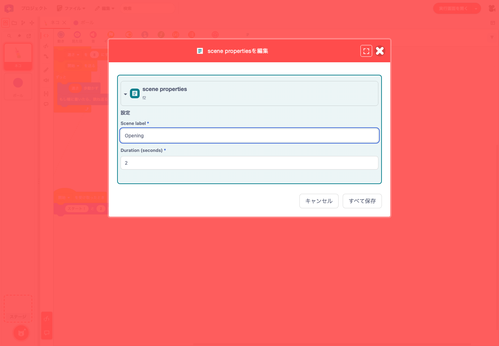

# TurboWarp-Plus-Editor

[English](README.md) | 日本語

[](https://kubohiroya.github.io/turbowarp-plus-editor/)

**[TurboWarp-Plus-Editorを開く](https://kubohiroya.github.io/turbowarp-plus-editor/)**

TurboWarp-Plus-Editorは、Scratch 3とTurboWarpの作品のためのエディターです。長い作品や人と共有する作品に要るものを加えています。分割して並べ替えられる作業画面、作品全体の検索と置換、Gitで追える作品フォルダ、動かす前に確かめられる機能拡張、Plus拡張を同梱したひとつのHTMLへの書き出しです。ScratchやTurboWarpのSB3はそのまま開き、ここで保存したものはそちらでもまた開けます。

- エディター: <https://kubohiroya.github.io/turbowarp-plus-editor/editor.html?lang=ja>
- 機能ガイド: <https://kubohiroya.github.io/turbowarp-plus-editor/features/>
- 開発者ガイド: <https://kubohiroya.github.io/turbowarp-plus-editor/developer-guide/>
- npm: [`@kubohiroya/turbowarp-plus-editor`](https://www.npmjs.com/package/@kubohiroya/turbowarp-plus-editor)
- TurboWarp Plusファミリー（機能拡張・アプリ・ダッシュボード）: <https://kubohiroya.github.io/turbowarp-plus-packages/>

[](https://kubohiroya.github.io/turbowarp-plus-editor/features/documents/#forms)

## 目次

- [このエディターでできること](#このエディターでできること)
- [標準TurboWarpから増える機能](#標準turbowarpから増える機能)
- [作品を開く](#作品を開く)
- [「TurboWarp-Plus-Editorで編集」ボタン](#edit-button)
- [npmパッケージとコマンド](#npmパッケージとコマンド)
- [URLの切り替え](#urlの切り替え)
- [エディターの組み立て](#エディターの組み立て)
- [開発](#開発)
- [ドキュメント](#ドキュメント)
- [ライセンス・製作者](#ライセンス製作者)

## このエディターでできること

- **手元の作品を、そのまま続けられる。** 移植は要りません。このエディター・Scratch 3・TurboWarpのあいだで、どちらの向きに何が保たれるかは[互換性の一覧](docs/features/sb3-compatibility.md)に記録しています。
- **作品の中で迷わない。** スプライト一覧はコードの横に固定され、名前で探せます。パレットは画面上部の検索できる帯で、カテゴリの順番を並べ替えられます。検索はすべてのスプライトとステージを横断し、変数・リスト・メッセージがどこで使われているかを一覧にします。
- **作品の組み立てが見える。** スプライトとステージの左端のアイコンに、**ハット・関数一覧**と**呼び出し関係**があります。**ハット・関数一覧**はすべてのスクリプトをハットごとに、ブロック定義を関数ごとに並べ、**呼び出し関係**の図はどの関数がどの関数を呼ぶかを、ほかのスプライトやステージのグローバル関数まで含めて描きます。そこで関数やスクリプトを選ぶか、関数を呼ぶブロックの右クリックで**この関数を表示**を選ぶと、それだけを表示した本物のコード領域がスプライトの右に開きます。パレット・ズーム・ミニマップも通常のコード領域と同じです。どちらからも、名前を入れて関数（通常のブロック定義か TurboWarp Plus の名前付き関数）を追加できます（[ガイド](https://kubohiroya.github.io/turbowarp-plus-editor/features/sprites/#functions)）。変数ペインは一時変数拡張のスレッド変数・ランタイム変数と、それを読み書きする関数を示し、メッセージの関係図は、どのハットや関数が送っているかを示します。
- **長いスクリプトも読みやすく。** ハットの右クリックでスクリプトを折りたたむと、ハットだけが残ります。状態は作品に保存され、折りたたんだ中の関数呼び出しも、関数を直せば追従します。長いテキスト引数はブロックの中で短く表示し、ダイアログで編集します。ブロックの右クリックメニューは操作の種類ごとに並びます（[ガイド](https://kubohiroya.github.io/turbowarp-plus-editor/features/blocks/#context-menu)）。
- **長い作品を、先へ進められる。** 作業画面は[Dockview](https://dockview.dev/)です。パネルを分割し、コードとパレットを別のウィンドウに出し、次に開いたときに同じ配置が戻ります。ミニマップ、ショートカット付きの編集メニュー、作品間で `.blocks3` / `.stage3` を移す転送も備えています。
- **作品をGitのフォルダとして持つ。** [`sb3-toolchain`](https://www.npmjs.com/package/@kubohiroya/sb3-toolchain) がSB3をテキストとファイルに展開します。Editorはそのフォルダを直接開き、`project.source.json` に保存し、**ローカル Git** パネルで差分・ブランチ・履歴・プルリクエストを見せます。差分はJSONではなくブロックで描きます。リミックスは、元の作品から切れたバイナリではなく、読める履歴と送り返せる変更になります。
- **AIエージェントと組んで作る。** 作品が普通のファイルなので、エージェントは手持ちのファイル操作で編集できます。こちらは再読込して、ブロックの差分をレビューします。
- **拡張を使う側から、書く側へ。** 拡張の取得元と実行条件を確かめ、作品と一緒にコードをどう保存するかを選び、自分の拡張を埋め込み、`sb3-toolchain` で固定・検証します。拡張はTypeScriptで、ファミリーの型付きAPIに対して書き、npmのライブラリを同梱することをすすめています。
- **YAML文書とJSON Schemaを、作品の一部として扱う。** 文書は原文・共通YAMLブロック・所有する拡張が提供するブロックのどれでも編集できます。スキーマがあればフォームと検証が生成され、ローカル補助プロセス経由のVS Codeで補完も効きます。
- **インタラクティブ作品とデバイスの土台になる。** 拡張は `@kubohiroya/turbowarp-app-shell` を通してメニューバーに操作を登録します。カメラ・AR・QR・Teachable Machineのホストアプリは、Editorのフォークではなく、拡張と作品の組み合わせとして作れます。
- **入口は物語から。** [`turbowarp-kamishibai-app`](https://www.npmjs.com/package/@kubohiroya/turbowarp-kamishibai-app) が子どもの入口です。物語は文書で、次の場面を分岐させたくなったときが、ブロックを開く理由になります。

## 標準TurboWarpから増える機能

| 作業 | 標準のTurboWarp | Plusで加わる操作 |
| --- | --- | --- |
| 作品を開く | SB3の読み込みと拡張の実行確認 | 読み込みの経過表示、Plusカタログ、読み込みの診断 |
| 作品を管理する | SB3ファイル単位の保存 | 作品フォルダの読み書き、ローカルGitの差分・履歴・プルリクエスト |
| 作業画面を整える | コード・ステージ・スプライトの基本配置 | パネルの分割、パネルとパレットの別画面、ステージ表示メニュー、配置の復元 |
| 構造をつかむ | コード領域をスクロールして探す | ハット・関数一覧、スプライトとステージをまたぐ呼び出し図、関数やスクリプトだけの表示、変数とメッセージの使われ方 |
| 編集する | ブロックの入力欄やメニュー | 作品全体の検索と置換、編集メニュー、検索付きの横型パレット、ミニマップ、スクリプトの折りたたみ、長いテキスト引数のダイアログ、対応する拡張のフォームとYAMLタブ |
| 再利用する | バックパック | スクリプトやステージのファイル転送、バンドル素材の追加 |
| 保存して渡す | SB3の保存と標準Packager | 上書き保存と名前を変えて保存、組み込みデータと拡張コードの保存方式、Plus拡張を同梱したHTML |

対応する拡張や専用データが必要なものもあります。どれが必要かは[機能ガイド](https://kubohiroya.github.io/turbowarp-plus-editor/features/)に記録しています。ガイドは画面構成・作業領域・スプライト・ステージ・ブロック・検索・文書・再利用・保存・作品フォルダとGit・GitHubの各ページを、実際の画面とともに説明しています。

最初に知っておくとよいこと:

- **書き出し**は、通常のSB3なら標準のTurboWarp Packagerを、Plus拡張を記録した作品ならPlus専用の出力画面を開きます。拡張コードは記録したハッシュと照合してからHTMLに入るので、外部依存のない作品はそのHTMLだけでオフラインで動きます。
- [作品のプロパティ](https://kubohiroya.github.io/turbowarp-plus-editor/features/save/#project-properties)はタイトル・概要・作者・連絡先をSB3に保存します。[作品の診断](https://kubohiroya.github.io/turbowarp-plus-editor/features/open/#project-diagnostics)は、Editorを開いている間、検証・実行許可・読み込み・失敗の記録を集めます。
- [ファミリーのカタログ](https://kubohiroya.github.io/turbowarp-plus-packages/extensions-v1.json)の条件（取得元とSHA-256の一致）を満たす拡張は、個別の確認なしで動きます。それ以外の拡張は、Editorでも書き出したHTMLでも、動かす前に確認します。

## 作品を開く

手元のSB3や作品フォルダは、Editorの**ファイル**メニューから開きます。URLで開くときは、ブラウザーから取得できるHTTPSのSB3を、URLエンコードして `project_url` に指定します。

```text
https://kubohiroya.github.io/turbowarp-plus-editor/editor.html?lang=ja&project_url=https%3A%2F%2Fexample.com%2Fstory.sb3
```

`lang` は `ja` か `en` です。トップページの編集ボタンは、受け取った `project_url` などのEditorのパラメーターをそのまま引き継ぎます。

<a id="edit-button"></a>
## 「TurboWarp-Plus-Editorで編集」ボタン

自分のページに、作品をここで開くボタンを置けます。`<head>` でスタイルシートを一度読み込み、リンクを置きます。

```html
<link rel="stylesheet"
      href="https://kubohiroya.github.io/turbowarp-plus-editor/assets/edit-button.css">

<a class="twpe-edit-button"
   href="https://kubohiroya.github.io/turbowarp-plus-editor/editor.html?lang=ja&amp;project_url=https%3A%2F%2Fexample.com%2Fstory.sb3">
  
  <span>TurboWarp-Plus-Editorで編集</span>
</a>
```

- `project_url` を省くと新しい作品になります。英語では `lang=en` と `Edit in TurboWarp-Plus-Editor` にします。
- 小さいボタンは `twpe-edit-button--small` を加え、24pxの画像と**編集**（`Edit`）を表示し、`title` と `aria-label` に完全なラベルを入れます。
- ボタンはOSの配色に従います。固定するときは `<html data-theme="light">` か `dark` を指定します。
- GitHubのREADMEでは外部CSSを読めないので、アイコン画像とラベルを普通のリンクで囲みます。

## npmパッケージとコマンド

```sh
npm install @kubohiroya/turbowarp-plus-editor
```

```ts
import {createEditorURL, renderEditButton} from '@kubohiroya/turbowarp-plus-editor';

const url = createEditorURL({
    language: 'ja',
    projectURL: 'https://example.com/story.sb3',
    parameters: {fps: 60}
});
const html = renderEditButton({size: 'small', language: 'ja', projectURL: 'https://example.com/story.sb3'});
```

パッケージには、ブランドのSVG（`./assets/icon.svg`）、ボタンのCSS（`./assets/edit-button.css`）、型定義付きのURL・HTMLヘルパー、拡張ローダーの起動部（`./extension-loader`）、固定した配信情報（`./source.json`）が入っています。URLヘルパーはHTTP(S)以外の作品URLと未対応の言語を拒否します。Editor本体はPages向けにビルドするもので、パッケージには含みません。

コマンドも2つ入ります。

- **`turbowarp-plus-editor-sb3-format`** は、既存のSB3の拡張を `remote-non-cacheable`・`remote-cacheable`・`embedded-file`・`embedded-data` で保存し直します。`remote-cacheable` はブラウザーが検証済みのコピーを持ってよいという記録にすぎません。オフラインで動くSB3にするには `embedded-*` を選びます。

  ```sh
  npx --package=@kubohiroya/turbowarp-plus-editor turbowarp-plus-editor-sb3-format --input in.sb3 --output out.sb3 --extensions embedded-file
  ```

- **`turbowarp-plus-editor-yaml`** は、ビルド済みのEditorを、組み込みYAML文書をVS Codeで編集するためのローカル補助プロセスと一緒に配信します。VS Codeには専用の作業ファイルと独立した設定領域を渡し、スキーマ付きの文書を初めて開いたときに、そこへ `redhat.vscode-yaml` を入れます。手元の設定や拡張には触れません。

  ```sh
  npx --package=@kubohiroya/turbowarp-plus-editor turbowarp-plus-editor-yaml --site-dir /absolute/path/to/editor/build --data-dir /absolute/path/to/work-files
  ```

## URLの切り替え

以下はすべて既定で有効です。EditorのURLにパラメーターを加えて再読込すると変わります。

| パラメーター | 効果 |
| --- | --- |
| `twPlusStandardLayout=0` | 標準のPlus配置ではなく、以前の配置で開く |
| `twPlusWorkspaceMinimap=0` | コード領域のミニマップを隠す |
| `twPlusSaveWorkspace=0` | 画面（ドロワー・タブ・ペイン）を SB3 や作品フォルダに保存しない |
| `twPlusPaletteCategoryReorder=0` | パレットのカテゴリを長押しで並べ替えない |
| `twPlusPaletteDeletePreview=0` | ブロックをパレットへドラッグしたときのごみ箱表示を出さない |
| `twPlusContextMenuIcons=0` | コンテキストメニューのアイコンを出さない |
| `twPlusDockview=0` | 組み込み文書をDockviewのタブではなく以前のモーダルで開く |
| `twPlusLocalGit=0` | ローカル Git パネルを隠す |
| `twPlusExtensionLoader=0` | Plusの拡張ローダーと確認画面を止める |

## エディターの組み立て

このリポジトリは、独自のエディターのフォークを持ちません。固定した上流のソースと、npm に公開されたファミリーのパッケージから Editor をビルドします。`scratch-gui` のフォークは、それらを差し込む口だけを持ちます。

**固定したソース**（[`site/source.json`](site/source.json)）。ビルドは次のものを完全なコミット SHA でチェックアウトして照合し、チェックアウト・インストール済みのパッケージ・固定値が一致しなければ止まります。

| ソース | 役割 |
| --- | --- |
| [`kubohiroya/scratch-gui`](https://github.com/kubohiroya/scratch-gui) | 任意の差し込み口 `plusIntegration()` ひとつを持つ TurboWarp の GUI。上流にないファイルはなく、素のビルドでは `null` になって上流と同じに動く |
| [`kubohiroya/scratch-vm`](https://github.com/kubohiroya/scratch-vm) | VM。元にした上流のリビジョンとあわせて固定 |
| [`TurboWarp/packager`](https://github.com/TurboWarp/packager) | **書き出し**で使う標準の Packager |

**npm のファミリーパッケージ。** Plus が加える機能は、npm から厳密な版で入れる `@kubohiroya/*` パッケージから来ます。アーカイブとして同梱するパッケージはありません。`site/source.json` にも記録するもの（データエディター・拡張ローダー・文書エディター・スクリプト転送）は、公開版・integrity・公開元のコミットと照合します。

| 分野 | パッケージ |
| --- | --- |
| エディターの作業台 | `turbowarp-plus-editor-workbench`（配置・スプライトのタブ・ステージとその操作・メニュー・作品のダイアログ・バックパック）、`-windows`（ページ内ウィンドウ・メニュー・ダイアログの操作ボタン・外部の表示先と転送）、`-code-views`（タブや別窓のコード・切り離したパレット・スクリプトの配置・ブロックの入力欄の編集）、`-sprite-panes`（素材・変数・メッセージ・関数と呼び出し図・プロパティ）、`-fonts`（Web フォント）、`-host`（ファミリーが前提にするホストの契約）、`-project-model`（UI に依存しない作品の読み取りと編集、作品全体の検索と置換） |
| 作品フォルダと Git | `turbowarp-plus-editor-project-folder`、`-project-starter`（作品を GitHub リポジトリへ移す）、`-git`（ローカル Git パネル・公開・リポジトリの作成）、`-auth`（Git プロキシのセッション）、`sb3-toolchain` |
| 機能拡張 | `turbowarp-extension-loader`（検証付きの読み込み）、`turbowarp-extension-security-dialog`（実行前の確認）、`turbowarp-extension-data-editor`（拡張データのフォーム編集）、`turbowarp-sb3-save-format`（保存形式の語彙） |
| 文書 | `turbowarp-document-editor`、`turbowarp-document-data`、`turbowarp-document-source`、`turbowarp-structured-data`、`turbowarp-named-data`、`turbowarp-yaml-json` |
| 再利用 | `turbowarp-script-transfer`（`.blocks3` / `.stage3`） |

**このリポジトリに置くもの。** このリポジトリは実装のパッケージを持ちません。新しい機能はファミリーのパッケージに置き、ここでは版を固定して、その入口を GUI へ結線するだけです（[`AGENTS.md`](AGENTS.md)）。GUI の差し込み口を埋める接続コードは [`site/`](site/) にあります。

**ファミリー内の分担。** [`turbowarp-plus-packages`](https://github.com/kubohiroya/turbowarp-plus-packages) が拡張カタログ、拡張の表示名とアイコン、設計の基準文書を持ちます。各パッケージの版と依存関係は、その[ダッシュボード](https://kubohiroya.github.io/turbowarp-plus-packages/)で見られます。このリポジトリは [`site/plus-catalog.ts`](site/plus-catalog.ts) でカタログを取得します。Editor より上流のパッケージが Editor を取得・ビルド・配信することはありません。

公開される `build-info.json` は実際に組み合わせた版を、`notices/family.json` は同梱したファミリーパッケージのライセンスと取得元を記録します。GUI のフォークに残る変更は[差し込み口の設計](docs/plus-integration-sockets.md)に、なぜアドオンではなく差し込み口を使うのか、新しい機能を Editor に組み込む手順は[開発者ガイド](https://kubohiroya.github.io/turbowarp-plus-editor/developer-guide/)にまとめています。

## 開発

Node.jsは [`.nvmrc`](.nvmrc) の版（26）を使います。ソースはすべてTypeScript（`.ts`、CommonJSは `.cts`）です。Nodeが型除去でそのまま実行し、ブラウザー向けはesbuildが出力し、npm向けの入口と型定義は `tsc` が `dist/` にコンパイルします。

```sh
npm ci
npm run typecheck
npm test
npm run test:package
```

**サイトのビルド。** `site/source.json` のリビジョンでGUIとPackagerをチェックアウトし、GUIのチェックアウト内で依存を入れて `node scripts/prepublish.mjs` を実行してから、こちらでビルドします。

```sh
E2E_GUI_ROOT=/absolute/path/to/pinned/scratch-gui \
TW_PLUS_PACKAGER_ROOT=/absolute/path/to/pinned/packager npm run build:pages
```

ブラウザー版のローカル Git を使うときは、ビルド時に `TW_PLUS_GIT_BFF_ORIGIN` と `TW_PLUS_GIT_PROXY_ORIGIN` を正確なHTTPSオリジンで指定します。

**テスト。** `npm test` とほかの `test:*` は単体・結合テストです。Playwright の E2E（`E2E_GUI_ROOT` を指定して `npm run test:e2e`）と `*.browser.ts` はビルド済みのEditorに対して開発中にローカルで実行するもので、CIでは走らせません。

**CIとリリース。** CIは型検査、単体・結合テスト、パッケージの検査、サイトのビルドを実行します。リポジトリ変数 `TW_PLUS_CI_SCOPED=1` のとき、PRは差分に必要な検査だけを実行し、`main` は同じツリーで通った検査を再利用します。差分が読めなければ全体の検証に戻ります。Pagesは、`main` で成功した実行の成果物を、そのSHAのまま配信します。npmへは、パッケージの版と一致するタグから、OIDCのTrusted Publisherで公開します。

### ローカル Git と GitHub の接続

ローカル Git パネルは、GitHub のトークンを受け取りません。受け取るのは短い期限の Bearer だけです。プロキシは `/v1/git/<owner>/<repo>.git/` の Git Smart HTTP の4つの経路だけを中継し、要求のたびに要求元のオリジン・Bearer・接続時に記録したリポジトリ・操作を確かめます。push では、上流へ送る前に `Git-Push-Id` を予約します。

- **ブラウザー（Cloudflare）。** Editor は BFF の `/v1/git-auth/start` からログインを始め、GitHub App の認可を開き、メモリにだけ持つチケットで `/v1/git-auth/session` を問い合わせます。トークンは Durable Object に暗号化して置きます。ログインは最長8時間、プロキシの Bearer は5分ごとに更新します。
- **Desktop。** メインプロセスが認証し、`tw-editor://.` のオリジンだけを受け付ける `127.0.0.1` のループバックのプロキシで Git を中継します。トークンはメインプロセスの外に出ず、保存するときは OS のキーチェーンで暗号化します。ホストの設定に応じて、GitHub App のデバイスフロー、fine-grained PAT、Git credential helper を選べます。（[接続方式ごとの条件](docs/features/git/#connection-methods)）

GitHub App が求める権限は、インストールしたリポジトリの Metadata の read と Contents の read/write だけです。client ID は秘密の値ではなく、デバイスフローは client secret を使いません。残るリスクはフィッシングです。コードは Editor の画面に出たものだけを入れてください。許可は GitHub の **Settings → Applications → Authorized GitHub Apps** から取り消せます。

リポジトリの作成とPRの登録をヘッドレスで確かめるときは、`TW_PLUS_GIT_BFF_ORIGIN=https://github-create.example.invalid` と `TW_PLUS_GIT_PROXY_ORIGIN=https://github-git.example.invalid` でビルドし、`E2E_PROJECT_SAVE_BUILD` にビルドの出力先、`E2E_GIT_HTTP_FIXTURE` に Git パッケージの `test/smart-http-fixture.js` を指定して実行します。GitHub は模擬し、Git の通信はローカルの Git CGI で検証します。

```sh
node --test --test-concurrency=1 test/project-folder-save.browser.ts test/project-repository-creation.browser.ts test/project-publication.browser.ts
```

未公開の依存で確かめるときは、ローカル webpack の `TW_PLUS_PROJECT_SAVE_PREVIEW_ROOT` に、ビルド済みの `sb3-toolchain`・`turbowarp-plus-editor-project-folder`・`turbowarp-plus-editor-project-starter`・`turbowarp-plus-editor-git`・`turbowarp-plus-editor-auth` を `node_modules/@kubohiroya/` に置いたディレクトリの絶対パスを指定します。

### 組み込み文書

文書の編集はパッケージが持ち、このリポジトリは持ちません。`turbowarp-document-editor` がダイアログ・プレビュー・外部エディターとの橋渡しを、`turbowarp-document-data` が保存・参照・提供元の登録を、`turbowarp-document-source` がハットと共通YAMLブロックを、`turbowarp-yaml-json`・`turbowarp-named-data`・`turbowarp-structured-data` が解析・スキーマ・射影を担います。文書を所有する拡張が、その検証・スキーマ・変換を提供します。EditorはAppを埋め込まず、登録された提供元が所有する文書にだけファイルのアイコンを出します。

既存のビルドにYAMLの道具を加え（`build:pages` は自動で加えます）、補助プロセスと一緒に配信するには次のようにします。

```sh
npm run build:yaml-tools -- /absolute/path/to/editor/build
npm run editor:yaml -- --site-dir /absolute/path/to/editor/build --data-dir /absolute/path/to/work-files
```

`npm run test:yaml` がビルドとCLIを確かめます。往復の検証（`test:yaml:roundtrip`・`test:yaml:multi-document`）は `TWPE_YAML_SITE`・`TWPE_YAML_FIXTURE`・`TWPE_YAML_EVIDENCE`・`TWPE_CHROME_EXECUTABLE` を使って実際のChromeでビルド済みのEditorを動かします。fixtureは [`scripts/yaml-editor/`](scripts/yaml-editor/) のスクリプトで作ります。VS Code 本体での確認には [`test/vscode-edit-driver/`](test/vscode-edit-driver/) のテスト専用ドライバー（`npm run build:test-driver`）を使います。

## ドキュメント

- [TurboWarp-Plus-Editorの責務と配信](docs/architecture.md)
- [フォークに残す差し込み口の設計](docs/plus-integration-sockets.md) ・ [GUI追加ファイルの全面移設](docs/gui-integration/README.md)
- [拡張ローダーの統合](docs/extension-loader-integration.md) ・ [機能拡張一覧でEmbedded／Remoteを設定する](docs/extension-authoring-ui.md) ・ [SB3の保存形式](docs/sb3-save-format.md)
- [SB3互換性と機能一覧](docs/features/sb3-compatibility.md)
- [フォーム型ブロックエディター](docs/block-editor.md) ・ [組み込み文書のウィンドウ操作](docs/document-window.md)
- [作品のプロパティと診断](docs/project-tools.md) ・ [スクリプトとステージの転送](docs/script-stage-transfer.md)
- [ローカルのカタログ表示差分を確認する](docs/local-catalog-preview.md) ・ [機能拡張セキュリティのローカル確認](docs/gui-integration/local-security-preview.ja.md)

## ライセンス・製作者

GPL-3.0-or-later です。ただし編集ボタンのスニペットは MPL-2.0 です。

- **MPL-2.0:** `src/index.ts`（`createEditorURL`・`renderEditButton` とその定数。npm パッケージでは `dist/src/index.*`）と `assets/edit-button.css`。各ファイルに `SPDX-License-Identifier: MPL-2.0` があり、全文は [`LICENSE.MPL-2.0`](LICENSE.MPL-2.0) にあります。ほかのサイトは GPL-3.0 の義務を負わずに使えます。
- **GPL-3.0-or-later:** アイコン、拡張ローダーの起動部、コマンドを含むそれ以外のすべて。全文は [`LICENSE`](LICENSE) にあります。
- Pages で配信する Editor は GPL-3.0 の著作物です。その `notices/` に、同梱したファミリーパッケージのライセンスと取得元を記録しています。[`NOTICE`](NOTICE) も参照してください。

TurboWarp-Plus-Editor は、[久保 裕也](https://github.com/kubohiroya)（千葉商科大学）が進める [TurboWarp Plus Project](https://kubohiroya.github.io/turbowarp-plus-packages/) ファミリーのオープンソースソフトウェアの一つです。
