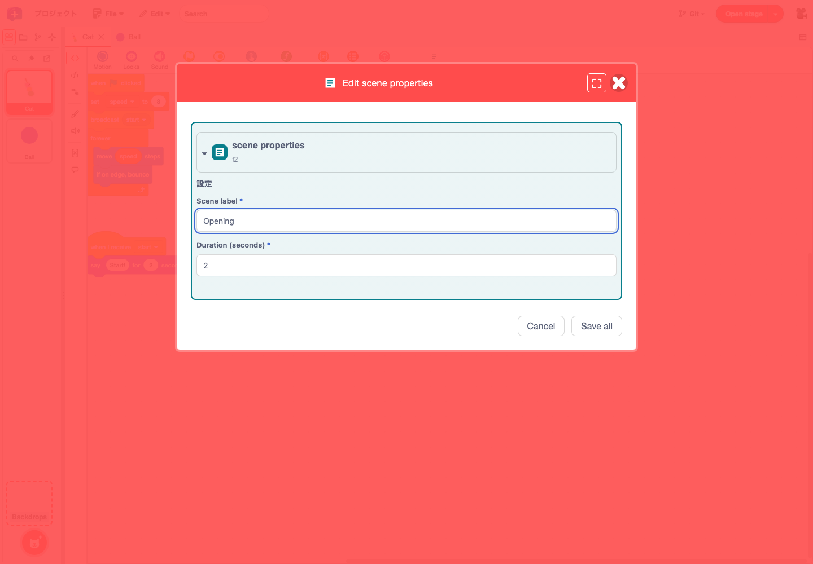

# TurboWarp-Plus-Editor

English | [日本語](README.ja.md)

[](https://kubohiroya.github.io/turbowarp-plus-editor/)

**[Open TurboWarp-Plus-Editor](https://kubohiroya.github.io/turbowarp-plus-editor/?lang=en)**

TurboWarp-Plus-Editor is an editor for Scratch 3 and TurboWarp projects that adds what a long or shared project needs: a workspace you can split and rearrange, project-wide search and replace, a project kept as a folder under Git, a visible check of every extension before it runs, and export to a single HTML file with the project's Plus extensions bundled in. An SB3 from Scratch or TurboWarp opens as it is, and what you save here opens there again.

- Editor: <https://kubohiroya.github.io/turbowarp-plus-editor/editor.html?lang=en>
- Feature guide: <https://kubohiroya.github.io/turbowarp-plus-editor/features/index.en.html>
- Developer guide: <https://kubohiroya.github.io/turbowarp-plus-editor/developer-guide/index.en.html>
- npm: [`@kubohiroya/turbowarp-plus-editor`](https://www.npmjs.com/package/@kubohiroya/turbowarp-plus-editor)
- TurboWarp Plus family (extensions, apps, dashboard): <https://kubohiroya.github.io/turbowarp-plus-packages/>

[](https://kubohiroya.github.io/turbowarp-plus-editor/features/documents/index.en.html#forms)

## Contents

- [What it is for](#what-it-is-for)
- [What Plus adds to standard TurboWarp](#what-plus-adds-to-standard-turbowarp)
- [Opening projects](#opening-projects)
- [“Edit in TurboWarp-Plus-Editor” button](#edit-button)
- [The npm package and its commands](#the-npm-package-and-its-commands)
- [URL switches](#url-switches)
- [How the Editor is built](#how-the-editor-is-built)
- [Development](#development)
- [Documentation](#documentation)
- [License and author](#license-and-author)

## What it is for

- **Keep working on the projects you have.** Nothing has to be ported. [The compatibility list](docs/features/sb3-compatibility.en.md) records what travels in each direction between this Editor, Scratch 3 and TurboWarp.
- **Find your way around a project.** The sprite list stays beside the code and searches by name; the palette is a searchable band across the top whose categories you can reorder; search covers every sprite and the stage and lists where each variable, list and message is used.
- **See how a project fits together.** The icons on the left of each sprite and the stage include **Hats and functions** and **Calls**. **Hats and functions** lists every script by its hat and every custom block definition, and the call graph under **Calls** draws which function calls which, including the global functions of other sprites and the stage. Pick a function or a script there, or choose **Show this function** on a block that calls one, and it opens alone in a real code area beside the sprite, with the palette, zoom and minimap of the main one. Add a function by name — a standard custom block or a TurboWarp Plus named function — from either of them ([guide](https://kubohiroya.github.io/turbowarp-plus-editor/features/sprites/index.en.html#functions)). The variables pane also shows the thread and runtime variables of the temporary-variables extension and the functions that set or read them, and the message diagram shows which hat or function sends each message.
- **Keep long scripts readable.** Collapse a script from its hat's context menu so that only the hat remains; the state is saved in the project and the collapsed body still updates when a function it calls changes. Long text arguments are shortened in the block and edited in a dialog, and the block context menu is grouped by kind of operation ([guide](https://kubohiroya.github.io/turbowarp-plus-editor/features/blocks/index.en.html#context-menu)).
- **Push a long project further.** The workspace is [Dockview](https://dockview.dev/): split panels, open the code and the palette in windows of their own, and get the same arrangement back next time. A minimap, an edit menu with shortcuts, and `.blocks3` / `.stage3` transfer between projects come with it.
- **Keep a project as a folder in Git.** [`sb3-toolchain`](https://www.npmjs.com/package/@kubohiroya/sb3-toolchain) unpacks an SB3 into text and files. The Editor opens that folder directly, saves `project.source.json` back into it, and shows diffs, branches, history and pull requests in its **Local Git** panel — with changes drawn as blocks, not JSON. A remix stays connected to the original as a history you can read and a change you can send back.
- **Work alongside an AI agent.** Because the project is ordinary files, an agent edits it with the file tools it already has; you reload and review the block diff.
- **Go from using extensions to writing them.** See where an extension comes from and on what terms it runs, choose how its code is stored with the project, embed your own, and let `sb3-toolchain` pin and verify it. Extensions are best written in TypeScript against the family packages' typed APIs, with npm libraries bundled in.
- **Treat YAML documents and JSON Schema as part of a project.** A document can be edited as source, as shared YAML blocks, or as blocks its owning extension supplies; a schema gives it a generated form and validation, and VS Code completion through the local companion.
- **Host interactive works and devices.** Extensions register controls into the Editor's menu bar through `@kubohiroya/turbowarp-app-shell`, so camera, AR, QR and Teachable Machine hosts are an extension plus a project, not a fork of the Editor.
- **Start from a story.** [`turbowarp-kamishibai-app`](https://www.npmjs.com/package/@kubohiroya/turbowarp-kamishibai-app) is the way in for children: the story is a document, and branching the next scene is a reason to open a block.

## What Plus adds to standard TurboWarp

| Task | Standard TurboWarp | What Plus adds |
| --- | --- | --- |
| Open a project | Loading an SB3 and confirming extension execution | Load progress, the TurboWarp Plus catalog, loading diagnostics |
| Manage a project | Saving one SB3 file at a time | Reading and writing a project folder, local Git diffs, history and pull requests |
| Arrange the workspace | The basic code, stage and sprite arrangement | Split panels, panels and the palette in separate windows, a stage display menu, layout restoration |
| Understand the structure | Scrolling through the code area | A list of hats and functions, a call graph across sprites and the stage, a function or script opened on its own, where variables and messages are used |
| Edit | Block input fields and menus | Project-wide search and replace, an edit menu, a searchable horizontal palette, a minimap, collapsing scripts, a dialog for long text arguments, and forms and YAML tabs from supporting extensions |
| Reuse | The backpack | Script and stage transfer as files, adding bundled assets |
| Save and hand over | Saving an SB3, the standard Packager | Save and Save As, storage formats for embedded data and extension code, HTML with Plus extensions bundled |

Some of these need a supporting extension or data of their own; the [feature guide](https://kubohiroya.github.io/turbowarp-plus-editor/features/index.en.html) marks which, and walks through each topic with screenshots: the screen, the workspace, sprites, the stage, blocks, search, documents, reuse, saving, project folders and Git, and GitHub.

A few things worth knowing up front:

- **Export** opens the standard TurboWarp Packager for an ordinary SB3 and the Plus output screen for a project that records Plus extensions. Extension code is checked against its recorded hash before it goes into the HTML, and a project with no external dependencies then works offline.
- [Project Properties](https://kubohiroya.github.io/turbowarp-plus-editor/features/save/index.en.html#project-properties) stores the title, description, author and contact in the SB3. [Project Diagnostics](https://kubohiroya.github.io/turbowarp-plus-editor/features/open/index.en.html#project-diagnostics) collects validation, approval, loading and failure records while the Editor page is open.
- Extensions that meet the conditions of the [family catalog](https://kubohiroya.github.io/turbowarp-plus-packages/extensions-v1.json) — matching origin and SHA-256 — run without an individual approval. Anything else asks first, in the Editor and again in exported HTML.

## Opening projects

Open a local SB3 or a project folder from the Editor's **File** menu. To open a project by URL, point `project_url` at an HTTPS SB3 that allows browser fetching, URL-encoded:

```text
https://kubohiroya.github.io/turbowarp-plus-editor/editor.html?lang=en&project_url=https%3A%2F%2Fexample.com%2Fstory.sb3
```

`lang` takes `en` or `ja`. The landing page's edit button forwards `project_url` and any other Editor parameters it was given.

<a id="edit-button"></a>
## “Edit in TurboWarp-Plus-Editor” button

Put a button on your own page that opens a project here. Load the stylesheet once in `<head>`, then place the link:

```html
<link rel="stylesheet"
      href="https://kubohiroya.github.io/turbowarp-plus-editor/assets/edit-button.css">

<a class="twpe-edit-button"
   href="https://kubohiroya.github.io/turbowarp-plus-editor/editor.html?lang=en&amp;project_url=https%3A%2F%2Fexample.com%2Fstory.sb3">
  
  <span>Edit in TurboWarp-Plus-Editor</span>
</a>
```

- Omit `project_url` to start a new project. For Japanese, use `lang=ja` and `TurboWarp-Plus-Editorで編集`.
- For a small button, add `twpe-edit-button--small`, show **Edit** (`編集`) with a 24px image, and set `title` and `aria-label` to the full label.
- The button follows the OS color scheme. Set `<html data-theme="light">` or `dark` to fix it.
- GitHub READMEs cannot load external CSS; there, use a plain link around the icon image and the label.

## The npm package and its commands

```sh
npm install @kubohiroya/turbowarp-plus-editor
```

```ts
import {createEditorURL, renderEditButton} from '@kubohiroya/turbowarp-plus-editor';

const url = createEditorURL({
    language: 'en',
    projectURL: 'https://example.com/story.sb3',
    parameters: {fps: 60}
});
const html = renderEditButton({size: 'small', language: 'en', projectURL: 'https://example.com/story.sb3'});
```

The package ships the brand SVG (`./assets/icon.svg`), the button CSS (`./assets/edit-button.css`), the URL and HTML helpers with TypeScript declarations, the extension loader bootstrap (`./extension-loader`) and the pinned distribution metadata (`./source.json`). The URL helpers reject non-HTTP(S) project URLs and unsupported languages. The Editor itself is built for Pages and is not in the package.

It also installs two commands:

- **`turbowarp-plus-editor-sb3-format`** saves the extensions of an existing SB3 again as `remote-non-cacheable`, `remote-cacheable`, `embedded-file` or `embedded-data`. `remote-cacheable` only permits a browser to keep a verified copy; for an SB3 that runs offline, choose one of the `embedded-*` formats.

  ```sh
  npx --package=@kubohiroya/turbowarp-plus-editor turbowarp-plus-editor-sb3-format --input in.sb3 --output out.sb3 --extensions embedded-file
  ```

- **`turbowarp-plus-editor-yaml`** serves a built Editor locally together with the companion process that lets you edit embedded YAML documents in VS Code. VS Code gets dedicated working files and an isolated settings area, and the first schema-bearing document installs `redhat.vscode-yaml` there without touching your own settings or extensions.

  ```sh
  npx --package=@kubohiroya/turbowarp-plus-editor turbowarp-plus-editor-yaml --site-dir /absolute/path/to/editor/build --data-dir /absolute/path/to/work-files
  ```

## URL switches

Everything below is on by default. Add the parameter to the Editor URL and reload to change it.

| Parameter | Effect |
| --- | --- |
| `twPlusStandardLayout=0` | The previous layout instead of the standard Plus layout |
| `twPlusWorkspaceMinimap=0` | Hide the code-area minimap |
| `twPlusPaletteCategoryReorder=0` | Stop press-and-hold reordering of palette categories |
| `twPlusPaletteDeletePreview=0` | No wastebasket preview when dragging a block onto the palette |
| `twPlusContextMenuIcons=0` | No icons in context menus |
| `twPlusDockview=0` | Open embedded documents in the earlier modal instead of Dockview tabs |
| `twPlusLocalGit=0` | Hide the Local Git panel |
| `twPlusExtensionLoader=0` | Turn off the Plus extension loader and its approval UI |

## How the Editor is built

This repository holds no editor fork of its own. It builds the Editor from pinned upstream sources and from family packages published on npm, and the `scratch-gui` fork only carries the sockets they plug into.

**Pinned sources** ([`site/source.json`](site/source.json)). The build checks out and verifies these by full commit SHA, and stops unless the checkout, the installed packages and the pins agree:

| Source | Role |
| --- | --- |
| [`kubohiroya/scratch-gui`](https://github.com/kubohiroya/scratch-gui) | TurboWarp's GUI with one optional `plusIntegration()` socket object and no files upstream lacks; a plain build gets `null` and behaves like upstream |
| [`kubohiroya/scratch-vm`](https://github.com/kubohiroya/scratch-vm) | The VM, pinned together with the upstream revision it is based on |
| [`TurboWarp/packager`](https://github.com/TurboWarp/packager) | The standard Packager behind **Export** |

**Family packages from npm.** Everything Plus adds comes from `@kubohiroya/*` packages installed at exact versions from npm; no package is vendored as an archive. Those also recorded in `site/source.json` (the data editor, extension loader, document editor and script transfer) are checked against their published version, integrity and source commit.

| Area | Packages |
| --- | --- |
| Editor workbench | `turbowarp-plus-editor-workbench` (layout, sprite tabs, stage and its controls, menus, project dialogs, the backpack), `-windows` (in-page windows, menus, dialog actions, external surfaces and transfers), `-code-views` (code in tabs and windows, the detached palette, script layout, block field editing), `-sprite-panes` (assets, variables, messages, functions and the call graph, properties), `-fonts` (web fonts), `-host` (the host contract the family is written against), `-project-model` (UI-free project reads and edits, project-wide search and replace) |
| Project folders and Git | `turbowarp-plus-editor-project-folder`, `-project-starter` (move a project into a GitHub repository), `-git` (Local Git panel, publishing and repository creation), `-auth` (Git proxy sessions), and `sb3-toolchain` |
| Extensions | `turbowarp-extension-loader` (verified loading), `turbowarp-extension-security-dialog` (review before running), `turbowarp-extension-data-editor` (form editing of extension data), `turbowarp-sb3-save-format` (storage-format vocabulary) |
| Documents | `turbowarp-document-editor`, `turbowarp-document-data`, `turbowarp-document-source`, `turbowarp-structured-data`, `turbowarp-named-data`, `turbowarp-yaml-json` |
| Reuse | `turbowarp-script-transfer` (`.blocks3` / `.stage3`) |

**What lives here.** This repository holds no implementation packages of its own: new features go into family packages, and this repository only pins their versions and wires their entry points into the GUI (see [`AGENTS.md`](AGENTS.md)). That wiring lives in [`site/`](site/).

**Family boundaries.** [`turbowarp-plus-packages`](https://github.com/kubohiroya/turbowarp-plus-packages) owns the extension catalog, the extension names and icons, and the design canon; its [dashboard](https://kubohiroya.github.io/turbowarp-plus-packages/) shows every package's versions and dependencies. This repository consumes the catalog through [`site/plus-catalog.ts`](site/plus-catalog.ts). No package upstream of the Editor fetches, builds or deploys it.

The published `build-info.json` records the versions that were used together, and `notices/family.json` indexes the license and source of every bundled family package. [The socket design](docs/plus-integration-sockets.md) records what remains in the GUI fork (Japanese), and the [developer guide](https://kubohiroya.github.io/turbowarp-plus-editor/developer-guide/index.en.html) explains why Plus uses sockets rather than addons and how to build a new feature into the Editor.

## Development

Use the Node.js version in [`.nvmrc`](.nvmrc) (26). Every source is TypeScript (`.ts`, or `.cts` for CommonJS): Node runs it directly with type stripping, esbuild emits the browser bundles, and `tsc` compiles the npm entry points and declarations into `dist/`.

```sh
npm ci
npm run typecheck
npm test
npm run test:package
```

**Building the site.** Check out the GUI and Packager at the revisions in `site/source.json`, install the GUI's dependencies and run `node scripts/prepublish.mjs` inside the GUI checkout, then build here:

```sh
E2E_GUI_ROOT=/absolute/path/to/pinned/scratch-gui \
TW_PLUS_PACKAGER_ROOT=/absolute/path/to/pinned/packager npm run build:pages
```

For the browser-side Local Git option, also set `TW_PLUS_GIT_BFF_ORIGIN` and `TW_PLUS_GIT_PROXY_ORIGIN` to exact HTTPS origins at build time.

**Tests.** `npm test` and the other `test:*` scripts are unit and integration tests. The Playwright E2E (`npm run test:e2e` with `E2E_GUI_ROOT` set) and the `*.browser.ts` suites run against a built Editor and are run locally during development, not in CI.

**CI and release.** CI runs the typecheck, unit and integration tests, package checks and the site build. With the repository variable `TW_PLUS_CI_SCOPED=1`, a PR runs only the checks its diff needs and `main` reuses checks already passed for the same tree; unreadable diffs fall back to full verification. Pages deploys the artifact of a green `main` run for that exact SHA. npm releases are published through a Trusted Publisher over OIDC from tags that match the package version.

### Local Git and GitHub connection

The Local Git panel never receives a GitHub token. It gets a short-lived Bearer for a proxy that relays only the four Git Smart HTTP routes under `/v1/git/<owner>/<repo>.git/` and checks the caller's origin, the Bearer, the repository recorded at sign-in and the operation on every request; a push also needs a `Git-Push-Id` reserved beforehand.

- **Browser (Cloudflare).** The Editor starts sign-in at the BFF's `/v1/git-auth/start`, opens the GitHub App authorization, and polls `/v1/git-auth/session` with a ticket held only in memory. Tokens stay encrypted in a Durable Object. A sign-in lasts up to eight hours; the proxy Bearer is renewed every five minutes.
- **Desktop.** The main process authenticates and relays Git through a loopback proxy on `127.0.0.1` that accepts only the `tw-editor://.` origin. Tokens stay in the main process, encrypted with the OS keychain when saved. GitHub App device flow, a fine-grained PAT or a Git credential helper can be offered depending on the host. ([Connection methods](docs/features/git/index.en.html#connection-methods))

The GitHub App asks only for Metadata read and Contents read and write, on the repositories where it is installed. Its client ID is not a secret and device flow uses no client secret, so the remaining risk is phishing: enter only codes the Editor itself shows, and revoke access under **Settings → Applications → Authorized GitHub Apps** on GitHub.

To check repository creation and pull-request registration headlessly, build with `TW_PLUS_GIT_BFF_ORIGIN=https://github-create.example.invalid` and `TW_PLUS_GIT_PROXY_ORIGIN=https://github-git.example.invalid`, set `E2E_PROJECT_SAVE_BUILD` to the build output and `E2E_GIT_HTTP_FIXTURE` to the Git package's `test/smart-http-fixture.js`, and run the following. GitHub is simulated, and the Git traffic goes through a local Git CGI.

```sh
node --test --test-concurrency=1 test/project-folder-save.browser.ts test/project-repository-creation.browser.ts test/project-publication.browser.ts
```

To try unpublished dependencies, set the local webpack's `TW_PLUS_PROJECT_SAVE_PREVIEW_ROOT` to the absolute path of a directory whose `node_modules/@kubohiroya/` holds built `sb3-toolchain`, `turbowarp-plus-editor-project-folder`, `turbowarp-plus-editor-project-starter`, `turbowarp-plus-editor-git` and `turbowarp-plus-editor-auth`.

### Embedded documents

Document editing is owned by the packages, not by this repository: `turbowarp-document-editor` provides the dialogs, previews and external-editor bridge; `turbowarp-document-data` the persistence, references and provider registration; `turbowarp-document-source` the hats and shared YAML blocks; `turbowarp-yaml-json`, `turbowarp-named-data` and `turbowarp-structured-data` the parsing, schemas and projections. Each extension that owns documents supplies their validation, schemas and conversions. The Editor embeds no App and shows a document's file icon only when a registered provider owns it.

To add the YAML tools to an existing build (`build:pages` does this already) and serve it with the companion:

```sh
npm run build:yaml-tools -- /absolute/path/to/editor/build
npm run editor:yaml -- --site-dir /absolute/path/to/editor/build --data-dir /absolute/path/to/work-files
```

`npm run test:yaml` covers the build and the CLI. The round-trip checks (`test:yaml:roundtrip`, `test:yaml:multi-document`) drive a real Chrome against a built Editor using `TWPE_YAML_SITE`, `TWPE_YAML_FIXTURE`, `TWPE_YAML_EVIDENCE` and `TWPE_CHROME_EXECUTABLE`; build their fixtures with the scripts in [`scripts/yaml-editor/`](scripts/yaml-editor/). Native VS Code checks use the test-only driver in [`test/vscode-edit-driver/`](test/vscode-edit-driver/) (`npm run build:test-driver`).

## Documentation

Most design documents are in Japanese.

- [Responsibilities and distribution](docs/architecture.md)
- [Integration sockets left in the fork](docs/plus-integration-sockets.md) · [Relocation inventory and build contract](docs/gui-integration/README.md)
- [Extension loader integration](docs/extension-loader-integration.md) · [Embedded / Remote settings in the extension library](docs/extension-authoring-ui.md) · [SB3 save formats](docs/sb3-save-format.md)
- [SB3 compatibility and feature list](docs/features/sb3-compatibility.en.md) (English)
- [Form-based block editor](docs/block-editor.md) · [Embedded document windows](docs/document-window.md)
- [Project properties and diagnostics](docs/project-tools.md) · [Script and stage transfer](docs/script-stage-transfer.md)
- [Checking catalog display locally](docs/local-catalog-preview.md) · [Checking extension security locally](docs/gui-integration/local-security-preview.ja.md)

## License and author

GPL-3.0-or-later, except the edit-button snippet, which is MPL-2.0.

- **MPL-2.0:** `src/index.ts` (`createEditorURL`, `renderEditButton` and their constants; `dist/src/index.*` in the npm package) and `assets/edit-button.css`. Each carries `SPDX-License-Identifier: MPL-2.0`; the text is in [`LICENSE.MPL-2.0`](LICENSE.MPL-2.0). Other sites can use them without taking on GPL-3.0 obligations.
- **GPL-3.0-or-later:** everything else, including the icon, the extension loader bootstrap and the commands; the text is in [`LICENSE`](LICENSE).
- The Editor served on Pages is a GPL-3.0 work. Its `notices/` directory records the license and source of every bundled family package. See also [`NOTICE`](NOTICE).

TurboWarp-Plus-Editor is open-source software in the [TurboWarp Plus Project](https://kubohiroya.github.io/turbowarp-plus-packages/) family by [Hiroya Kubo](https://github.com/kubohiroya), Chiba University of Commerce, Japan.
