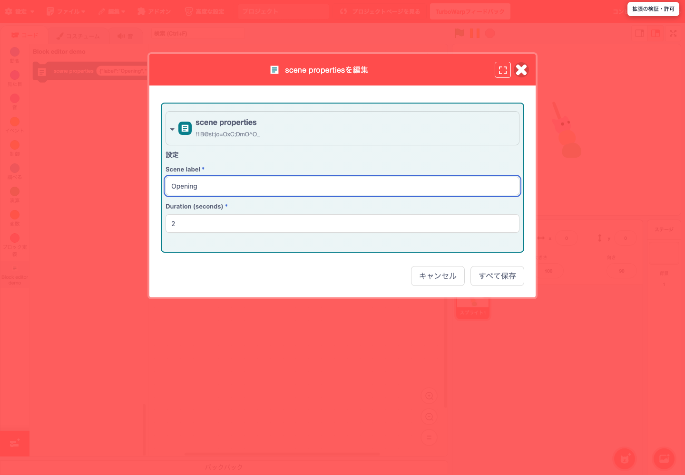

# TurboWarp-Plus-Editor

English | [日本語](README.ja.md)

[](https://kubohiroya.github.io/turbowarp-plus-editor/)

**[Open TurboWarp-Plus-Editor](https://kubohiroya.github.io/turbowarp-plus-editor/?lang=en)**

An editor for building TurboWarp Plus projects, and for editing the Scratch and TurboWarp projects you already have. Arrange and split the panels, put the stage, the sprite list, the palette and code panels in windows of their own, and get that arrangement back the next time you open it. Search a whole project and replace what you select. Keep a project as a folder under Git instead of one SB3 file. Check where every extension comes from and on what terms it runs. Export a single HTML file with the project's Plus extensions bundled in it.

The Editor is built from pinned revisions of kubohiroya's [scratch-gui](https://github.com/kubohiroya/scratch-gui) and [scratch-vm](https://github.com/kubohiroya/scratch-vm) forks and around twenty independently versioned `@kubohiroya/turbowarp-*` packages, and served through GitHub Pages in Japanese and English.

- Site: <https://kubohiroya.github.io/turbowarp-plus-editor/>
- Editor: <https://kubohiroya.github.io/turbowarp-plus-editor/editor.html?lang=en>
- npm: `@kubohiroya/turbowarp-plus-editor`
- Family index and dashboard: <https://kubohiroya.github.io/turbowarp-plus-packages/>

## What this editor is for

**Your existing projects open here.** An SB3 saved by Scratch 3 or by standard TurboWarp opens as it is, and what you make here saves back to an SB3 that those editors read. Nothing has to be rebuilt or ported to move a project in, so this is not a separate world you commit to; it is the same work, in an editor that does more with it. [The compatibility list](docs/features/sb3-compatibility.md) records exactly what travels in each direction.

**Learning where things are.** The route from the sprite list, through the block palette, to running the stage has been straightened out. The sprite list is pinned beside the editing area from startup, finds sprites by name, and grows columns as you widen it. The palette is a wide band across the top: pick a category, search inside it, drag blocks from below it, and press and hold a category to put the categories in the order you want. The stage has its own display menu for full screen, visible and hidden, and the project keeps running while it is hidden. Variables, lists and messages stop being invisible: project-wide search finds them by name and lists every place each one is used, alongside block names, argument values, extension names, comment text and asset names.

**Pushing a long project further.** The whole workspace is Dockview: split a panel left and right or top and bottom, drag the dividers, open the editing panel and the block palette in windows of their own, and get the arrangement back next time. A minimap and zoom controls move you around long scripts. The edit menu carries undo, redo, cut, copy, paste and delete with shortcuts and icons. The custom-block definition dialog is this project's own, with boolean arguments, labels and run-without-screen-refresh. Script and stage transfer moves work between projects as `.blocks3` and `.stage3` files or by copy and paste between windows.

**A project as a folder in Git.** `sb3-toolchain` unpacks an SB3 into project data, assets and individual extensions, and rebuilds the SB3 to distribute from them. In between, the project is text and files that Git can diff, branch, review and merge. The Editor opens such a folder directly and shows the diffs, the branches, the last fifty commits and the pull requests in **File → Local Git…**. This changes what remixing is: Scratch culture is built on taking someone's project apart and making it yours, and until now that meant downloading a binary and losing the thread back to the original. As a folder under Git it stays a history you can read, a diff you can review, and a change you can send back.

**Working with an AI, on a Scratch project.** **File → Open project folder…** reads a project folder and **Save** writes `project.source.json` back into it, next to the local images, sounds and extension code, after checking that the folder has not changed underneath you. That is the whole project as text and ordinary files, so an agent can read and edit it with the file tools it already has — no binary SB3 to decode first, and no screen to drive. You take turns: the agent writes the folder, you reload the project and look. Then you review it the way you would review code. Local Git shows the diff; the pull request view expands a change to `project.source.json` per target and per script, so what you read is the blocks that changed rather than JSON, and blocks from an extension you have not registered are drawn as substitute blocks carrying their names and connections, so a change stays readable without the extension. Embedded YAML documents are plain source with schemas, editable in VS Code through the local companion. Vibe coding for Scratch needs none of this to be special-cased: it follows from the project being files.

**From using extensions to writing them.** Extensions come from the TurboWarp Plus catalog, and before one runs you see where it came from, what it contains and on what terms it executes. You then choose how its code is stored with the project: `remote-non-cacheable`, `remote-cacheable`, `embedded-file` or `embedded-data`, in bulk or one at a time. Past that, your own extension can be embedded in the SB3 as a file and travel with the project. An extension can give its blocks a form through `Scratch.gui.blockEditors.register`, a preview through `registerPreview`, fields it draws itself inside the block, and documents it owns with their own validation and schemas. `sb3-toolchain` then takes it the rest of the way: name, description and sandbox requirement read from the code header, a GitHub commit or npm version pinned, the embedded code's SHA-256 verified, API manifests compared across updates, and several extensions bundled as one composite extension with the original code kept. The path from adding someone's extension to publishing your own is a series of steps, each one visible in the Editor.

**Extensions in TypeScript, with the npm ecosystem behind them.** Writing extensions in TypeScript is the recommended path, and the whole project is built that way: every source here is TypeScript — `.ts`, or `.cts` for CommonJS — run directly by Node's native type stripping in development, emitted as browser JavaScript by esbuild, and compiled with declarations by `tsc` for npm. The family packages publish their own `.d.ts` declarations behind subpath exports, so an extension is written against typed APIs instead of against guesses about the host, and a mistake surfaces in the editor rather than at runtime on someone else's stage. And because an extension is an npm package built with ordinary Node tooling, the npm ecosystem is reachable from inside a Scratch extension: take a parser, a geometry library or a model runtime off npm, bundle it, and let `sb3-toolchain` pin the version and verify the SHA-256 of what you ship. That is a way out of Scratch into the Node.js world, and a way back in.

**YAML documents and JSON Schema as first-class parts of a project.** A project carries documents, not only scripts. A document is YAML or JSON source with a JSON Schema attached by the provider that owns it, and the Editor treats three things as the same document: the source text, shared YAML blocks that represent keys, arrays, values and comments one at a time, and schema-specific blocks that an owning App supplies. Switching representation applies the current edits to source and converts within one save; regeneration from source is refused when it would overwrite block edits that have not been applied. From a schema alone the standard editor generates a form with react-jsonschema-form and validates against it, so an error shows up where it is typed instead of at runtime. In VS Code the local companion writes the owner's schema and its association into a private working area, so completion and diagnostics come from the schema the expert declared — through the official Red Hat YAML extension, without touching their existing settings. `yaml-json`, `named-data`, `structured-data`, `document-data` and `document-source` carry the parsing, the references, the deterministic path operations, the persistence and the provider contracts.

This is what the documents are for: a domain expert — someone who knows the subject rather than the code — declares a schema and writes the document, and the project operates it. Blocks stop being the place where an entire program is typed out and become the place where a domain model is driven, which is a different proposition from blocks as a way to learn to code. [`turbowarp-kamishibai-app`](https://www.npmjs.com/package/@kubohiroya/turbowarp-kamishibai-app) is that taken as far as a product: an AI-assisted interactive storytelling system whose stories are documents, not scripts.

**A host for interactive works and device applications.** The Editor supplies a controls area in its menu bar that capability extensions register into, and shares it through `@kubohiroya/turbowarp-app-shell` so an extension bundled independently reaches the same dock — in a packaged single-HTML player too, where there is no toolbar. The family already uses it: [`camera-source`](https://www.npmjs.com/package/@kubohiroya/turbowarp-camera-source) shares one `MediaDevices` camera stream across extensions, with `camera-calibration` publishing its intrinsics, `ar` holding camera-based target state, `jsqr` reading QR codes including Structured Append sequences, and `teachable-machine` recognising pose, image and audio models. `async-input` handles target-scoped asynchronous keyboard, pointer and accumulated pose input; `bubble`, `svg-text`, `diagnostic-overlay`, `runtime-expression`, `kvs` and `asset-cache` cover speech bubbles with portrait layers, ruby text, SVG diagnostics on the stage, safe condition evaluation, key-value storage and a browser-local asset cache. Nothing in the Editor knows about any particular extension: a camera or sensor host application is an extension plus a project, not a fork of the Editor.

**Where it starts, for a child.** None of the above matters to a ten-year-old until something on the screen is worth making. [`turbowarp-kamishibai-app`](https://www.npmjs.com/package/@kubohiroya/turbowarp-kamishibai-app) is the way in: the story is a document, the pictures and the voices are assets in the project, and a child who wants the next scene to branch has a reason to open a block. After that it is the same project that has a schema, a Git history, a typed extension and a camera attached to it, and the same editor they are already in. The intent is plain: a standard tool for STEAM education, reached through a story rather than through a tutorial.

## What Plus adds to standard TurboWarp

| Task | Standard TurboWarp | What Plus adds |
| --- | --- | --- |
| Open a project | Loading an SB3 and confirming extension execution | Load progress, the TurboWarp Plus catalog, loading diagnostics |
| Manage a project | Saving one SB3 file at a time | Reading and writing a project folder, local Git diffs and history |
| Arrange the workspace | The basic code, stage and sprite arrangement | Splitting panels, panels and the palette in separate windows, a separate stage display, layout restoration |
| Edit | Block input fields and menus | Project-wide search and replace, an edit menu, a searchable horizontal palette, a minimap, and the forms and YAML tabs a supporting extension provides |
| Reuse | The backpack and similar | Script and stage transfer as files, adding bundled assets |
| Save and hand over | Saving an SB3, the standard Packager | Save and Save As, the storage format for embedded data, the storage format for extension code, HTML with Plus extensions bundled |

Some Plus features need a supporting extension or data of their own; the [guide](https://kubohiroya.github.io/turbowarp-plus-editor/features/) marks which.

Project-wide search covers every sprite and the stage, and groups its results by kind: block names, variable and list names, message names, argument values, extension names, comment text, YAML body, and asset names. [Project Properties](https://kubohiroya.github.io/turbowarp-plus-editor/features/#project-properties) stores the title, description, author and contact with timestamps in the SB3, keeping the five most recent author and contact entries and opening email and HTTPS links. [Project Diagnostics](https://kubohiroya.github.io/turbowarp-plus-editor/features/#project-diagnostics) collects validation, execution-approval, loading, retry and failure records for when a project will not open; those records last only while the Editor page stays open. Both are on ordinary Editor URLs, with no supporting extension or activation option required.

**Export** packages a project for distribution: an ordinary Scratch 3 or TurboWarp SB3 opens the standard TurboWarp Packager, while a project that records Plus extensions opens the Plus output screen instead. Extension code served over HTTPS is checked against its recorded hash before it goes into the HTML, sandbox requirements are preserved, and catalog extensions that meet the trust conditions run against the bundled hash. A project with no external dependencies then works offline.

The [illustrated feature guide (Japanese)](https://kubohiroya.github.io/turbowarp-plus-editor/features/) walks through all of this in eleven topic pages with real screenshots, workflow diagrams, the comparison table, availability conditions, and saving and compatibility details.

[](https://kubohiroya.github.io/turbowarp-plus-editor/features/documents/#forms)

## Editor layout

In the standard TurboWarp Plus layout, the sprite list is pinned to the left of the editing area at startup. Unpin it and the list opens when you move the pointer to the left edge. The search icon finds sprites by name. While the list is pinned, dragging the divider adds columns as the width allows. The undock button in the action column moves the list and the backdrop tiles into a separate window. Pick a category in the wide palette at the top centre and drag blocks from below it.

The **Stage display** menu at the top right of the stage switches between full screen, visible, and hidden. The project keeps running while the stage is hidden. With free placement enabled, the layout menu can show undock buttons.

To start with the previous layout, add `twPlusStandardLayout=0` to the Editor URL and reload.

In the standard layout, the code area shows a minimap above the zoom out, zoom in, and reset buttons at the bottom right. Click it or drag the viewport frame to move. To hide it, add `twPlusWorkspaceMinimap=0` to the Editor URL and reload.

Press and hold a category icon to reorder categories in either the vertical or the horizontal palette. Releasing over another position commits the move, and releasing outside the palette cancels it. To disable reordering, add `twPlusPaletteCategoryReorder=0` and reload.

The context menus of the sprite and asset lists, of blocks, and of the code area show an icon next to each action name. To disable the icons, add `twPlusContextMenuIcons=0` to the Editor URL and reload.

Dragging a block from the code area far enough into the palette blurs the palette and shows a wastebasket at its centre. In the horizontal palette it also appears on the category band while the block list is closed. To disable the preview, add `twPlusPaletteDeletePreview=0` and reload. To check the rollback, delete a block by dropping it on the palette and confirm that Undo restores it.

**Panels and windows.** The workspace is a Dockview arrangement: drag a divider to resize, split a panel left and right or top and bottom, and the arrangement comes back the next time you open the Editor. In the public build the editing panel and the block palette open in a window of their own. Development builds go further and are verified there: several code views side by side, the stage, the sprite list and the sprite properties form each in a window, and costume, sound and variable views that keep their selection while you edit. A child window runs its own ScratchBlocks against the parent's single VM over a `MessagePort` and holds no VM, Node, preload or opener itself. It takes the edit ownership of one target at a time, with Undo and Redo history kept per target, so what is committed is still what the VM saves into the SB3. The same panel hosts work inside the Desktop application.

**Editing.** The custom-block definition dialog is this project's own: add number or text arguments, boolean arguments and labels, and set run-without-screen-refresh, in Japanese or English. The edit menu carries undo, redo, cut, copy, paste and delete with their shortcuts and icons. Where an extension supplies them, a block can also carry a field drawn by the extension itself, and the nested blocks of a supported block can be edited in place.

## Project folders, Git and sb3-toolchain

A project does not have to live as a single SB3 file. `sb3-toolchain` is a local Node.js tool: `import` unpacks an SB3 into project data, assets and individual embedded extensions so Git can see what changed, `check` validates the unpacked data, and `build` produces the SB3 to distribute. An unpacked project folder can also be opened and edited directly in the Editor (a prototype at present). Bundling reads the name, description and sandbox requirement from each extension's code header, pins a GitHub commit or an npm version, verifies the SHA-256 of the code it embeds, and can compare API manifests across updates. Several extensions can be embedded as one composite extension while their original code is kept, and execution is then approved for the composite as a whole. In the public Editor, extensions that meet the conditions of the [TurboWarp Plus family catalog](https://kubohiroya.github.io/turbowarp-plus-packages/extensions-v1.json), which `turbowarp-plus-packages` publishes, are treated as trusted: the Editor matches the recorded origin and the code's SHA-256 and skips the individual approval screen.

**File → Local Git…** opens a repository by its root and shows staged, unstaged and untracked changes separately, changes to the project data (`project.source.json`) as blocks by stage, sprite and script, in frames that zoom and scroll together like the code area (switch to **Text** for the line diff), text diffs for other files and sizes for binary assets, the current branch, HEAD, the local branches and the last fifty commits, with the diff against the first parent for a selected commit. Pick an `sb3-toolchain` v1 project folder below the root and the list narrows to that folder and is arranged by stage and sprite into code, costumes, sounds, variables and other settings, with assets shown by name and thumbnail (the list by file stays available); **Open this project** loads it into the Editor. The panel never writes to Git. After working on the command line, use **Refresh**; **Reload project** confirms unsaved Editor edits first. Where a connection is configured, the **GitHub connection** area does a fetch, a fast-forward-only pull, and an explicitly permitted push against the HTTPS `origin` remote. This needs a Chromium-based browser with File System Access; linked worktrees, submodules and symbolic links are out of scope, and executable-bit changes in the working tree cannot be seen from the browser. Add `twPlusLocalGit=0` to the startup URL to remove the panel.

**Reviewing the changes in a public PR**: open **Pull requests** at the top of the same panel. In a working folder whose `origin` is GitHub, pick a PR from the list or by number. The PR body and its changed files are shown, and changes to `project.source.json` can be expanded per target and per script. The comparison uses the PR's merge base and head. Communication with GitHub is read-only through the public API, and the reviewed marks last only while the panel stays open; the public API rate limits apply. Unregistered extension blocks are shown as substitute blocks that convey their names and connections, and extension code is never fetched or run.

## Packages, the fork and the build

The Editor is assembled from independently versioned packages, not from patches carried in a fork. Around twenty `@kubohiroya/turbowarp-*` packages hold the implementation, each with its own version, tests and release:

```text
yaml-json · named-data · structured-data · document-data · document-source · document-editor ┐
extension-data-editor · extension-loader · extension-security-dialog · sb3-save-format       ├→ turbowarp-plus-editor → GitHub Pages
editor-layout · editor-ui · editor-views · editor-surfaces · editor-transfer · editor-backpack│
plus-editor-git · plus-editor-auth · plus-editor-project-folder · script-transfer             ┘
         scratch-gui fork · scratch-vm fork · @turbowarp/packager (all pinned by revision) ───┘
```

No package upstream of this one fetches, builds or deploys anything downstream of it. The `scratch-gui` fork now carries **no files that upstream TurboWarp does not have**: the thirty-two added modules, tools, documents and tests were relocated into this repository, and what remains is reached through one optional object, `plusIntegration()`, whose named sockets carry extension hosting, modals, theme tokens, translations, block shapes, workspace attachment, key handling, project-state reduction, stage and camera controls, the extension library, the GUI extension API and addons. A plain GUI build gets `null` from that getter and behaves exactly like upstream. [The socket design](docs/plus-integration-sockets.md) records the measured diff, every remaining modification and where each one goes; [the relocation inventory](docs/gui-integration/README.md) records the move and its build contract.

[`site/source.json`](site/source.json) pins the GUI, VM, data-editor core, extension loader, Packager and document-editor by forty-hex revision, and the security dialog and core by exact npm version. The build refuses to proceed unless the checkout, the installed packages and the pins all agree. The published `build-info.json` records the GUI, VM, library and site versions that were actually used together, and `notices/family.json` indexes the license text and source location of every bundled family package. The former data-editor Pages site is being retired; this site replaces it.

Verification is part of the distribution rather than a step after it. Regular CI runs the unit tests, the integration groundwork, the pinned-GUI connection tests, the build and the relocated GUI E2E; nineteen browser E2E specs, twenty-four in CI with the fixed-input profile. Pages deploys only the artifact of a fully green run on `main` for that exact SHA, re-verifying the pinned identifiers rather than rebuilding, and runs seven checks against the published site afterwards. npm publishes through a Trusted Publisher over OIDC, with no token held in the workflow, and stops if an existing version differs by a single byte.

Where this repository sits in the family is a division of ownership, not a hierarchy. [`turbowarp-plus-packages`](https://github.com/kubohiroya/turbowarp-plus-packages) is the index and dashboard for the whole family — seventy-odd repositories in thirteen categories, with their dependency graphs, demos, open issues and release freshness on [one page](https://kubohiroya.github.io/turbowarp-plus-packages/) — and it owns three things this repository deliberately does not: the official extension catalog it publishes as [`extensions-v1.json`](https://kubohiroya.github.io/turbowarp-plus-packages/extensions-v1.json) (each entry naming the npm package, the version, a jsDelivr URL, a SHA-256, a category and whether it needs to run unsandboxed), the extension display names and icons under `assets/extension-icons/`, and the design canon in its `docs/editor-architecture.ja.md`, which the documents here cite rather than restate.

This repository is the Editor, and a consumer of all three. [`site/plus-catalog.ts`](site/plus-catalog.ts) fetches that catalog at the pinned URL and the Editor verifies an extension's origin and SHA-256 against it before skipping an individual approval; the GUI holds no name-mapping logic of its own. The link runs the other way too: the family page's demos open in this Editor through the edit button described below, so a package there is one click from being edited here.

The landing page loads the shared `turbowarp-plus-site-header`. The Editor itself displays the GUI across the full screen.

## Opening projects

Choose **Edit in TurboWarp-Plus-Editor** on the landing page to open the Editor. Open a local SB3 file from the Editor’s **File** menu. To open a URL, provide an HTTPS SB3 file that allows browser fetching.

```text
https://kubohiroya.github.io/turbowarp-plus-editor/editor.html?lang=en&project_url=https%3A%2F%2Fexample.com%2Fstory.sb3
```

URL-encode `project_url`. Both `lang=ja` and `lang=en` are supported. The edit button forwards the project URL and other Editor parameters supplied to the landing page.

<a id="edit-button"></a>
## “Edit in TurboWarp-Plus-Editor” button

The edit icon is a brand variant of the existing blue TurboWarp Plus base, drawn over with a blue pencil. Display the action label alongside the image and use a keyboard-focusable link. The shared CSS provides a minimum height of 56px, a 36px image, and a visible focus indicator.

Load the stylesheet once in the page’s `<head>`, then place the following link where you want the button:

```html
<link rel="stylesheet"
      href="https://kubohiroya.github.io/turbowarp-plus-editor/assets/edit-button.css">

<a class="twpe-edit-button"
   href="https://kubohiroya.github.io/turbowarp-plus-editor/editor.html?lang=en&amp;project_url=https%3A%2F%2Fexample.com%2Fstory.sb3">
  
  <span>Edit in TurboWarp-Plus-Editor</span>
</a>
```

Omit `project_url` to create a new project. For Japanese, use `lang=ja` and `TurboWarp-Plus-Editorで編集`.

The regular button shows the icon and action label. For a small button, add `twpe-edit-button--small`, use **Edit** as the visible text, and set both `title` and `aria-label` to **Edit in TurboWarp-Plus-Editor**. The Japanese equivalents are `編集` and `TurboWarp-Plus-Editorで編集`. The `title` supplies the hover tooltip.

```html
<a class="twpe-edit-button twpe-edit-button--small"
   href="https://kubohiroya.github.io/turbowarp-plus-editor/editor.html?lang=en"
   title="Edit in TurboWarp-Plus-Editor" aria-label="Edit in TurboWarp-Plus-Editor">
  
  <span>Edit</span>
</a>
```

Both sizes follow the OS color scheme by default (`auto`). Set `<html data-theme="light">` or `dark` to fix the theme; use `auto` or remove the attribute to restore automatic selection. To generate a button in code, use `renderEditButton({size: 'small', language: 'en', projectURL: 'https://example.com/story.sb3'})`. The default size is regular.

GitHub READMEs cannot apply external CSS. Use an image link instead:

```html
<a href="https://kubohiroya.github.io/turbowarp-plus-editor/editor.html?lang=en">
   Edit in TurboWarp-Plus-Editor
</a>
```

The TurboWarp Plus extension catalog is available on ordinary Editor URLs. To use the legacy catalog path, reload with `twPlusExtensionLoader=0&twPlusExtensions=1`. Other GUI feature flags remain unchanged, and the button preserves supplied parameters.

The extension loader from Issue #4 consists of an independent loader core and thin GUI/VM adapters. In the regular distribution, the Embedded/Remote validation and permission UI is enabled on ordinary launch URLs without a feature flag (fixed at startup, on by default). The Packager action for Plus projects opens the local output screen. Extensions listed in the catalog run without confirmation, as in the Editor; only extensions outside the catalog need approval, both when generating the HTML and every time the generated HTML is opened. Reload with `twPlusExtensionLoader=0` to disable it. Explicit `=1` remains supported; invalid values disable it. See the [integration specification](docs/extension-loader-integration.md) for configuration, validation, Desktop limitations, and rollback.

See the [Issue #11 authoring guide](docs/extension-authoring-ui.md) for bulk and individual Embedded/Remote settings in the extension catalog. This UI is on by default for ordinary launches; reload with `twPlusExtensionLoader=0` to turn it off. "Custom Extension" is the same screen as in TurboWarp and does not go through the loader.

## Using the npm package

```sh
npm install @kubohiroya/turbowarp-plus-editor
```

```ts
import {createEditorURL, renderEditButton} from '@kubohiroya/turbowarp-plus-editor';

const url = createEditorURL({
    language: 'en',
    projectURL: 'https://example.com/story.sb3',
    parameters: {fps: 60}
});
const html = renderEditButton({language: 'en', projectURL: 'https://example.com/story.sb3'});
```

The package includes the brand SVG, button CSS, URL/HTML helpers, and pinned distribution metadata. It ships compiled JavaScript and TypeScript declarations. The large GUI output is built for Pages from the pins rather than included in npm. URL helpers reject project URLs outside HTTP(S) and unsupported languages.

## Development and deployment

Implementation files, tools, documentation and tests that do not exist upstream in scratch-gui are collected in this repository. See the [relocation inventory and build contract](docs/gui-integration/README.md).

Use Node.js 26. All maintained JavaScript sources, build scripts, configurations, and tests are authored in TypeScript (`.ts`, or `.cts` for CommonJS). Node.js runs development scripts directly with native type stripping. Browser modules are emitted as JavaScript with esbuild, and npm entry points and declarations are compiled into `dist/` with TypeScript.

```sh
TWEXTSEC_SOURCE_REVISION=$(node -p "require('./site/source.json').securityRevision || ''") npm ci
npm run typecheck
npm run build
npm test
npm run test:package
E2E_GUI_ROOT=/absolute/path/to/pinned/scratch-gui \
TW_PLUS_PACKAGER_ROOT=/absolute/path/to/pinned/packager npm run build:pages
E2E_GUI_ROOT=/absolute/path/to/pinned/scratch-gui npm run test:e2e
```

The review dialog is a Git dependency whose build reads its own revision, and npm installs it from an archive with no history to read it from — so a plain `npm ci` stops there. The pin is what it asks for, which is why the install carries it; this is the form the workflows use.

To check the minimap alone, build first and then run `npm run test:e2e -- workspace-minimap.spec.cts` with `E2E_GUI_ROOT` set. It covers the default display, hiding it from the URL, and moving by click and drag.

`npm run build` produces the npm JavaScript and declarations; `npm pack` runs it automatically. `npm run build:test-driver` compiles the optional VSCode test extension before native VSCode checks.

Check out the GUI and Packager SHAs recorded in `site/source.json`. Install the GUI dependencies and prepare that upstream checkout with `node scripts/prepublish.mjs`. The build verifies the GUI SHA, installed data-editor SHA, and security-dialog version against the pins. Pages deploys from main after successful integration checks. Release tags must match the npm version.

For the Cloudflare option in the Local Git panel, set both `TW_PLUS_GIT_BFF_ORIGIN` and `TW_PLUS_GIT_PROXY_ORIGIN` to exact HTTPS origins at build time. The Desktop local option is available when the host exposes `EditorPreload.localGit`. Use `twPlusLocalGit=0` to hide the Git panel at startup.

This repository verifies the integrated Editor. Existing upstream unit tests and GUI feature flags are preserved. After verifying the new distribution, migrate references and stop the former data-editor Pages site without leaving a redirect deployment. To roll back, revert to the previous GUI pin and site changes, then redeploy the previous artifact. To undo the TypeScript migration, revert its changes and restore the previous JavaScript sources and package configuration.

### CI verification scope

While the repository variable `TW_PLUS_CI_SCOPED` is unset, the previous verification runs in full. Set it to `1` and an ordinary PR runs the items that match its diff, while `main` reuses the items that already passed in a PR CI run with the same Git tree and verification contract. When the diff or the evidence cannot be read, it falls back to full verification. Artifacts for Pages are always built from the `main` revision.

To return to the previous verification, unset the variable or set it to `0`. Before a stable release, run full verification against the commit the tag points at.

## Editing embedded documents (0.2.0-rc.1)

This feature tracks [Issue #3](https://github.com/kubohiroya/turbowarp-plus-editor/issues/3) and [shared-package Issue #6](https://github.com/kubohiroya/turbowarp-plus-editor/issues/6). It has no startup switch: a hat gets its file icon only when a registered provider owns its document, so a project without such a provider looks like upstream TurboWarp. To edit in VSCode, install Visual Studio Code and Node.js, then open the Editor through the local companion process. The shared `@kubohiroya/turbowarp-document-editor` package owns the editing UI and external-editor bridge, and the scratch-gui fork embeds it directly. This distribution pins, builds, and serves the GUI. `@kubohiroya/turbowarp-document-data` owns source persistence, document references, and provider registration; the independent `@kubohiroya/turbowarp-document-source` package owns hats, YAML icons, and shared YAML blocks. Extensions register documents, and the shared UI delegates validation and document updates to their owners. The GUI handles standard SB3 file saving.

Providers live in the extensions that own their documents and use those extensions’ own validation APIs and schemas. The Editor’s browser code embeds no App or App parser, and the Editor has no App among its dependencies. Each App documents which of its projects are supported and how to migrate older ones.

Add the tools to a prepared Editor build and start it locally. A new `build:pages` build performs the same addition automatically.

```sh
npm ci --ignore-scripts
npm run build:yaml-tools -- /absolute/path/to/editor/build
npm run editor:yaml -- --site-dir /absolute/path/to/editor/build --data-dir /absolute/path/to/work-files
```

VSCode integration requires the local companion serving a built Editor. It can also be launched from npm:

```sh
npx --package=@kubohiroya/turbowarp-plus-editor@0.2.0-rc.1 turbowarp-plus-editor-yaml --site-dir /absolute/path/to/editor/build --data-dir /absolute/path/to/work-files
```

GitHub Pages supports document display, conversion, and validation. Launching VSCode is available when opening the local URL above.

Embedded YAML opens in the same Dockview workspace as code and the stage by default in the Web Editor. Drafts survive tab moves and splits, and closing a tab with a draft offers save, discard, and cancel. To return to the previous layout and document modal, save the document and SB3, then reopen the Editor with `twPlusDockview=0` in the URL.

1. Open an SB3 containing an embedded document and select the file icon on its **Data source** hat. In the YAML text tab of the document dialog, choose **Edit in external editor**.
2. Edit the YAML and save it in VSCode.
3. Return to the Editor and choose **Convert, validate and save the displayed format** at the lower right. It reads the saved VSCode working copy, validates its format, asset references, and project identity, and applies the document and consistency metadata in the Editor.
4. Save the SB3 using the Editor’s standard **File** menu or **Save to your computer**. Saving in the document dialog does not download a file. Image and audio storage remains unchanged.

The hat is the entry point to embedded YAML. Its dropdown shows the filename, while the SB3 stores a provider ID and document ID reference rather than duplicating the script text in a block argument. IDs distinguish documents even when filenames match. In the document modal, save or cancel the current edit before switching documents. The owning provider handles retrieval, validation, and updates. Supported SB3s contain hats added by their owning extension. The Editor does not automatically inject unknown blocks or extension code into older hatless SB3s. When a provider registers conversion capabilities, the document editor can convert between source files, shared YAML blocks, and schema-specific blocks.

Providers may attach `schema: {id, schema}` to each document. Local integration writes the owner’s schema and associations to the working directory without inserting configuration comments into the YAML. The first opening of a document with a schema downloads the official Red Hat YAML extension, `redhat.vscode-yaml@2.0.0`, into a private extensions directory. Existing VSCode settings and extensions remain unchanged. The initial download requires network access. Documents without schemas continue to use owner validation when importing.

VSCode completion and diagnostics use [Red Hat YAML schema associations](https://github.com/redhat-developer/vscode-yaml#associating-schemas). An owner may supply an authoring schema for its source; import also runs the owner’s own validation.

The companion accepts only authenticated operations from its local Editor. VSCode receives dedicated working files and an isolated settings area, preserving existing windows, settings, and extensions. Saved working files remain after sessions close or the process stops. The web interface cannot specify executable commands or arbitrary local paths.

Invalid YAML and project switches do not overwrite the previous content. Drafts that could not be applied remain in VSCode’s working files. **X** and **Cancel** discard dialog candidates and close without changing the Editor or deleting working files. New asset references in a document must validate against the project’s existing asset set.

If a storage path exceeds macOS IPC path limits, only the VSCode settings area moves automatically into a short private directory; working files stay in place. The working area’s `host.json` records the actual locations.

To roll back, revert the integration commit and redeploy, or restore the previous verified version. Stopping the companion preserves working files.

Relevant checks:

```sh
npm run test:yaml
# Build the test-only fixtures from any SB3 that contains assets
# (CI generates one with `node test/fixtures/yaml-editor/base-project.ts /absolute/path/to/base.sb3`).
node scripts/yaml-editor/build-settings-fixture.ts /absolute/path/to/base.sb3 /absolute/path/to/settings.sb3
node scripts/yaml-editor/build-document-source-fixture.ts /absolute/path/to/base.sb3 /absolute/path/to/document-source.sb3
TWPE_YAML_SITE=/absolute/path/to/editor/build \
TWPE_YAML_FIXTURE=/absolute/path/to/settings.sb3 \
TWPE_YAML_EVIDENCE=/absolute/path/to/evidence \
TWPE_CHROME_EXECUTABLE='/Applications/Google Chrome.app/Contents/MacOS/Google Chrome' \
npm run test:yaml:roundtrip
# The same variables also check the two-document settings fixture.
npm run test:yaml:multi-document
# Representation previews use the document-source fixture with the same variables.
node --test test/representation-preview.browser.ts
```

Source previews, cancellation, saving, fresh retrieval and conversion to an embedded file are tested in `@kubohiroya/turbowarp-document-editor` with its own test provider. This repository checks that they reach the built Editor: `test/e2e/turbowarp/document-source.spec.cts` opens the `twpeyamlsettings` fixture without any URL switch and expects the source controls, a preview that fetches only when asked, and a save; setting the removed URL switches to `0` changes nothing. `document-refusal.spec.cts` opens a hat whose provider is not registered and a document its owner refuses, expecting the unavailable message and no project change. Both run in `npm run test:e2e` against the built Editor.

SB3 round-trip browser regressions inject only the native launcher and exercise the real GUI, VM, and SB3. CI runs `test:yaml:roundtrip` and `test:yaml:multi-document` against the built Editor and keeps their screenshots and `result.json` under `test-results/yaml-roundtrip/` and `test-results/yaml-multi-document/` in the `integration-evidence-*` artifact. Native VSCode checks use the test-only Extension Development Host in `test/vscode-edit-driver/`, saving working YAML through VSCode’s own document-editing and saving APIs. The normal companion does not require this driver.

### Source, shared YAML blocks, and schema-specific blocks

Source files, shared YAML blocks representing keys/arrays/values/comments, and schema-specific blocks supplied by an owning App are three representations of the same document. Source is the reference for meaning and conversion, while block edits are retained in Editor state. Switching to another block representation applies the current edits to source before converting, within one save operation. Selecting a conversion target alone does not change the project. The initial tab is the currently stored representation; the label above the preview identifies it with 💽. Saving another tab asks for confirmation; **OK** validates, converts, and applies it to the Editor. **Cancel** returns to the dialog with the selection retained. **X** and **Cancel** perform the same cancellation. Regeneration from source is rejected when it would overwrite unapplied block edits.

Each tab previews its format: text for source, read-only ScratchBlocks for block representations. Viewing does not change the project. Preview blocks cannot be moved or edited, but scrolling and zooming are available. 💽 identifies the representation currently stored in the Editor, not a downloaded SB3 file.

Shared YAML blocks represent comments one line at a time and multiline strings as line and line-break-kind blocks, avoiding newline loss in standard text fields. Unedited source preserves line breaks, quotes, and comments. The owner and YAML library determine formatting for edited content. JSON does not allow comments.

- `turbowarp-yaml-json`: YAML/JSON parsing and serialization, source syntax, and schema validation.
- `turbowarp-document-data`: Source, schemas, document references, provider registration, and SB3 persistence.
- `turbowarp-structured-data`: Temporary projections from source into runtime values, without rewriting source.
- `turbowarp-document-source`: Shared hats and blocks, conversion candidates, and application contracts.
- Each App: DSL-specific validation, schema-specific block conversion, and runtime-data regeneration.
- `turbowarp-document-editor`: Dialogs, external-editor integration, previews, and document-save operations.
- The scratch-gui fork: Shared UI mounting, VM/Blockly integration, and standard SB3 file saving.
- TurboWarp-Plus-Editor: GUI pinning, builds, and distribution.

`turbowarp-document-data` source documents support YAML and JSON while preserving existing HTML/Markdown APIs. YAML/JSON detection is also added to the lower-level `turbowarp-named-data` package. The limited schema interpretation for structured data remains a separate contract from complete JSON Schema document validation.

Document persistence, projections, and representation conversion have no startup switch; they are available for documents a registered provider owns. Owners supply each document’s conversion capabilities; unsupported extensions do not acquire conversion automatically. If an older block script has no stored original module YAML, conversion does not claim to restore the original file and its comments.

**View guide** opens the provider’s website in another tab. There is no separate validation button: **Convert, validate and save the displayed format** validates and applies the displayed format. VSCode actions are disabled while block edits await application to source. JSON source uses VSCode’s standard JSON support and schema associations.

## Rewriting how extensions are saved

A helper CLI saves the extensions of a built SB3 again as `remote-non-cacheable`, `remote-cacheable`, `embedded-file` or `embedded-data`. The vocabulary and the writer come from `@kubohiroya/turbowarp-sb3-save-format` and its `./writer`; reading and writing the ZIP, and the defaults (no extension is requested unsandboxed unless named), stay here. `--extensions` takes the security dialog's `ReviewDecision.loading` as it is; the old spellings `embedded`, `remote` and `cached` are refused.

```bash
npx --package=@kubohiroya/turbowarp-plus-editor turbowarp-plus-editor-sb3-format --input in.sb3 --output out.sb3 --extensions embedded-file
```

`remote-cacheable` only records that the opener's browser may keep a verified copy. The CLI cannot write, read or check that copy (IndexedDB), so it is no reason the saved SB3 runs offline; choose `embedded-file` or `embedded-data` for that.

## License and author

License: GPL-3.0-or-later, except the edit-button snippet, which is MPL-2.0. See the individual licenses and NOTICE files for the integrated GUI and bundled components.

- The MPL-2.0 part is `src/index.ts`, which builds the Editor URL and the edit-button HTML (`createEditorURL`, `renderEditButton` and their constants; `dist/src/index.js` and `dist/src/index.d.ts` in the npm package), and the button stylesheet `assets/edit-button.css`. Each file carries `SPDX-License-Identifier: MPL-2.0`; the full text is in [`LICENSE.MPL-2.0`](LICENSE.MPL-2.0). Other sites can load it from their JavaScript without taking on GPL-3.0 obligations.
- Everything else, including the icon (`assets/icon.svg`), the extension loader bootstrap (`./extension-loader`) and the YAML editing command, is GPL-3.0-or-later; the full text is in [`LICENSE`](LICENSE).
- The Editor served on Pages is a GPL-3.0 work. Its `notices/` directory records the license text and source location (npm and GitHub) of every bundled turbowarp-plus family package, indexed by `notices/family.json`.

Author: [Hiroya Kubo](https://github.com/kubohiroya)

## Block icon previews

The integrated data editor provides the optional `Scratch.gui.blockEditors.registerPreview` API, documented in `docs/block-preview.md` of `@kubohiroya/turbowarp-extension-data-editor`. An extension registers previews for its own blocks. A preview shares the existing form’s draft, and the form’s Save remains the only persistence path, so one save is one undo step. `Scratch.gui.createPreviewVm()` creates an isolated VM that cannot load extensions.

Extensions own their previews and any switch that enables them. The Editor ships no previews or preview samples of its own. `test/e2e/turbowarp/block-icon-preview.spec.cts` verifies this host contract with a test-only extension.

## Local data-source migration candidate

Documents whose provider marks their source location as editable offer **File inside SB3** and **External URL** source choices; there is no flag for them. Source location is separate from the YAML text, YAML blocks, and schema-specific block representations. Document names and references are preserved. The generic label is **Data source**; a provider may supply its own label.

After changing the source location, fetch and preview it, then save to apply the same validated candidate. Cancel leaves the project unchanged. External sources must use browser-accessible HTTPS URLs with CORS support. To edit or convert external content into blocks, first import it by switching to **File inside SB3** and saving. External sites are never written back to. Fetching URL content again at runtime is the provider’s responsibility, and a provider must not silently fall back to stale cached data on failure.

There is no startup switch; the provider decides per document. To roll back, revert the integration commit and use the original SB3. These dependencies identify migration candidates; updating published references or publishing new packages/repositories is separate work.

This candidate includes the preceding UI changes: preventing preview overlays, showing the stored format within the tab, a floating external-editor button, and guide/schema links.


## Script and stage transfer

`.blocks3` script export/import, copying and pasting scripts between windows, and `.stage3` stage export/import are always available. No startup option is needed, and there is no flag to turn them off. Importing a stage adds its contents to the current stage. See the [transfer specification (Japanese)](docs/script-stage-transfer.md) for operations, dependency handling, limits, and rollback instructions.
