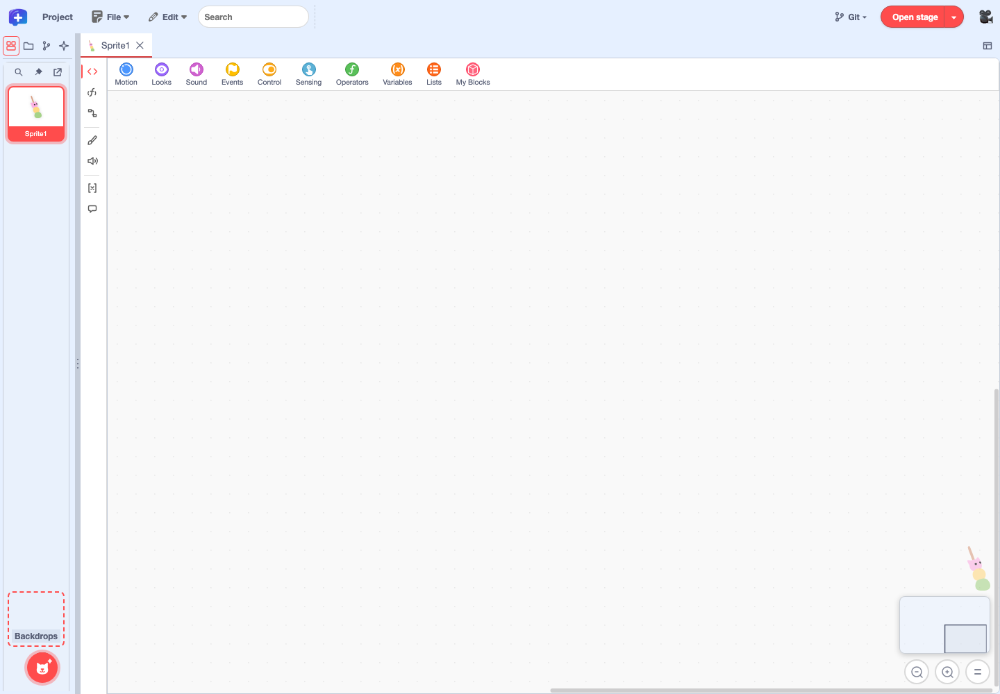
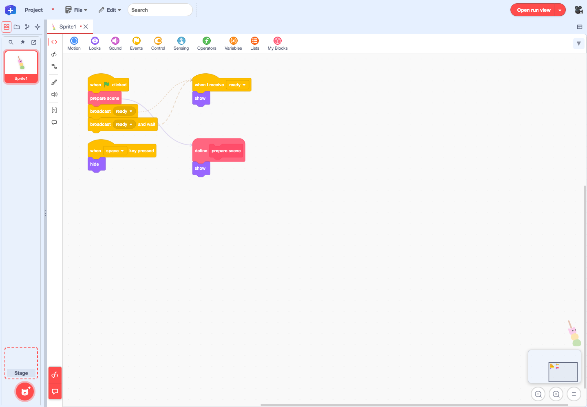
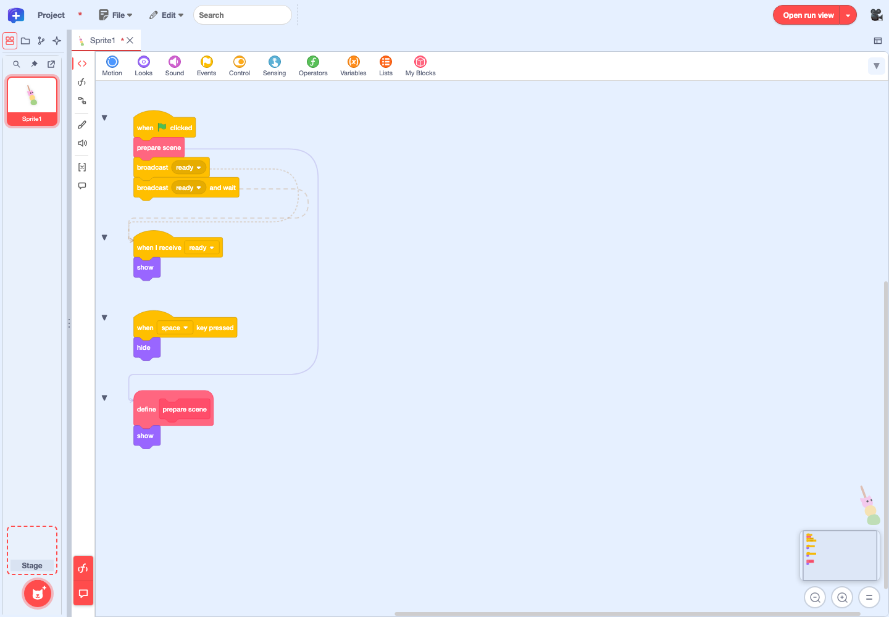
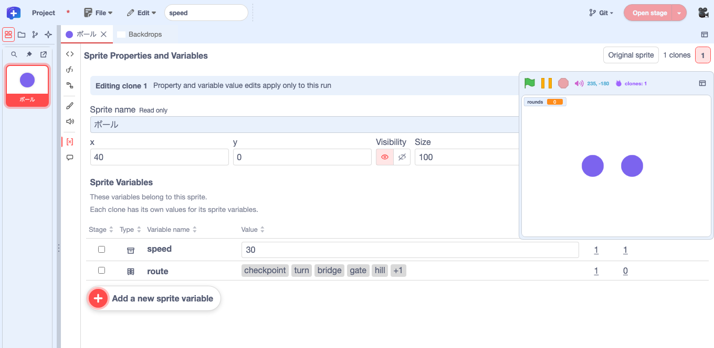
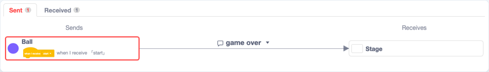
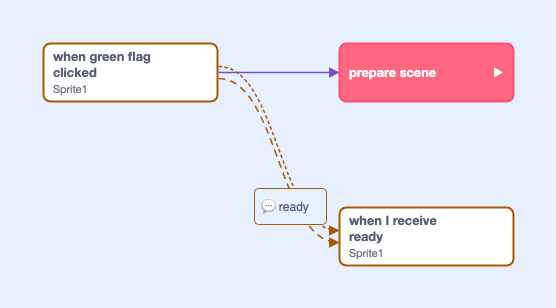
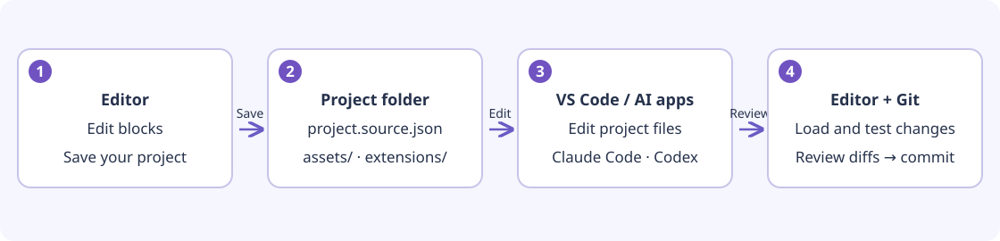
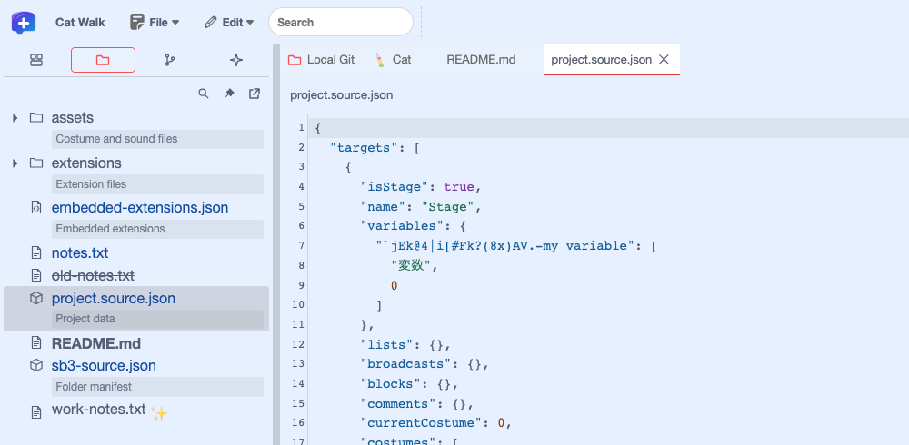
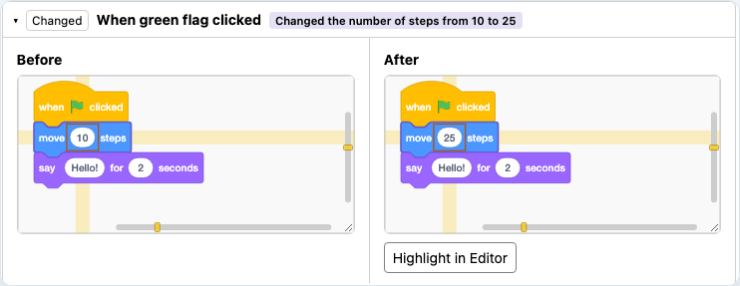
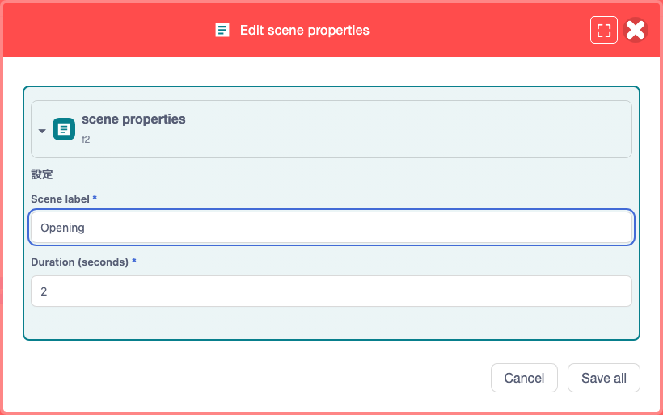

# TurboWarp-Plus-Editor

English | [日本語](README.ja.md)

**An extensible IDE for Scratch and TurboWarp projects.**

Open multiple panels to edit different sprites or work on the same sprite in several views at once.

[Open the editor](https://kubohiroya.github.io/turbowarp-plus-editor/editor.html?lang=en) · [Feature guide](https://kubohiroya.github.io/turbowarp-plus-editor/features/index.en.html) · [Developer guide](https://kubohiroya.github.io/turbowarp-plus-editor/developer-guide/index.en.html)

[](https://kubohiroya.github.io/turbowarp-plus-editor/features/screen/index.en.html)

*The workspace right after startup.*

## Contents

- [Editing and inspecting projects](#what-it-is-for)
- [Extensions, data, and assets](#extensions-data-and-assets)
- [Opening projects](#opening-projects)
- [“Edit in TurboWarp-Plus-Editor” button](#edit-button)
- [The npm package and its commands](#the-npm-package-and-its-commands)
- [URL switches](#url-switches)
- [How the Editor is built](#how-the-editor-is-built)
- [Development](#development)
- [Documentation](#documentation)
- [License and author](#license-and-author)

<a id="what-it-is-for"></a>

## Editing and inspecting projects

### Keep editing tools within reach

Hover to reveal controls, and drag and drop to rearrange tabs or copy blocks between sprites. Use the minimap to see how scripts are laid out. Saving a project also stores your tab and panel layout and your position in the code, so you can pick up where you left off when you reopen it.

| Keep editing tools within reach | Open the stage or panels in separate windows |
| --- | --- |
| <a href="https://kubohiroya.github.io/turbowarp-plus-editor/features/screen/index.en.html#layout"></a> | <a href="https://kubohiroya.github.io/turbowarp-plus-editor/features/stage/index.en.html#dock"></a> |

The sprite list is on the left, block categories are across the top of the code area, and buttons down the side of each panel open code, costumes, sounds, variables, and messages. The palette remembers each category’s size and scroll position. Panels can be pinned, resized, and moved between the workspace and separate windows. [Screen layout](https://kubohiroya.github.io/turbowarp-plus-editor/features/screen/index.en.html) · [Workspace layout](https://kubohiroya.github.io/turbowarp-plus-editor/features/workspace/index.en.html)

### Read scripts in Z or N order

Right-click the code background and use **Change code layout view** to choose Z or N order. The scripts form a spaced vertical column, and the minimap follows that view. Click a script to edit it while keeping its original free-layout position. Use ▼ / ▶ on the left to fold or unfold one script, or right-click the background for **Fold all** / **Unfold all**. Arrows curve widely to the right, with space on the left for incoming arrows. [Code layout views](https://kubohiroya.github.io/turbowarp-plus-editor/features/blocks/index.en.html#arrange)

While a panel switches or an opened project first draws its code, the pointer shows a wait cursor.

| Z layout | N layout |
| --- | --- |
| <a href="https://kubohiroya.github.io/turbowarp-plus-editor/features/blocks/index.en.html#arrange"></a> | <a href="https://kubohiroya.github.io/turbowarp-plus-editor/features/blocks/index.en.html#arrange"></a> |

*Z and N layout views, with fold buttons, a matching minimap, and different dashes for each broadcast type.*

### Inspect clones, variables, lists, and messages

Choose an individual clone to inspect and edit its properties and sprite variables while the project runs. The variables pane lists variables and lists together and shows how many blocks read or change each one. Follow a count to find those blocks, or open a list to edit and reorder its items. [Properties and variables](https://kubohiroya.github.io/turbowarp-plus-editor/features/sprites/index.en.html#variable-pane)

[](https://kubohiroya.github.io/turbowarp-plus-editor/features/sprites/index.en.html#variable-pane)

*Inspect and edit each clone’s own properties and variable values.*

[](https://kubohiroya.github.io/turbowarp-plus-editor/features/sprites/index.en.html#messages)

*Trace broadcasts in a diagram.*

See which sprites or the stage send and receive each broadcast. The diagram uses sprite thumbnails for the participants and labels the connecting arrows with message names. Select a participant to open its code. [Messages](https://kubohiroya.github.io/turbowarp-plus-editor/features/sprites/index.en.html#messages)

The variables pane also shows thread and runtime variables from the temporary-variables extension and the functions that read or write them. [Variable usage](https://kubohiroya.github.io/turbowarp-plus-editor/features/sprites/index.en.html#variable-pane)

### Trace function calls in a graph

**Calls** shows which function calls which, using boxes for functions and arrows for calls. The graph also includes connected global named functions defined in other sprites or the stage, and links from scripts that send messages to the scripts that receive them.

[](https://kubohiroya.github.io/turbowarp-plus-editor/features/sprites/index.en.html#call-graph)

*Trace function calls and messages. Ordinary and waiting broadcasts between the same scripts have separate dashed arrows.*

Message arrows use fine dashes for **broadcast** and longer dashes for **broadcast and wait**. This rule also applies in Free layout, Hats and functions, Z/N views, and minimaps; hourglass icons are no longer shown.

Hover over a box to highlight its connected arrows. Select a function belonging to the current sprite or stage to open it in the code panel on the right. **Hats and functions** also lets you select and edit individual scripts and custom block definitions. [Functions and calls](https://kubohiroya.github.io/turbowarp-plus-editor/features/sprites/index.en.html#call-graph)

### Connect block editing with your other tools

Unpack a project into a project folder to work with its data, assets, and extensions as files. Edit with VS Code or an AI app, then return to the Editor to run the project and review the changes.

[](https://kubohiroya.github.io/turbowarp-plus-editor/features/github/index.en.html#agent)

*Example workflow diagram. A shared project folder carries changes between the tools.*

#### Save in a project folder

In the left drawer's Project folder view, choose “Choose a Folder and Save…” or “Name and Save in This Browser…” to unpack the open SB3. Subsequent saves write to that same folder. Open the folder again with File → Open Folder…. [Save in a project folder](https://kubohiroya.github.io/turbowarp-plus-editor/features/git/index.en.html#project-folder)

[](https://kubohiroya.github.io/turbowarp-plus-editor/features/git/index.en.html#folder-files)

*Edit files directly. Use the “Normal view / Diff view” capsule toggle and the bottom-right minimap to inspect the content. Saving is enabled when the file has unsaved changes.*

#### Edit text with VS Code

Open the Editor through the local companion and choose “Edit in VSCode” in a file tab to open a working copy. Save in VSCode, choose “Finish and import edits”, then “Save file” to update the original file. The tab's content and controls are disabled during external editing. OPFS also works in the local companion URL's storage. [File tabs and external editing](https://kubohiroya.github.io/turbowarp-plus-editor/features/git/index.en.html#folder-files)

#### Work with generative AI apps

Give Claude Code, Codex, or another AI app that reads and writes local files access to your project folder. Ask it to change a script, for example to change the cat’s movement speed, then test the result and review the block diff in the Editor. [Work with generative AI apps](https://kubohiroya.github.io/turbowarp-plus-editor/features/github/index.en.html#agent)

Save in the Editor and stop the project before editing externally. Script changes apply automatically when there are no unsaved edits. Changes to assets or variables require a full project reload; when you have unsaved edits, compare the versions and choose what to keep. [How external changes are loaded](https://kubohiroya.github.io/turbowarp-plus-editor/features/git/index.en.html#external-changes)

#### Compare and record changes with Git

Opening the folder of a Git repository connects Git. Review changed files and block diffs in Local Git, then commit. Choose a past commit in Git History to trace its changes. Use branches and pull requests to review work with others. [Compare and record changes with Git](https://kubohiroya.github.io/turbowarp-plus-editor/features/git/index.en.html#block-diff)

[](https://kubohiroya.github.io/turbowarp-plus-editor/features/git/index.en.html#block-diff)

*In the diff view, horizontal and vertical guide bands intersect at the changed part of the script.*

You can also collapse scripts from their hats, edit long text arguments in a dialog, search across the project, and transfer scripts or the stage between projects as `.blocks3` or `.stage3` files. [Block editing](https://kubohiroya.github.io/turbowarp-plus-editor/features/blocks/index.en.html) · [Search](https://kubohiroya.github.io/turbowarp-plus-editor/features/search/index.en.html) · [Reuse](https://kubohiroya.github.io/turbowarp-plus-editor/features/reuse/index.en.html)

<a id="what-plus-adds-to-standard-turbowarp"></a>

## Extensions, data, and assets

Want to make your editor even more useful? Want more freedom to develop with your own extension blocks? The projects in the TurboWarp Plus family help you turn those ideas into reality.

### Extension verification and approval

Before running a Plus-format extension, Plus Editor verifies its code against the recorded SHA-256 hash. When approval is required, review the source and execution requirements and choose whether and how to run each extension, including in a sandbox when supported. The family catalog identifies trusted extensions by their source and hash. [Loading and approval](https://kubohiroya.github.io/turbowarp-plus-editor/features/open/index.en.html#review)

### Form editing for custom extension blocks

Extension blocks can have custom UIs. These UIs can be generated automatically from JSON Schema. Plus Editor uses React JSON Schema Form to let you edit block arguments field by field and validate required values and allowed ranges before saving.

[](https://kubohiroya.github.io/turbowarp-plus-editor/features/documents/index.en.html#forms)

*Form editing for a block registered by a compatible extension. [Block forms](https://kubohiroya.github.io/turbowarp-plus-editor/features/documents/index.en.html#forms)*

### Embed structured data and DSLs in a project

With a compatible extension, write settings or a domain-specific language (DSL) such as a story script in YAML or blocks, then embed it in the SB3. For example, the Kamishibai extension reads the script at runtime to switch scenes and display dialogue. Open YAML documents in tabs beside the code, and use the forms supported by the extension that owns the document. [Documents and blocks](https://kubohiroya.github.io/turbowarp-plus-editor/features/documents/index.en.html#documents)

### Choose which function to call by name at runtime

With the Named Functions extension, define a function with blocks and give it a name as you write your code. At runtime, pass the name as a string, for example from a variable. The extension looks up the function by that name and runs it. Use JSON for arguments and return values, with JSON Schema to validate each. [Named Functions guide](https://kubohiroya.github.io/turbowarp-named-functions/)

### External assets and caching

In Plus Editor, choose which costume images, backdrops, and sounds to bundle with your project and which to serve over HTTPS. Reuse verified assets from the cache. Add a compatible extension such as Kamishibai to use externally hosted video. [Asset storage](https://kubohiroya.github.io/turbowarp-plus-editor/features/save/index.en.html#payload-formats)

Extensions can add controls, previews, and blocks for interactive projects using cameras, AR, QR codes, or Teachable Machine. Write an extension in TypeScript using the family’s typed APIs and npm libraries, choose how its code is stored with the project, and pin and verify it with `sb3-toolchain`. [Developer guide](https://kubohiroya.github.io/turbowarp-plus-editor/developer-guide/index.en.html) · [TurboWarp Plus family](https://kubohiroya.github.io/turbowarp-plus-packages/)

Save your work as an SB3, or export a single HTML file that includes its Plus extensions. Export checks extension code against the recorded hash and retains its execution requirements. [Saving and export](https://kubohiroya.github.io/turbowarp-plus-editor/features/save/index.en.html)

The [compatibility list](docs/features/sb3-compatibility.en.md) describes how project files and Plus features work in Scratch, TurboWarp, and Plus Editor. Project properties such as title, author, and contact are saved in the SB3, and project diagnostics show validation, approval, loading, and failure records while the editor is open. [Project properties](https://kubohiroya.github.io/turbowarp-plus-editor/features/save/index.en.html#project-properties) · [Diagnostics](https://kubohiroya.github.io/turbowarp-plus-editor/features/open/index.en.html#project-diagnostics)

## Opening projects

Open a local SB3 or a project folder from the Editor's **File** menu. To open a project by URL, point `project_url` at an HTTPS SB3 that allows browser fetching, URL-encoded:

```text
https://kubohiroya.github.io/turbowarp-plus-editor/editor.html?lang=en&project_url=https%3A%2F%2Fexample.com%2Fstory.sb3
```

`lang` takes `en` or `ja`. The landing page's edit button forwards `project_url` and any other Editor parameters it was given.

<a id="edit-button"></a>
## “Edit in TurboWarp-Plus-Editor” button

Put a button on your own page that opens a project here. Load the stylesheet once in `<head>`, then place the link:

```html
<link rel="stylesheet"
      href="https://kubohiroya.github.io/turbowarp-plus-editor/assets/edit-button.css">

<a class="twpe-edit-button"
   href="https://kubohiroya.github.io/turbowarp-plus-editor/editor.html?lang=en&amp;project_url=https%3A%2F%2Fexample.com%2Fstory.sb3">
  
  <span>Edit in TurboWarp-Plus-Editor</span>
</a>
```

- Omit `project_url` to start a new project. For Japanese, use `lang=ja` and `TurboWarp-Plus-Editorで編集`.
- For a small button, add `twpe-edit-button--small`, show **Edit** (`編集`) with a 24px image, and set `title` and `aria-label` to the full label.
- The button follows the OS color scheme. Set `<html data-theme="light">` or `dark` to fix it.
- GitHub READMEs cannot load external CSS; there, use a plain link around the icon image and the label.

## The npm package and its commands

```sh
npm install @kubohiroya/turbowarp-plus-editor
```

```ts
import {createEditorURL, renderEditButton} from '@kubohiroya/turbowarp-plus-editor';

const url = createEditorURL({
    language: 'en',
    projectURL: 'https://example.com/story.sb3',
    parameters: {fps: 60}
});
const html = renderEditButton({size: 'small', language: 'en', projectURL: 'https://example.com/story.sb3'});
```

The package ships the brand SVG (`./assets/icon.svg`), the button CSS (`./assets/edit-button.css`), the URL and HTML helpers with TypeScript declarations, the extension loader bootstrap (`./extension-loader`) and the pinned distribution metadata (`./source.json`). The URL helpers reject non-HTTP(S) project URLs and unsupported languages. The Editor itself is built for Pages and is not in the package.

It also installs two commands:

- **`turbowarp-plus-editor-sb3-format`** saves the extensions of an existing SB3 again as `remote-non-cacheable`, `remote-cacheable`, `embedded-file` or `embedded-data`. `remote-cacheable` only permits a browser to keep a verified copy; for an SB3 that runs offline, choose one of the `embedded-*` formats.

  ```sh
  npx --package=@kubohiroya/turbowarp-plus-editor turbowarp-plus-editor-sb3-format --input in.sb3 --output out.sb3 --extensions embedded-file
  ```

- **`turbowarp-plus-editor-yaml`** serves a built Editor locally together with the companion process that lets you edit embedded YAML documents in VS Code. VS Code gets dedicated working files and an isolated settings area, and the first schema-bearing document installs `redhat.vscode-yaml` there without touching your own settings or extensions.

  ```sh
  npx --package=@kubohiroya/turbowarp-plus-editor turbowarp-plus-editor-yaml --site-dir /absolute/path/to/editor/build --data-dir /absolute/path/to/work-files
  ```

## URL switches

Everything below is on by default. Add the parameter to the Editor URL and reload to change it.

| Parameter | Effect |
| --- | --- |
| `twPlusStandardLayout=0` | The previous layout instead of the standard Plus layout |
| `twPlusWorkspaceMinimap=0` | Hide the code-area minimap |
| `twPlusSaveWorkspace=0` | Stop saving the screen (drawer, tabs, panes) into the SB3 or project folder |
| `twPlusPaletteCategoryReorder=0` | Stop press-and-hold reordering of palette categories |
| `twPlusPaletteDeletePreview=0` | No wastebasket preview when dragging a block onto the palette |
| `twPlusContextMenuIcons=0` | No icons in context menus |
| `twPlusDockview=0` | Open embedded documents in the earlier modal instead of Dockview tabs |
| `twPlusLocalGit=0` | Hide the Local Git panel |
| `twPlusExtensionLoader=0` | Turn off the Plus extension loader and its approval UI |

## How the Editor is built

This repository holds no editor fork of its own. It builds the Editor from pinned upstream sources and from family packages published on npm, and the `scratch-gui` fork only carries the sockets they plug into.

**Pinned sources** ([`site/source.json`](site/source.json)). The build checks out and verifies these by full commit SHA, and stops unless the checkout, the installed packages and the pins agree:

| Source | Role |
| --- | --- |
| [`kubohiroya/scratch-gui`](https://github.com/kubohiroya/scratch-gui) | TurboWarp's GUI with one optional `plusIntegration()` socket object and no files upstream lacks; a plain build gets `null` and behaves like upstream |
| [`kubohiroya/scratch-vm`](https://github.com/kubohiroya/scratch-vm) | The VM, pinned together with the upstream revision it is based on |
| [`TurboWarp/packager`](https://github.com/TurboWarp/packager) | The standard Packager behind **Export** |

**Family packages from npm.** Everything Plus adds comes from `@kubohiroya/*` packages installed at exact versions from npm; no package is vendored as an archive. Those also recorded in `site/source.json` (the data editor, extension loader, document editor and script transfer) are checked against their published version, integrity and source commit.

| Area | Packages |
| --- | --- |
| Editor workbench | `turbowarp-plus-editor-workbench` (layout, sprite tabs, stage and its controls, menus, project dialogs, the backpack), `-windows` (in-page windows, menus, dialog actions, external surfaces and transfers), `-code-views` (code in tabs and windows, the detached palette, script layout, block field editing), `-sprite-panes` (assets, variables, messages, functions and the call graph, properties), `-fonts` (web fonts), `-host` (the host contract the family is written against), `-project-model` (UI-free project reads and edits, project-wide search and replace) |
| Project folders and Git | `turbowarp-plus-editor-project-folder`, `-project-starter` (move a project into a GitHub repository), `-git` (Local Git panel, publishing and repository creation), `-auth` (Git proxy sessions), and `sb3-toolchain` |
| Extensions | `turbowarp-extension-loader` (verified loading), `turbowarp-extension-security-dialog` (review before running), `turbowarp-extension-data-editor` (form editing of extension data), `turbowarp-sb3-save-format` (storage-format vocabulary) |
| Documents | `turbowarp-document-editor`, `turbowarp-document-data`, `turbowarp-document-source`, `turbowarp-structured-data`, `turbowarp-named-data`, `turbowarp-yaml-json` |
| Reuse | `turbowarp-script-transfer` (`.blocks3` / `.stage3`) |

**What lives here.** This repository holds no implementation packages of its own: new features go into family packages, and this repository only pins their versions and wires their entry points into the GUI (see [`AGENTS.md`](AGENTS.md)). That wiring lives in [`site/`](site/).

**Family boundaries.** [`turbowarp-plus-packages`](https://github.com/kubohiroya/turbowarp-plus-packages) owns the extension catalog, the extension names and icons, and the design canon; its [dashboard](https://kubohiroya.github.io/turbowarp-plus-packages/) shows every package's versions and dependencies. This repository consumes the catalog through [`site/plus-catalog.ts`](site/plus-catalog.ts). No package upstream of the Editor fetches, builds or deploys it.

The published `build-info.json` records the versions that were used together, and `notices/family.json` indexes the license and source of every bundled family package. [The socket design](docs/plus-integration-sockets.md) records what remains in the GUI fork (Japanese), and the [developer guide](https://kubohiroya.github.io/turbowarp-plus-editor/developer-guide/index.en.html) explains why Plus uses sockets rather than addons and how to build a new feature into the Editor.

## Development

Use the Node.js version in [`.nvmrc`](.nvmrc) (26). Every source is TypeScript (`.ts`, or `.cts` for CommonJS): Node runs it directly with type stripping, esbuild emits the browser bundles, and `tsc` compiles the npm entry points and declarations into `dist/`.

```sh
npm ci
npm run typecheck
npm test
npm run test:package
```

**Building the site.** Check out the GUI and Packager at the revisions in `site/source.json`, install the GUI's dependencies and run `node scripts/prepublish.mjs` inside the GUI checkout, then build here:

```sh
E2E_GUI_ROOT=/absolute/path/to/pinned/scratch-gui \
TW_PLUS_PACKAGER_ROOT=/absolute/path/to/pinned/packager npm run build:pages
```

For the browser-side Local Git option, also set `TW_PLUS_GIT_BFF_ORIGIN` and `TW_PLUS_GIT_PROXY_ORIGIN` to exact HTTPS origins at build time.

**Tests.** `npm test` and the other `test:*` scripts are unit and integration tests. The Playwright E2E (`npm run test:e2e` with `E2E_GUI_ROOT` set) and the `*.browser.ts` suites run against a built Editor and are run locally during development, not in CI.

**CI and release.** CI runs the typecheck, unit and integration tests, package checks and the site build. With the repository variable `TW_PLUS_CI_SCOPED=1`, a PR runs only the checks its diff needs and `main` reuses checks already passed for the same tree; unreadable diffs fall back to full verification. Pages deploys the artifact of a green `main` run for that exact SHA. npm releases are published through a Trusted Publisher over OIDC from tags that match the package version.

### Local Git and GitHub connection

The Local Git panel never receives a GitHub token. It gets a short-lived Bearer for a proxy that relays only the four Git Smart HTTP routes under `/v1/git/<owner>/<repo>.git/` and checks the caller's origin, the Bearer, the repository recorded at sign-in and the operation on every request; a push also needs a `Git-Push-Id` reserved beforehand.

- **Browser (Cloudflare).** The Editor starts sign-in at the BFF's `/v1/git-auth/start`, opens the GitHub App authorization, and polls `/v1/git-auth/session` with a ticket held only in memory. Tokens stay encrypted in a Durable Object. A sign-in lasts up to eight hours; the proxy Bearer is renewed every five minutes.
- **Desktop.** The main process authenticates and relays Git through a loopback proxy on `127.0.0.1` that accepts only the `tw-editor://.` origin. Tokens stay in the main process, encrypted with the OS keychain when saved. GitHub App device flow, a fine-grained PAT or a Git credential helper can be offered depending on the host. ([Connection methods](docs/features/git/index.en.html#connection-methods))

The GitHub App asks only for Metadata read and Contents read and write, on the repositories where it is installed. Its client ID is not a secret and device flow uses no client secret, so the remaining risk is phishing: enter only codes the Editor itself shows, and revoke access under **Settings → Applications → Authorized GitHub Apps** on GitHub.

To check repository creation and pull-request registration headlessly, build with `TW_PLUS_GIT_BFF_ORIGIN=https://github-create.example.invalid` and `TW_PLUS_GIT_PROXY_ORIGIN=https://github-git.example.invalid`, set `E2E_PROJECT_SAVE_BUILD` to the build output and `E2E_GIT_HTTP_FIXTURE` to the Git package's `test/smart-http-fixture.js`, and run the following. GitHub is simulated, and the Git traffic goes through a local Git CGI.

```sh
node --test --test-concurrency=1 test/project-folder-save.browser.ts test/project-repository-creation.browser.ts test/project-publication.browser.ts
```

To try unpublished dependencies, set the local webpack's `TW_PLUS_PROJECT_SAVE_PREVIEW_ROOT` to the absolute path of a directory whose `node_modules/@kubohiroya/` holds built `sb3-toolchain`, `turbowarp-plus-editor-project-folder`, `turbowarp-plus-editor-project-starter`, `turbowarp-plus-editor-git` and `turbowarp-plus-editor-auth`.

### Embedded documents

Document editing is owned by the packages, not by this repository: `turbowarp-document-editor` provides the dialogs, previews and external-editor bridge; `turbowarp-document-data` the persistence, references and provider registration; `turbowarp-document-source` the hats and shared YAML blocks; `turbowarp-yaml-json`, `turbowarp-named-data` and `turbowarp-structured-data` the parsing, schemas and projections. Each extension that owns documents supplies their validation, schemas and conversions. The Editor embeds no App and shows a document's file icon only when a registered provider owns it.

To add the YAML tools to an existing build (`build:pages` does this already) and serve it with the companion:

```sh
npm run build:yaml-tools -- /absolute/path/to/editor/build
npm run editor:yaml -- --site-dir /absolute/path/to/editor/build --data-dir /absolute/path/to/work-files
```

`npm run test:yaml` covers the build and the CLI. The round-trip checks (`test:yaml:roundtrip`, `test:yaml:multi-document`) drive a real Chrome against a built Editor using `TWPE_YAML_SITE`, `TWPE_YAML_FIXTURE`, `TWPE_YAML_EVIDENCE` and `TWPE_CHROME_EXECUTABLE`; build their fixtures with the scripts in [`scripts/yaml-editor/`](scripts/yaml-editor/). Native VS Code checks use the test-only driver in [`test/vscode-edit-driver/`](test/vscode-edit-driver/) (`npm run build:test-driver`).

## Documentation

### Feature guide (published)

The illustrated [feature guide](https://kubohiroya.github.io/turbowarp-plus-editor/features/index.en.html) covers the following twelve topics. To try the Editor first, start with the [ball demo](https://kubohiroya.github.io/turbowarp-plus-editor/features/ball-demo/index.en.html).

1. [Open projects and prepare extensions](https://kubohiroya.github.io/turbowarp-plus-editor/features/open/index.en.html)
2. [Screen layout and menus](https://kubohiroya.github.io/turbowarp-plus-editor/features/screen/index.en.html)
3. [Edit sprites and the backdrop](https://kubohiroya.github.io/turbowarp-plus-editor/features/sprites/index.en.html)
4. [Open the stage and run your project](https://kubohiroya.github.io/turbowarp-plus-editor/features/stage/index.en.html)
5. [Split the workspace and open panels separately](https://kubohiroya.github.io/turbowarp-plus-editor/features/workspace/index.en.html)
6. [Find, place and organize blocks](https://kubohiroya.github.io/turbowarp-plus-editor/features/blocks/index.en.html)
7. [Search and replace across the project](https://kubohiroya.github.io/turbowarp-plus-editor/features/search/index.en.html)
8. [Edit extension data and documents](https://kubohiroya.github.io/turbowarp-plus-editor/features/documents/index.en.html)
9. [Reuse scripts and assets](https://kubohiroya.github.io/turbowarp-plus-editor/features/reuse/index.en.html)
10. [Save and distribute](https://kubohiroya.github.io/turbowarp-plus-editor/features/save/index.en.html)
11. [Manage projects with project folders and Git](https://kubohiroya.github.io/turbowarp-plus-editor/features/git/index.en.html)
12. [Develop projects on GitHub](https://kubohiroya.github.io/turbowarp-plus-editor/features/github/index.en.html)

### Design documents

Most design documents are in Japanese.

- [Responsibilities and distribution](docs/architecture.md)
- [Integration sockets left in the fork](docs/plus-integration-sockets.md) · [Relocation inventory and build contract](docs/gui-integration/README.md)
- [Extension loader integration](docs/extension-loader-integration.md) · [Embedded / Remote settings in the extension library](docs/extension-authoring-ui.md) · [SB3 save formats](docs/sb3-save-format.md)
- [SB3 compatibility and feature list](docs/features/sb3-compatibility.en.md) (English)
- [Form-based block editor](docs/block-editor.md) · [Embedded document windows](docs/document-window.md)
- [Project properties and diagnostics](docs/project-tools.md) · [Script and stage transfer](docs/script-stage-transfer.md)
- [Checking catalog display locally](docs/local-catalog-preview.md) · [Checking extension security locally](docs/gui-integration/local-security-preview.ja.md)

## License and author

GPL-3.0-or-later, except the edit-button snippet, which is MPL-2.0.

- **MPL-2.0:** `src/index.ts` (`createEditorURL`, `renderEditButton` and their constants; `dist/src/index.*` in the npm package) and `assets/edit-button.css`. Each carries `SPDX-License-Identifier: MPL-2.0`; the text is in [`LICENSE.MPL-2.0`](LICENSE.MPL-2.0). Other sites can use them without taking on GPL-3.0 obligations.
- **GPL-3.0-or-later:** everything else, including the icon, the extension loader bootstrap and the commands; the text is in [`LICENSE`](LICENSE).
- The Editor served on Pages is a GPL-3.0 work. Its `notices/` directory records the license and source of every bundled family package. See also [`NOTICE`](NOTICE).

TurboWarp-Plus-Editor is open-source software in the [TurboWarp Plus Project](https://kubohiroya.github.io/turbowarp-plus-packages/) family by [Hiroya Kubo](https://github.com/kubohiroya), Chiba University of Commerce, Japan.
